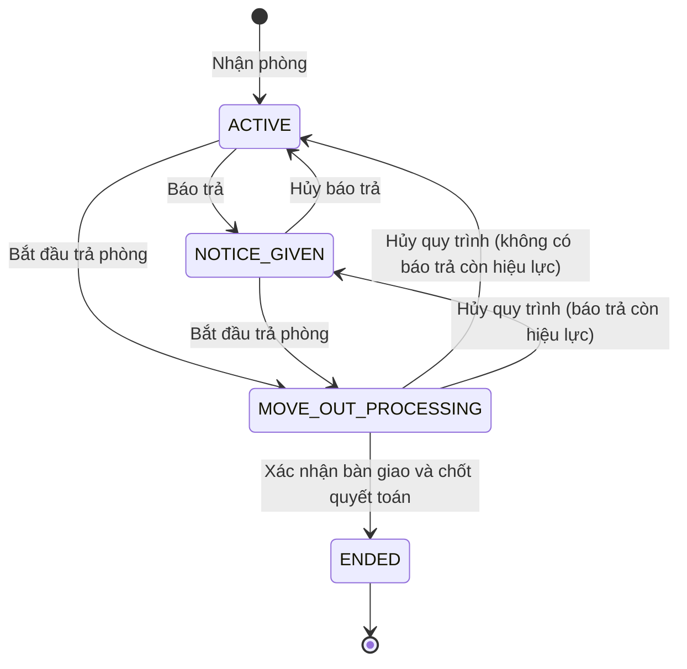

# MASTER PLAN — PHẦN MỀM QUẢN LÝ NHÀ TRỌ

**Phiên bản:** 2.8 — Đặc tả triển khai MVP + V1.1 cho Claude Code  
**Ngày:** 07/10/2026  
**Ngôn ngữ UI:** Tiếng Việt  
**Tiền tệ:** VND  
**Múi giờ nghiệp vụ:** Asia/Ho_Chi_Minh

> Đọc toàn bộ tài liệu trước khi triển khai. Đây là nguồn yêu cầu nghiệp vụ chính thức. Những mặc định kỹ thuật được ghi rõ bên dưới dùng để triển khai mà không phải tự đoán. Nếu có yêu cầu mới của chủ dự án, cập nhật tài liệu và ghi lại quyết định trước khi thay đổi nghiệp vụ.

### Thay đổi so với v2.7 (yêu cầu của chủ dự án, 10/10/2026)

| # | Mục | Thay đổi |
|---|---|---|
| 1 | 2.2, 8.1 | **Ân hạn khi lập thông báo muộn.** Thông báo tháng lập/phát hành khi hạn theo lịch (ngày 5, hoặc ngày nhận phòng với thông báo đầu tiên) đã qua thì hạn = ngày phát hành + 7 ngày; không “Quá hạn” ngay khi gửi khách. Quyết định: D-044. |
| 2 | 13 | Báo cáo doanh thu theo tháng gọn 4 cột: **Tổng tiền phải thu** (chia thành Đã thu + Còn nợ), Đã thu, Còn nợ, Thực thu theo tháng; chi tiết (giảm trừ, doanh thu thuần, cách thu) ở “Xem chi tiết”. Chỉ đổi hiển thị. |

### Thay đổi so với v2.6 (yêu cầu của chủ dự án, 07/10/2026)

| # | Mục | Thay đổi |
|---|---|---|
| 1 | 8.5, 12 | **Giá điện nước nằm trong form tòa.** Tạo tòa có ô giá điện (đ/kWh) và nước (đ/m³), không bắt buộc, mặc định áp dụng từ kỳ hiện tại. “Sửa tòa” hiện giá hiện tại; nhập giá khác thì chọn kỳ áp dụng và lý do — vẫn tạo phiên bản giá mới, kỳ đã tính giữ giá cũ. Mục “Giá điện nước” ở trang tòa giữ lịch sử giá. Mức giá cùng kỳ áp dụng chưa dùng trên thông báo đã phát hành thì được ghi đè (sửa nhầm). Quyết định: D-043. |

### Thay đổi so với v2.5 (yêu cầu của chủ dự án, 07/10/2026)

| # | Mục | Thay đổi |
|---|---|---|
| 1 | 2.2, 8.5, 11.2, 12 | **Điện nước theo cách dùng thực tế.** Mỗi phòng có đồng hồ điện/nước riêng; chỉ số ban đầu nhập **một lần khi thiết lập phòng** (số seri không bắt buộc), nhận phòng điền sẵn. Màn hình hàng tháng chọn **tòa + tháng tiêu thụ** (tách khỏi tháng phát hành), danh sách phòng với chỉ số cũ / số mới / tiêu thụ / đơn giá / thành tiền, lưu từng phòng hoặc cả danh sách, tiến độ theo phòng; phòng thiếu chỉ số nền được hướng dẫn thiết lập ngay. Nghiệp vụ tính tiền không đổi: điện nước tháng M vào thông báo tháng M+1 cùng tiền phòng tháng M+1. Quyết định: D-042. |

### Thay đổi so với v2.4 (yêu cầu của chủ dự án, 07/10/2026)

| # | Mục | Thay đổi |
|---|---|---|
| 1 | 1.1, 1.2, 2.2, 11.2, 15, Phase 10, 20 | **Chỉ hai vai trò: OWNER (Chủ trọ) và MANAGER (Quản lý).** Bỏ STAFF và ACCOUNTANT. Khác mặc định thì cấp thêm/thu hồi quyền riêng cho từng người. Quản lý được ghi nhận thu tiền. Quyết định: `docs/DECISIONS.md` D-041. |

### Thay đổi so với v2.3 (yêu cầu mới của chủ dự án, 06/10/2026)

| # | Mục | Thay đổi |
|---|---|---|
| 1 | 1.2, 9.6, 6.5 | **Mã VietQR đóng tiền** đưa vào MVP. QR có sẵn số tiền và nội dung chuyển khoản; chủ trọ **xác nhận tay** khi thấy tiền vào. QR không bao giờ tự đánh dấu đã thu. Link xem thông báo có thời hạn cũng đưa vào MVP để khách mở được QR. |
| 2 | 1.2, 9.7, 6.7, Phase 8B | **Nhắc đóng tiền qua Zalo/SMS tới người thuê** đưa vào MVP (trước đây Zalo nằm ngoài phạm vi). Gửi theo mốc trước hạn / đúng hạn / quá hạn, chống gửi trùng, có nhật ký gửi. Nhà cung cấp và tài khoản cần chủ dự án chốt (mục 2.3). |
| 3 | 8.5, 12, Phase 4 | **Điện nước:** đơn giá điện (đ/kWh) và nước (đ/m³) **đặt riêng cho từng tòa**, nhập một lần, có nút “Thay đổi giá”. Chỉ số đầu nhập một lần; mỗi tháng chỉ nhập chỉ số mới, hệ thống tự lấy chỉ số trước và tự tính tiền. |
| 4 | 13, Phase 8A | **Báo cáo doanh thu theo tháng** (đã phát hành / đã thu / còn nợ, kèm thực thu trong tháng) đưa vào MVP. |

### Thay đổi so với v2.2

| # | Mục | Thay đổi |
|---|---|---|
| 1 | 8.6 | Đối soát chỉ coi invoice **PUBLISHED** là “đã phát hành”; nháp được tính lại riêng. Đối soát làm theo từng tháng của từng nguồn phí, không theo từng dòng. |
| 2 | 5.3, 6.3, 7.4 | Giá và mức cọc phát sinh từ hợp đồng gắn `source_contract_id`; hủy hợp đồng chưa bắt đầu thì vô hiệu hóa các thay đổi đó, có lịch sử và đối soát. |
| 3 | 8.8, 9.2 | Deposit allocation chỉ có hiệu lực khi giao dịch APPLIED_TO_INVOICE gốc chưa bị đảo. |
| 4 | 9.1, 9.5 | Đảo payment sau quyết toán: nợ quay lại trên invoice gốc, ghi sự kiện bổ sung cho quyết toán, không tạo khoản phí thứ hai. |
| 5 | 7.6, 8.6 | FINAL bù mọi khoản chưa phát hành đến ngày trả (tiền phòng, dịch vụ thu trước và thu sau, điện nước), rồi mới credit phần thừa. Nháp đang mở được hủy khi hoàn tất. |
| 6 | 4.3, 8.3 | Chia ngày và làm tròn xác định ở cấp **tháng × nguồn phí**, rồi phân bổ vào các đoạn. FIXED_30 không còn tính vượt giá tháng. |
| 7 | 3.3, 12 | Trang in đổi sang `(print)/print/...` để không trùng URL với trang chi tiết. |
| 8 | 3.1, 3.6 | Pin phiên bản Prisma trước rồi mới chọn ràng buộc nào khai báo trong schema, ràng buộc nào viết SQL thủ công. Rà từng lệnh DROP thay vì xóa máy móc. Test kiểm tra cả định nghĩa và hành vi. |
| 9 | 5.6, 6.3, 6.8, 7.1 | Reservation có khoảng giữ chỗ, ngày dự kiến nhận, hạn giữ; chặn chồng lịch bằng exclusion constraint và khóa phòng. |
| 10 | 9.2, 9.3 | Cặp giao dịch chuyển tiền giữ chỗ thành cọc (và chuyển cọc ở V1.1) chỉ được đảo cả cặp, atomic. |
| 11 | 16 | Tiêu chí nghiệm thu chia theo phase; assertion về tính phí dời sang Phase 5, nơi chạy kiểm thử tích hợp đầy đủ. |
| 12 | 3.2, 19 | Thông tin môi trường chỉ là ghi nhận tại một thời điểm; prompt Phase 0 yêu cầu kiểm tra thực tế trước khi `git init`. |
| 13 | 14 | Thêm test T49–T56 cho các trường hợp trên; T47 kiểm tra định nghĩa và hành vi của ràng buộc. |

### Thay đổi so với v2.1

| # | Thay đổi |
|---|---|
| 1 | **Thu tiền phòng trước, điện nước thu sau.** Tách tháng phát hành, khoảng phí của từng dòng và ngày đến hạn (mục 8). |
| 2 | Thêm cơ chế **đối soát phí đã phát hành với phí đúng**, dùng cho mọi thay đổi giữa tháng sau khi đã thu trước (mục 8.6). |
| 3 | Thêm **tiền giữ chỗ**, tách khỏi tiền cọc thuê; không tự động mất tiền (mục 5.6, 9.3). |
| 4 | Hợp đồng chỉ lưu trạng thái vòng đời; ACTIVE/EXPIRED/SCHEDULED luôn suy ra từ ngày, không cần cron (mục 5.3). |
| 5 | Một cơ chế đảo thanh toán duy nhất; bổ sung bảng `credit_refunds`; làm rõ dấu của giao dịch đảo cọc (mục 6, 9). |
| 6 | Quyết toán cấn trừ credit tiền phòng thu trước trước khi dùng cọc (mục 9.4). |
| 7 | Chia **MVP / V1.1**. MVP giữ đủ lõi hợp đồng, thu trước và hoàn tiền dư khi trả giữa tháng (mục 1.2, 16). |
| 8 | Thiết kế thư mục chi tiết, monorepo pnpm, chạy cùng tên miền `/api`, quy trình migration SQL thủ công (mục 3). |
| 9 | UI gọi chứng từ là **“Thông báo tiền phòng”** / **“Phiếu thu”**; ghi rõ là chứng từ nội bộ. |
| 10 | Theo dõi đăng ký tạm trú; màn hình nhập điện nước ưu tiên điện thoại; trang in để lưu PDF. |
| 11 | Mỗi phase một phiên làm việc, có nghiệm thu và commit git. |
| 12 | Sửa các lỗi trong v2.1: sơ đồ trạng thái tenancy, lỗi chữ, tên case test. |

## 0. Chỉ thị dành cho Claude Code

Bạn là kỹ sư full-stack chịu trách nhiệm xây dựng sản phẩm chạy được, có dữ liệu demo, API thật, database thật và kiểm thử nghiệp vụ. Không dừng ở UI mockup hoặc CRUD rời rạc.

1. Khảo sát repository, đọc `CLAUDE.md`, `docs/IMPLEMENTATION_STATUS.md`, `docs/DECISIONS.md` nếu có. Không ghi đè code đang hoạt động hoặc dữ liệu thật.
2. Nếu repository đã có stack phù hợp, tái sử dụng. Nếu là dự án mới, dùng stack và cấu trúc thư mục ở mục 3.
3. Phase 0 tạo `CLAUDE.md`, `docs/IMPLEMENTATION_STATUS.md` (checklist từng phase, lệnh kiểm thử, kết quả, việc còn lại) và `docs/DECISIONS.md` (quyết định kỹ thuật, đánh số D-001, D-002…).
4. **Mỗi phiên làm việc chỉ triển khai một phase** (mục 16) cùng dependency cần thiết. Mỗi phase là vertical slice: migration → domain → service → API → UI → kiểm thử → cập nhật tiến độ.
5. Kết thúc phase: chạy typecheck, lint, test liên quan; cập nhật `IMPLEMENTATION_STATUS.md`; báo cáo cho chủ dự án gồm việc đã làm, lệnh đã chạy, kết quả và hạn chế. Chỉ sang phase tiếp theo khi chủ dự án nghiệm thu.
6. Không hỏi lại các quy tắc đã chốt trong tài liệu. Với chi tiết kỹ thuật chưa nêu, chọn phương án đơn giản, ghi vào `DECISIONS.md` và tiếp tục. Với mâu thuẫn ảnh hưởng tiền, mất dữ liệu hoặc quyền truy cập, làm phần độc lập trước rồi hỏi chủ dự án.
7. Không thông báo “hoàn thành” nếu chỉ tạo skeleton, dùng dữ liệu giả thay API hoặc chưa chạy kiểm tra cần thiết. Phân biệt rõ: đã triển khai, đã kiểm thử, bị chặn bởi môi trường.
8. Không hardcode thông tin tài khoản, bí mật hoặc dữ liệu cá nhân thật. Dữ liệu seed hoàn toàn hư cấu.
9. Không triển khai production, xóa database hoặc chạy migration phá hủy dữ liệu thật nếu chưa được chủ dự án yêu cầu.
10. Giao diện dùng dữ liệu backend. Loading, empty, validation error, permission denied và retry phải có trạng thái rõ ràng.
11. Git: làm việc trên nhánh `phase/<số>-<tên>`, commit nhỏ theo bước. Merge vào `main` sau khi chủ dự án nghiệm thu. Không force-push, không sửa lịch sử `main`.

### Quy tắc cốt lõi bằng tiếng Anh

> Contract expiry does not terminate a tenancy. A tenant may continue occupying the room and be billed month-to-month after the fixed contract term expires. The tenancy ends only through the move-out workflow. Deposit settlement occurs at move-out, not at contract expiry. Contract renewal keeps the same tenancy. Billing is based on actual chargeable occupancy dates, never on contract status alone.
>
> Rent is billed in advance for the statement month; metered utilities are billed in arrears from meter readings. Each charge line carries its own charge range. Every chargeable day of every charge source must be billed exactly once in net terms. Published statements are immutable; any difference between what was billed and what should have been billed is corrected by linked adjustment lines or adjustment statements, never by editing a published statement.

## 1. Mục tiêu và phạm vi

### 1.1 Mô hình

**Một chủ trọ → nhiều tòa/khu → nhiều phòng → nhiều người thuê.** Có thể có nhiều tài khoản quản lý, mỗi người làm trong các tòa được giao.

Phần mềm lưu điều khoản do hai bên thỏa thuận. Phần mềm không tự suy diễn quyền tăng giá, phạt hay tịch thu cọc từ trạng thái hợp đồng.

### 1.2 MVP và V1.1

| Nhóm | MVP (bản dùng được đầu tiên) | V1.1 |
|---|---|---|
| Nền tảng | Đăng nhập, hai vai trò OWNER/MANAGER, phạm vi theo tòa, audit backend, idempotency, transaction | Chỉnh quyền theo người dùng, giao diện xem audit |
| Tòa/phòng | Tòa, phòng, trạng thái vận hành, giữ phòng, **tiền giữ chỗ** | — |
| Thuê | Người thuê, thành viên, nhận phòng, cọc, **trạng thái tạm trú** | **Chuyển phòng**, ẩn danh dữ liệu cá nhân theo chính sách lưu trữ |
| Hợp đồng | Nháp/ký, kỳ tương lai, hết hạn suy ra từ ngày, thuê tiếp theo tháng, gia hạn, chặn chồng kỳ, hủy kỳ chưa bắt đầu có lý do | Phụ lục/revision, thông báo theo mốc 30/15/7 ngày |
| Điện nước, dịch vụ | Dịch vụ và lịch sử giá, đồng hồ, chỉ số, thay đồng hồ, sửa chỉ số; màn hình nhập ưu tiên điện thoại | Ảnh đồng hồ |
| Tính phí | **Thu trước tiền phòng, thu sau điện nước**, đối soát điều chỉnh, credit, trang in/lưu PDF, **mã VietQR**, **link xem thông báo có thời hạn** | Đóng/mở lại kỳ |
| Nhắc đóng tiền | **Zalo/SMS tới người thuê** theo mốc trước hạn / đúng hạn / quá hạn, nhật ký gửi | — |
| Thu tiền | Thu nhiều lần, đảo thanh toán, công nợ, **hoàn tiền dư (ghi thủ công)** | — |
| Trả phòng | Báo trả, wizard trả phòng, quyết toán, áp cọc, hoàn cọc, khoản còn phải thu/hoàn | — |
| Báo cáo | Dashboard, công nợ, cọc và khoản phải hoàn, thu tiền theo ngày, **doanh thu theo tháng**, xuất CSV các báo cáo này | Chi phí, doanh thu theo tòa/phòng/khoản thu, dòng tiền, lấp đầy đầy đủ, báo cáo phục vụ kê khai thuế |
| Vận hành | Backup/restore database, runbook | Yêu cầu bảo trì, tệp đính kèm riêng tư (hợp đồng scan, ảnh CCCD) |

**Ngoài V1.1:** ứng dụng mobile native, cổng người thuê, **đối soát ngân hàng tự động** (tự ghi nhận tiền vào), Zalo/SMS cho mục đích khác ngoài nhắc đóng tiền, smart meter/lock, ký điện tử, AI, multi-owner SaaS, hóa đơn điện tử.

**Phải đúng ngay từ MVP**, vì sửa về sau rất tốn kém: mô hình dữ liệu, ràng buộc database, idempotency, bất biến của chứng từ đã phát hành, audit backend, tiền lưu bằng số nguyên.

QR chỉ là hình thức ghi nhận thanh toán thủ công. Tạo QR không phải là bằng chứng đã nhận tiền.

## 2. Những quyết định nghiệp vụ đã chốt

| Chủ đề | Quyết định bắt buộc |
|---|---|
| Hợp đồng | Quản lý thời hạn cam kết và điều khoản |
| Tenancy / lần thuê | Quản lý vòng đời thuê thực tế; là entity trung tâm |
| Hết hạn hợp đồng | Không kết thúc tenancy, không trả phòng, không hoàn/mất cọc |
| Khách ở tiếp | Tự hiển thị thuê theo tháng sau thời hạn; không cần nút “Tiếp tục thuê” |
| Gia hạn | Tạo kỳ hợp đồng mới thuộc cùng tenancy; không sửa kỳ cũ |
| **Thời điểm thu** | **Tiền phòng thu trước** cho tháng phát hành. **Điện nước đồng hồ thu sau** theo chỉ số chốt. Dịch vụ khác cấu hình riêng từng dịch vụ, mặc định thu trước. |
| **Ví dụ chuẩn** | Thông báo đầu tháng 10 = tiền phòng tháng 10 + điện nước theo chỉ số chốt tháng 9 + dịch vụ theo cấu hình + dòng điều chỉnh của các kỳ trước nếu có |
| Hóa đơn | Sinh theo khoảng thuê thực tế, kể cả khi hợp đồng đã hết hạn |
| Thay đổi sau khi đã thu trước | Không sửa chứng từ đã phát hành; chênh lệch thành dòng điều chỉnh có liên kết |
| Cọc | Gắn tenancy; giữ cho đến quyết toán; mọi thay đổi qua giao dịch |
| **Tiền giữ chỗ** | Tách khỏi cọc thuê. Khi nhận phòng, chuyển thành cọc bằng giao dịch liên kết. Khách không đến thì **không tự động mất tiền**; hoàn hay giữ theo thỏa thuận, cần người có quyền xác nhận và ghi lý do. |
| Trả trước hạn | Cảnh báo; khấu trừ chỉ khi người có quyền nhập số tiền và lý do |
| Trả giữa tháng sau khi đã thu trước | Phần tiền phòng của những ngày không ở thành credit; credit cấn trừ nợ trước, phần dư là khoản phải hoàn |
| Công nợ sau trả phòng | Vẫn tồn tại trên tenancy cũ; không ngăn phòng cho khách mới sau bàn giao |
| Phòng sau trả | READY hoặc MAINTENANCE theo bàn giao |
| Chứng từ đã phát hành | Bất biến nội dung tiền; sửa bằng chứng từ hoặc dòng điều chỉnh có liên kết |
| Tiền và lịch sử | Không hard-delete chứng từ tài chính, hợp đồng đã ký hoặc tenancy |
| Tên gọi trên UI | “Thông báo tiền phòng” (invoice), “Thông báo điều chỉnh” (adjustment), “Phiếu thu” (payment), “Biên bản quyết toán trả phòng”. Đây là chứng từ nội bộ, không phải hóa đơn GTGT/hóa đơn điện tử. Backend giữ tên `invoice`. |
| **Mã QR đóng tiền** | VietQR chứa tài khoản nhận, số tiền còn phải trả, nội dung chuyển khoản theo mã thông báo. Khách quét bằng app ngân hàng. Chủ trọ/quản lý **tự ghi nhận phiếu thu** khi thấy tiền vào. Tạo hay quét QR không bao giờ làm thông báo thành “đã thu”. |
| **Nhắc đóng tiền** | Hệ thống tự gửi Zalo/SMS tới người thuê theo mốc ngày đến hạn. Chỉ gửi cho thông báo đã phát hành và còn nợ. Mỗi mốc gửi tối đa một lần. Gửi tin không thay đổi trạng thái tiền. |
| **Giá điện nước** | Đơn giá điện (đ/kWh) và nước (đ/m³) đặt **riêng cho từng tòa**, có lịch sử phiên bản. Đổi giá áp dụng từ kỳ đọc số tiếp theo. |

### 2.1 Những chỗ dễ hiểu sai

- Một phòng chỉ có một tenancy **chưa ENDED**, gồm cả NOTICE_GIVEN và MOVE_OUT_PROCESSING, không chỉ kiểm tra ACTIVE.
- NOTICE_GIVEN/MOVE_OUT_PROCESSING vẫn được tính tiền đến ngày kết thúc thuê thực tế.
- Tenant đã bàn giao không tiếp tục bị tính tiền chỉ vì còn nợ hoặc chưa nhận hoàn cọc.
- Ngày trả phòng và tình trạng quyết toán tài chính là hai khái niệm tách biệt.
- Thu trước nghĩa là thông báo tháng 11 đã tính đủ tiền phòng tháng 11. Khi khách trả phòng ngày 20/11, phải **credit** phần 21–30/11, không lập thêm tiền phòng tháng 11.
- “Tháng phát hành” của thông báo khác “khoảng phí” của từng dòng. Không dùng một kỳ để ép mọi khoản phí thuộc cùng một tháng.
- Hai phòng “sắp trả” là tập con của phòng OCCUPIED; dashboard không cộng thêm vào tổng phòng.

### 2.2 Mặc định đang dùng, chủ dự án có thể đổi trong cấu hình

| Mục | Mặc định |
|---|---|
| Ngày phát hành thông báo tháng | Ngày 1 của tháng phát hành |
| Ngày đến hạn | Ngày 5 của tháng phát hành; ngày không tồn tại trong tháng thì dùng ngày cuối tháng. Thông báo lập/phát hành sau ngày đó: hạn = ngày phát hành + 7 ngày (D-044) |
| Thông báo đầu tiên khi nhận phòng | Tiền phòng từ ngày nhận đến hết tháng (chia theo ngày) + dịch vụ thu trước; đến hạn ngày nhận phòng |
| Chỉ số chốt điện nước | Một đợt chốt cho mỗi **tháng tiêu thụ** M, đọc từ ngày cuối tháng M đến ngày 3 tháng M+1; vào thông báo tháng M+1 (cùng tiền phòng tháng M+1) |
| Chia ngày | Theo số ngày thực tế của tháng (`ACTUAL_DAYS`) |
| Làm tròn | HALF_UP đến 1 VND, áp dụng cho từng dòng |
| Quản lý ghi thu tiền | Được ghi thu trong tòa được giao; không được đảo, hoàn hoặc duyệt (trừ khi chủ trọ cấp riêng) |
| Nội dung chuyển khoản VietQR | `<mã thông báo> <mã phòng>`, không dấu, tối đa 25 ký tự, ví dụ `TB2611-0012 A101` |
| Mốc nhắc đóng tiền | Trước hạn 3 ngày, đúng ngày đến hạn, quá hạn 3 ngày; mỗi thông báo tối đa 3 tin |
| Giờ gửi nhắc | 9:00 giờ Việt Nam; không gửi từ 21:00 đến 7:00 |
| Hạn của link xem thông báo | 60 ngày, hoặc tới khi bị thu hồi; vẫn xem được sau khi đã trả đủ (QR ẩn khi hết nợ) |

### 2.3 Cần chủ dự án xác nhận (không chặn việc bắt đầu MVP)

1. Yêu cầu pháp lý cụ thể về đăng ký tạm trú và thời gian lưu dữ liệu cá nhân. Cần kiểm chứng riêng trước khi chốt chính sách ẩn danh ở V1.1.
2. Mẫu báo cáo phục vụ kê khai thuế cho thuê nhà (V1.1).
3. **Nhắc đóng tiền (chặn Phase 8B, không chặn các phase trước):**
   - N-1. Chọn kênh và nhà cung cấp: Zalo ZNS (cần Zalo Official Account đã xác thực và mẫu tin được Zalo duyệt), SMS brandname, hay cả hai với SMS làm dự phòng khi Zalo gửi lỗi.
   - N-2. Chủ trọ tự đăng ký tài khoản với nhà cung cấp và tự nhập khóa API vào cấu hình server. AI agent không đăng ký hay nhập khóa thay.
   - N-3. Chấp nhận chi phí tin nhắn (tính theo tin, do nhà cung cấp quy định).
   - N-4. Cách lấy và ghi nhận đồng ý nhận tin của người thuê; kiểm tra quy định về tin nhắn chăm sóc khách hàng trước khi bật gửi thật.
   - N-5. Nội dung mẫu tin (phải khớp mẫu đã đăng ký với nhà cung cấp).

## 3. Stack, cấu trúc thư mục và quy ước kỹ thuật

### 3.1 Stack

| Lớp | Công nghệ |
|---|---|
| Package manager | pnpm workspaces; khai báo `packageManager` trong `package.json` gốc |
| Frontend | Next.js (App Router), TypeScript strict, Tailwind, shadcn/ui |
| State/server data | TanStack Query; React Hook Form + Zod cho form |
| Backend | NestJS, TypeScript strict, REST `/api/v1`, OpenAPI |
| Database | PostgreSQL + Prisma (pin phiên bản ở Phase 0); ràng buộc schema không khai báo được thì viết SQL thủ công (mục 3.6) |
| Auth | Access token ngắn hạn + refresh token xoay vòng, cả hai trong cookie HttpOnly |
| Storage | `StorageAdapter`: thư mục riêng tư ở dev, S3/R2 ở production (dùng từ V1.1) |
| Kiểm thử | Vitest cho domain/unit, integration với PostgreSQL thật, Playwright cho E2E |
| Hạ tầng dev | Docker Compose cho PostgreSQL; profile `full` chạy toàn bộ stack |
| Reverse proxy (production) | Caddy: một tên miền, `/` → web, `/api` → api |

**Chốt phiên bản ở Phase 0** (bắt buộc trước khi viết code nghiệp vụ):

- Chọn bản stable mới nhất tương thích nhau của Node.js (LTS), pnpm, Next.js, NestJS, Prisma, PostgreSQL, Playwright.
- Pin chính xác: `.nvmrc`, `packageManager`, version cụ thể (không dùng `^`/`~` cho Prisma, Next, Nest), lockfile, tag image PostgreSQL cụ thể.
- Ghi bảng phiên bản vào `docs/DECISIONS.md` và README. Nâng cấp sau này là một quyết định mới, có ghi lại.
- Không dùng tag `latest` ở bất kỳ đâu.

### 3.2 Môi trường máy chủ dự án

Ghi nhận ngày 06/10/2026, **chỉ để tham khảo**. Phase 0 phải kiểm tra lại thực tế trước khi làm gì:

- Khi ghi nhận: Windows 11, PowerShell, Node.js 24, Git, Docker; chưa có pnpm; thư mục `QL_TRO` chỉ có `MASTER_PLAN.md`, chưa là git repository.
- Kiểm tra: `node --version`, `pnpm --version`, `docker --version`, `git status`, liệt kê file trong thư mục.
- Chưa có pnpm: `corepack enable` rồi `corepack prepare pnpm@<phiên bản> --activate`; nếu không có corepack thì `npm install -g pnpm@<phiên bản>`.
- Chỉ chạy `git init` khi thư mục chưa là git repository. Nếu đã có code hoặc git, làm theo chỉ thị 1–2 ở mục 0.
- `.gitattributes` đặt `* text=auto eol=lf` để tránh lỗi xuống dòng giữa Windows và Docker.

### 3.3 Cấu trúc thư mục

```text
QL_TRO/
├── MASTER_PLAN.md                 # Tài liệu này — nguồn yêu cầu chính thức
├── CLAUDE.md                      # Hướng dẫn ngắn cho Claude Code: lệnh, quy ước, trỏ về MASTER_PLAN
├── README.md                      # Cài đặt và chạy trên Windows PowerShell và macOS/Linux
├── package.json                   # Script gốc (mục 17), packageManager
├── pnpm-workspace.yaml
├── tsconfig.base.json
├── eslint.config.mjs              # Gồm luật chặn import sai lớp (mục 3.4)
├── .editorconfig  .gitattributes  .gitignore  .nvmrc
├── .env.example                   # Không chứa bí mật thật
├── docker-compose.yml             # postgres (mặc định) + profile "full"
│
├── apps/
│   ├── api/                       # NestJS — nơi duy nhất tính tiền chính thức
│   │   ├── src/
│   │   │   ├── main.ts
│   │   │   ├── app.module.ts
│   │   │   ├── config/            # Đọc và validate env bằng Zod
│   │   │   ├── common/            # Guards, filters (error envelope), interceptors, decorators, pagination, request-id
│   │   │   ├── infrastructure/
│   │   │   │   ├── prisma/        # PrismaService, helper transaction (thứ tự khóa, retry 40001/40P01)
│   │   │   │   ├── locking/       # SELECT … FOR UPDATE theo thứ tự cố định
│   │   │   │   ├── clock/         # Clock inject được, ngày nghiệp vụ theo Asia/Ho_Chi_Minh
│   │   │   │   ├── storage/       # StorageAdapter (V1.1)
│   │   │   │   └── logging/
│   │   │   ├── domain/            # HÀM THUẦN, không import Nest/Prisma
│   │   │   │   ├── money/         # BIGINT VND, decimal, làm tròn
│   │   │   │   ├── dates/         # Khoảng nửa mở, cắt theo tháng, số ngày
│   │   │   │   ├── pricing/       # Chọn giá theo effective_from
│   │   │   │   ├── billing/       # Proration, dòng phí, đối soát phí đúng vs đã phát hành
│   │   │   │   ├── contracts/     # Trạng thái suy ra, rental_mode
│   │   │   │   ├── deposits/      # Sổ cọc, tiền giữ chỗ, dấu giao dịch
│   │   │   │   └── settlement/    # Công thức quyết toán
│   │   │   └── modules/           # Mỗi module: controller, service, repository, dto/, *.spec.ts
│   │   │       ├── auth/  users/  audit/  idempotency/  settings/
│   │   │       ├── buildings/  rooms/  reservations/
│   │   │       ├── tenants/  tenancies/  contracts/  rent-prices/
│   │   │       ├── services/  meters/
│   │   │       ├── billing/  invoices/  payments/  credits/  deposits/
│   │   │       ├── move-out/  dashboard/  reports/
│   │   │       └── (V1.1) expenses/  maintenance/  files/  notifications/  transfers/
│   │   ├── prisma/
│   │   │   ├── schema.prisma
│   │   │   ├── migrations/        # Gồm SQL thủ công, xem mục 3.6
│   │   │   ├── MANUAL_SQL.md      # Danh mục mọi ràng buộc SQL thủ công
│   │   │   └── seed/
│   │   │       ├── index.ts
│   │   │       ├── anchor.ts      # Anchor date cố định, mọi ngày seed tính tương đối
│   │   │       └── scenarios/     # Mỗi kịch bản demo một file
│   │   └── test/
│   │       ├── integration/       # PostgreSQL thật, mỗi module một thư mục
│   │       ├── concurrency/       # Race move-in, payment, generate
│   │       ├── schema/            # Kiểm tra ràng buộc SQL thủ công còn tồn tại
│   │       └── helpers/           # Reset DB, factory, fixed clock
│   │
│   └── web/                       # Next.js — chỉ hiển thị, không tính tổng tiền chính thức
│       └── src/
│           ├── app/
│           │   ├── (auth)/login/
│           │   ├── (app)/                 # Layout có sidebar
│           │   │   ├── page.tsx           # Tổng quan
│           │   │   ├── buildings/  rooms/  reservations/
│           │   │   ├── tenants/  tenancies/  contracts/
│           │   │   ├── readings/          # Nhập chỉ số — ưu tiên điện thoại
│           │   │   ├── services/
│           │   │   ├── billing/  invoices/  payments/  debts/
│           │   │   ├── deposits/  move-outs/
│           │   │   ├── reports/  settings/  users/
│           │   └── (print)/               # Layout tối giản để in/lưu PDF. Route group không xuất hiện trong URL,
│           │       └── print/             # nên phải có segment "print" để không trùng /invoices/[id] của (app)
│           │           ├── invoices/[id]/      # → /print/invoices/:id
│           │           ├── payments/[id]/      # → /print/payments/:id
│           │           └── settlements/[id]/   # → /print/settlements/:id
│           ├── features/          # Theo module: api.ts (query/mutation), components/, forms/, schemas
│           ├── components/
│           │   ├── ui/            # shadcn
│           │   └── common/        # DataTable, MoneyText, DateText, StatusBadge, EmptyState, ErrorState, ConfirmMoneyDialog
│           └── lib/               # api-client (CSRF, error envelope), format VN, query-keys
│
├── packages/
│   └── shared/                    # Zod schema request/response, enum, mã lỗi, mã permission, kiểu tiền dạng chuỗi
│                                  # Không chứa logic tính tiền, không chứa Prisma client hay bí mật
│
├── e2e/                           # Playwright cho toàn hệ thống
│   ├── fixtures/
│   └── specs/
│
├── infra/
│   ├── docker/                    # api.Dockerfile, web.Dockerfile
│   ├── caddy/Caddyfile            # Cùng tên miền, /api → api
│   └── scripts/                   # backup/restore: .ps1 và .sh
│
├── docs/
│   ├── IMPLEMENTATION_STATUS.md
│   ├── DECISIONS.md
│   ├── RUNBOOK.md                 # Backup, restore, migration, rollback
│   └── DEMO_SCENARIOS.md          # Mã phòng và kịch bản demo theo seed
│
└── .data/                         # Gitignore: file lưu trữ local, bản backup thử
```

### 3.4 Quy tắc phụ thuộc giữa các lớp

- `apps/api/src/domain/**` không import `@nestjs/*`, `@prisma/client` hay bất kỳ thứ gì từ `modules/` hoặc `infrastructure/`. Có luật ESLint chặn.
- Controller chỉ xử lý DTO, auth và permission. Service quản lý transaction và điều phối. Repository chứa truy vấn.
- `apps/web` chỉ import `packages/shared`. Không import code từ `apps/api`. Web không tự tính tổng tiền chính thức.
- Mọi số tiền đi qua API dạng chuỗi thập phân. `packages/shared` có Zod schema cho định dạng này.
- Không microservice, không queue framework trong MVP/V1.1.

### 3.5 Chạy cùng tên miền, cookie và CSRF

- **Dev:** web ở `http://localhost:3000`, api ở `http://localhost:4000`. Next.js rewrite `/api/:path*` sang api. Trình duyệt chỉ nói chuyện với origin của web.
- **Production:** Caddy phục vụ một tên miền; `/api/*` → api, phần còn lại → web.
- Cookie: `HttpOnly`, `Secure` ở production, `SameSite=Lax`. Refresh cookie đặt `Path=/api/v1/auth`.
- CSRF: double-submit token. Mọi request làm thay đổi dữ liệu gửi header `X-CSRF-Token` khớp với cookie CSRF.
- MVP gọi API từ phía client bằng TanStack Query. Không gọi API từ Server Component để tránh phải chuyển tiếp cookie.

### 3.6 Quy trình migration Prisma và SQL thủ công

Khả năng của Prisma thay đổi theo phiên bản; ví dụ partial index có thể đã có ở dạng preview trong các bản gần đây. Vì vậy **không mặc định** điều gì, mà làm theo thứ tự:

1. **Sau khi pin phiên bản Prisma** (mục 3.1), đọc tài liệu/changelog của đúng phiên bản đó. Lập bảng trong `prisma/MANUAL_SQL.md`: với mỗi ràng buộc ở mục 6.8, ghi cách triển khai là *schema Prisma* (kể cả tính năng preview, nếu chủ dự án chấp nhận dùng preview) hay *SQL thủ công*, kèm lý do. Ghi quyết định vào `DECISIONS.md`.
2. Ràng buộc nào schema khai báo được ổn định thì khai báo trong schema. CHECK, EXCLUDE và các ràng buộc schema không biểu diễn được thì viết SQL thủ công.
3. Sửa `schema.prisma`, chạy `prisma migrate dev --create-only --name <tên>`.
4. **Rà từng lệnh trong file SQL sinh ra**, không xóa máy móc:
   - Lệnh DROP nhắm vào ràng buộc thủ công mà migration này không có ý định thay đổi: xóa lệnh đó.
   - Ràng buộc cần đổi định nghĩa: giữ DROP và tạo lại với định nghĩa mới trong cùng migration; cập nhật `MANUAL_SQL.md`.
   - Ghi chú trong file migration lý do của mỗi thay đổi thủ công.
5. Thêm SQL thủ công vào chính file migration. Cập nhật `MANUAL_SQL.md`, gồm cả định nghĩa chuẩn của từng ràng buộc.
6. Áp dụng migration rồi chạy `test/schema/`:
   - **Định nghĩa:** so `pg_get_indexdef` / `pg_get_constraintdef` với định nghĩa chuẩn trong `MANUAL_SQL.md`.
   - **Hành vi:** với mỗi ràng buộc, chèn dữ liệu vi phạm và xác nhận database từ chối; chèn dữ liệu hợp lệ sát biên và xác nhận được chấp nhận.
7. Khóa dòng dùng helper trong `infrastructure/locking` (`$queryRaw … FOR UPDATE`), luôn theo thứ tự ở mục 6.9.
8. Migration đầu tiên bật extension `btree_gist` cho exclusion constraint.

## 4. Quy ước dữ liệu và tính toán

### 4.1 Tiền

- Tiền đã ghi sổ là số nguyên VND không âm, PostgreSQL `BIGINT`; JSON dạng chuỗi, ví dụ `"3500000"`.
- Dòng giảm trừ dùng trường `direction = CREDIT` với `amount_vnd` dương. Không lưu số âm tùy ý.
- Đơn giá và khối lượng trung gian dùng decimal có độ chính xác cố định; không tính tiền bằng floating point.
- Các phép cộng/rút cọc và allocation chạy trong database transaction.
- Cọc và tiền giữ chỗ nhận vào không phải doanh thu thuê. Hoàn cọc không phải chi phí vận hành.

### 4.2 Ngày và khoảng thời gian

- Ngày nghiệp vụ dùng PostgreSQL `DATE`, API `YYYY-MM-DD`. Timestamp kỹ thuật dùng UTC; UI đổi theo múi giờ nghiệp vụ.
- Khoảng tính phí dạng nửa mở `[start, end_exclusive)`.
- UI “Ngày trả phòng” là **ngày cuối cùng tính tiền**. Nhập 20/11 thì lưu `charge_end_exclusive = 21/11`; màn hình xác nhận ghi rõ “tính đến hết 20/11”.
- Nhận và trả phòng cùng ngày: tính một ngày. Tenancy mới nhận phòng sớm nhất vào ngày sau ngày cuối tính phí của tenancy cũ.
- Hợp đồng: `term_start` và `term_end` đều bao gồm ngày đó; hợp đồng hết hạn khi ngày nghiệp vụ > `term_end`.
- Thay đổi giá có hiệu lực từ đầu ngày `effective_from`.
- “Ngày nghiệp vụ hôm nay” lấy từ Clock inject được, không gọi `new Date()` rải rác.

### 4.3 Chính sách tính phí có snapshot

Cấu hình workspace (`settings_versions`, có `effective_from`) gồm:

| Chính sách | Lựa chọn | Mặc định |
|---|---|---|
| `proration` | `ACTUAL_DAYS` hoặc `FIXED_30`; công thức ở mục 8.3, luôn tính ở cấp **tháng × nguồn phí** | `ACTUAL_DAYS` |
| `rounding_unit` | 1, 100 hoặc 1.000 VND; HALF_UP một lần cho mỗi tháng × nguồn phí, rồi phân bổ vào các dòng (mục 8.3) | 1 |
| `due_day` | 1–28 hoặc “cuối tháng” | 5 |
| `charge_timing` mặc định của dịch vụ không đồng hồ | `ADVANCE` / `ARREARS` | `ADVANCE` |

- Mỗi `invoice_item` snapshot đủ chính sách đã dùng (`policy_snapshot`). Đổi cấu hình không làm đổi tiền của chứng từ cũ.
- Chính sách được **chốt cho từng cặp (tenancy, nguồn phí, tháng dương lịch)** ở lần phát hành đầu tiên có dòng thuộc cặp đó. Mọi lần đối soát sau cho cặp này dùng lại đúng chính sách đã chốt. Chỉ thay đổi dữ liệu nguồn mới tạo chênh lệch; đổi cấu hình hoặc đổi cách chia dòng thì không.
- Tổng chứng từ = tổng các dòng đã làm tròn.

### 4.4 Giá có phiên bản

- Lưu lịch sử theo `effective_from`, không ghi đè giá quá khứ.
- Snapshot nhãn, đơn giá, số lượng, khoảng phí, chính sách và ID nguồn vào `invoice_items`.
- Giá phòng mặc định của phòng chỉ dùng lúc nhận phòng; đổi `default_rent` không thay giá của tenancy đang thuê.
- Mặc định đổi giá thuê và dịch vụ từ đầu tháng kế tiếp. Đổi giữa tháng cần người có quyền xác nhận; dòng phí được chia theo ngày hiệu lực.
- Giá đổi lùi ngày ảnh hưởng chứng từ đã phát hành: xử lý bằng đối soát (mục 8.6), không sửa chứng từ cũ.

## 5. Domain và state machine

### 5.1 Room

Không lưu OCCUPIED như một cờ có thể sửa độc lập. Dùng:

- `operational_status`: READY hoặc MAINTENANCE.
- `reservations`: giữ phòng với khoảng ngày và trạng thái.
- Trạng thái hiển thị tính từ tenancy chưa ENDED, `operational_status` và reservation hiện hành.

Thứ tự ưu tiên hiển thị: **OCCUPIED → MAINTENANCE → RESERVED → AVAILABLE**. Phòng có khách vẫn là OCCUPIED, kèm badge bảo trì nếu cần. Không nhận khách mới khi `operational_status = MAINTENANCE`. Đặt giữ phòng cho khách mới sau ngày khách cũ rời không đổi badge của phòng đang thuê.

### 5.2 Tenancy



- ENDED không mở lại; khách quay lại thì tạo tenancy mới.
- Tạo nháp trả phòng không dừng tính phí. Chỉ khi COMPLETE mới ghi ngày kết thúc phí thực tế.
- Đã ENDED vẫn nhận được thanh toán nợ cũ, hoàn cọc và hoàn tiền dư còn phải trả.
- `rental_mode` là giá trị tính toán: `FIXED_TERM` nếu có hợp đồng SIGNED bao phủ ngày đang xét, ngược lại `MONTH_TO_MONTH`.

### 5.3 Contract

**Lưu trong database** (`lifecycle`): `DRAFT`, `SIGNED`, `CANCELLED`, cùng các trường `term_start`, `term_end`, `signed_at`, `terminated_on?`, `cancelled_at?`, `cancellation_reason?`.

**Trạng thái hiển thị** chỉ suy ra bằng hàm thuần `contractStatus(contract, businessDate)`, không cần cron:

| Điều kiện (xét theo thứ tự) | Trạng thái |
|---|---|
| `lifecycle = CANCELLED` | CANCELLED |
| `lifecycle = DRAFT` | DRAFT |
| `terminated_on` có giá trị | TERMINATED_EARLY |
| `businessDate < term_start` | SCHEDULED |
| `term_start ≤ businessDate ≤ term_end` | ACTIVE |
| `businessDate > term_end` | EXPIRED |

- Danh sách cần lọc theo trạng thái thì dùng SQL view cài cùng logic, có test đối chiếu với hàm thuần.
- `terminated_on` chỉ ghi khi bàn giao thực tế xảy ra trước `term_end` của hợp đồng áp dụng tại thời điểm đó.
- Hủy hợp đồng DRAFT: cần lý do. Hủy hợp đồng SIGNED **chưa bắt đầu**: thao tác riêng, cần quyền `contracts.cancel_signed`, lý do và audit. Không được hủy hợp đồng SIGNED đã bắt đầu; dùng trả phòng hoặc phụ lục (V1.1).
- **Thay đổi phát sinh từ hợp đồng** (giá thuê, mức cọc yêu cầu, thay đổi dịch vụ nếu có) lưu kèm `source_contract_id`. Thay đổi thỏa thuận độc lập với hợp đồng thì `source_contract_id = NULL` và bắt buộc có `reason`.
- Hủy hợp đồng SIGNED chưa bắt đầu, **trong cùng một transaction**:
  1. Đổi mọi phiên bản `rent_price_history` và `tenancy_services` có `source_contract_id` = hợp đồng đó sang `status = VOIDED`, ghi `voided_at`, `voided_by`, `void_reason`. Không xóa dòng.
  2. Không động tới thay đổi có `source_contract_id = NULL` hoặc thuộc hợp đồng khác.
  3. Mức cọc yêu cầu hiện hành tự quay về giá trị trước đó (mục 7.4), vì được suy ra từ hợp đồng còn hiệu lực.
  4. Tính lại các nháp chưa phát hành của tenancy.
  5. Nếu đã phát hành phí dùng giá vừa bị vô hiệu hóa (ví dụ thông báo thu trước đã gồm giá mới từ giữa tháng), đối soát ở mục 8.6 tự tạo dòng điều chỉnh, vì phí đúng giờ được tính lại không có giá đó.
  6. Ghi audit gồm danh sách các phiên bản đã vô hiệu hóa.
- Các kỳ SIGNED của cùng tenancy không chồng ngày. Gia hạn mặc định bắt đầu ngày sau kỳ cũ. Nếu thuê theo tháng một thời gian rồi mới ký tiếp, khoảng trống đó vẫn là MONTH_TO_MONTH.
- Gia hạn tạo contract mới cùng tenancy và phiên bản giá mới nếu cần. Không tạo lại giao dịch nhận cọc cho số cọc đang giữ.
- Hợp đồng đã ký bất biến. Sửa điều khoản qua phụ lục có liên kết (V1.1).
- Điều khoản báo trước, khấu trừ và cam kết giá được snapshot. Phần mềm không mặc định phạt do hết hạn hoặc trả trước hạn.

### 5.4 Invoice (Thông báo tiền phòng)

Vòng đời nội dung: DRAFT → PUBLISHED → CANCELLED (có điều kiện).

Trạng thái thanh toán tính toán: UNPAID, PARTIAL, PAID; thêm cờ OVERDUE khi quá hạn mà còn nợ. UI có thể hiển thị “Thanh toán một phần · Quá hạn”.

- DRAFT được tính lại. Phát hành thì khóa nội dung và cấp số chứng từ.
- Không hủy invoice có allocation hoặc credit application còn hiệu lực.
- Không PATCH số tiền của invoice đã phát hành.
- Loại: `MONTHLY`, `FINAL`, `DEBIT_ADJUSTMENT`, `CREDIT_ADJUSTMENT`. Adjustment liên kết invoice gốc.
- Invoice loại nợ (MONTHLY/FINAL/DEBIT_ADJUSTMENT) có tổng ≥ 0. Nếu tổng dòng của một nháp ra âm, engine tách các dòng CREDIT sang một `CREDIT_ADJUSTMENT` riêng (mục 8.6).
- Số chứng từ cấp khi phát hành, theo dãy `<loại>-<YYYYMM>-<số thứ tự>`, cấp trong transaction phát hành.

### 5.5 Move-out settlement

Tách:

- Workflow: DRAFT → APPROVED → COMPLETED; có CANCELLED trước khi COMPLETED.
- Tình trạng tài chính tính toán: BALANCED, RECEIVABLE (khách còn nợ), REFUND_PAYABLE (chủ còn phải hoàn).
- COMPLETED nghĩa là số liệu đã chốt và bàn giao đã xác nhận; không có nghĩa mọi khoản tiền đã giao/nhận.

Điều kiện COMPLETE: settlement APPROVED; có chỉ số cuối kỳ hoặc lý do miễn; có kiểm kê tài sản; khoản phải thu/hoàn đã xác nhận; có người duyệt; **mọi hợp đồng SIGNED chưa bắt đầu của tenancy đã được hủy có lý do**. Cho phép tiền hoàn chưa chuyển hoặc công nợ chưa trả: ghi rõ số dư, không ghi payment/refund giả để cân bằng.

### 5.6 Reservation và tiền giữ chỗ

- Reservation lưu `status`: `ACTIVE`, `CONVERTED` (đã nhận phòng), `CANCELLED`. Trạng thái hiển thị `EXPIRED` suy ra khi ngày nghiệp vụ > `hold_until`.
- Ba mốc ngày:
  - `hold_from`: ngày bắt đầu giữ phòng.
  - `expected_move_in`: ngày dự kiến nhận phòng, `hold_from ≤ expected_move_in`.
  - `hold_until`: ngày cuối cùng còn giữ chỗ, `hold_until ≥ expected_move_in`; mặc định bằng `expected_move_in`.
  - Khoảng chặn lịch: `[hold_from, hold_until + 1)`.
- **Chống chồng lịch:**
  - Hai reservation `ACTIVE` của cùng phòng không được giao nhau về khoảng chặn lịch (exclusion constraint, mục 6.8).
  - Khóa dòng phòng khi tạo, đổi ngày hoặc chuyển đổi reservation; kiểm tra lại xung đột trong transaction.
  - Phòng đang có tenancy mở: chỉ cho tạo reservation nếu tenancy có báo trả ACTIVE và `hold_from` > `planned_last_charge_date`. Nếu sau đó báo trả bị hủy hoặc ngày dự kiến trả bị lùi, reservation **không bị hủy tự động**; nó hiện trong “việc cần xử lý” với nhãn “xung đột lịch”.
  - Phòng MAINTENANCE vẫn được giữ chỗ cho ngày tương lai, nhưng nhận phòng vẫn bị chặn cho đến khi READY.
  - Nhận phòng (mục 7.2) bị chặn nếu ngày nhận nằm trong khoảng chặn lịch của một reservation ACTIVE khác với reservation đang được chuyển đổi.
- Tiền giữ chỗ là sổ riêng (`holding_transactions`), gắn reservation, không phải cọc thuê.
- Nhận phòng từ reservation: số dư giữ chỗ được chuyển thành cọc bằng **cặp giao dịch liên kết** (`CONVERTED_TO_DEPOSIT` bên giữ chỗ, `CONVERTED_FROM_HOLDING` bên cọc). Không có tiền thu mới. Cặp này chỉ được đảo **cả hai phía cùng lúc** (mục 9.3).
- Hủy hoặc hết hạn reservation **không tự động** làm mất tiền giữ chỗ. Số dư vẫn còn và hiện trong danh sách “việc cần xử lý” cho đến khi người có quyền chọn: hoàn (`REFUND`, khi thực chi) hoặc giữ lại theo thỏa thuận (`FORFEIT`, cần quyền, số tiền và lý do).
- Tiền giữ chỗ bị giữ lại là thu nhập khác, báo cáo riêng, không phải doanh thu tiền phòng.

## 6. Database blueprint

### 6.1 Quy ước chung

UUID primary key, `created_at`/`updated_at`, `created_by` khi phù hợp. FK dùng on-delete RESTRICT cho chứng từ. Dữ liệu danh mục dùng archive. Trường `version` cho optimistic concurrency trên aggregate có thay đổi.

V1 có một `workspace`. `workspace_id` dùng để phân tách tài khoản và phạm vi nhất quán, chưa xây đăng ký multi-owner. Mọi FK chéo phải cùng workspace (compound FK, hoặc service + integration test). Không tin `workspace_id` do client gửi.

Cột ghi chú **MVP/V1.1** ở các bảng dưới cho biết bảng cần có từ khi nào.

### 6.2 Auth và cấu hình

| Bảng | Trường chính / constraint | Có từ |
|---|---|---|
| workspaces | name, timezone, currency | MVP |
| users | workspace_id, email unique, password_hash, display_name, is_active | MVP |
| roles / permissions | code unique; role_permissions, user_roles | MVP |
| user_building_scopes | user_id, building_id unique; OWNER có phạm vi toàn workspace | MVP |
| refresh_sessions | user_id, token_hash, family_id, expires_at, revoked_at; không lưu token plaintext | MVP |
| settings_versions | workspace_id, kind, effective_from, payload, created_by | MVP |
| idempotency_requests | workspace_id, actor_id, route, key, request_hash, status IN_PROGRESS/DONE, result_reference; unique(workspace_id, actor_id, route, key) | MVP |
| audit_logs | workspace_id, actor_id, action, entity_type/id, before/after đã che dữ liệu nhạy cảm, reason, request_id, occurred_at | MVP |
| user_permission_overrides | user_id, permission_code, granted | V1.1 |

### 6.3 Property, giữ chỗ và khách thuê

| Bảng | Trường chính / constraint | Có từ |
|---|---|---|
| buildings | workspace_id, code, name, address, floors, contact, archived_at; unique(workspace_id, code) | MVP |
| rooms | building_id, code, floor, area, default_rent_vnd, max_occupants, amenities, operational_status, version; unique(building_id, code) | MVP |
| reservations | room_id, hold_from, expected_move_in, hold_until, status ACTIVE/CONVERTED/CANCELLED, contact_name, contact_phone, note, converted_tenancy_id?, cancelled_reason?, version; CHECK hold_from ≤ expected_move_in ≤ hold_until | MVP |
| holding_transactions | reservation_id, type RECEIVED/CONVERTED_TO_DEPOSIT/REFUND/FORFEIT/REVERSAL, amount_vnd > 0, reason, paid_at?, method?, reference?, linked_deposit_transaction_id?, reverses_transaction_id? unique, idempotency_key, created_by | MVP |
| tenants | workspace_id, full_name, birth_date?, gender?, phone?, email?, identity_number?, issue_date?, issue_place?, permanent_address?, hometown?, reminder_opt_in (mặc định false), reminder_consent_at?, reminder_consent_note?, archived_at | MVP |
| tenancies | workspace_id, room_id, code, start_date, charge_end_exclusive?, actual_move_out_date?, status, billing_due_day, initial_deposit_required_vnd, notice_days_snapshot, reservation_id?, version | MVP |
| tenancy_tenants | tenancy_id, tenant_id, role PRIMARY/MEMBER, joined_on, left_on_exclusive?, residence_status NOT_REGISTERED/REGISTERED/NOT_APPLICABLE, residence_registered_on?, residence_note? | MVP |
| contracts | tenancy_id, code, term_start, term_end, lifecycle DRAFT/SIGNED/CANCELLED, signed_at?, terminated_on?, previous_contract_id?, terms_snapshot, cancelled_at?, cancellation_reason?, document_file_id? (V1.1) | MVP |
| contract_revisions | contract_id, revision_no, effective_from, terms_snapshot, file_id?, reason | V1.1 |
| rent_price_history | tenancy_id, effective_from, monthly_rent_vnd, source_contract_id?, reason, status ACTIVE/VOIDED, voided_at?, voided_by?, void_reason?; unique(tenancy_id, effective_from) chỉ trong các dòng ACTIVE | MVP |

- Mỗi tenancy mở có đúng một PRIMARY đang ở. Nếu người đại diện rời đi, chuyển vai trò trong cùng transaction. Không xóa thành viên cũ; lưu ngày rời.
- Không áp unique số CCCD toàn hệ thống. Validate định dạng nếu có nhập, và cảnh báo trùng để xác minh.
- Trạng thái tạm trú gắn với từng người trong từng lần thuê, vì đăng ký tạm trú theo địa chỉ.

### 6.4 Utility và dịch vụ

| Bảng | Trường chính / constraint | Có từ |
|---|---|---|
| meters | room_id, type ELECTRICITY/WATER, serial?, installed_on, retired_on?, initial_reading | MVP |
| meter_readings | meter_id, tenancy_id?, read_on, value decimal, kind INITIAL/PERIODIC/FINAL, statement_period_id?, photo_file_id? (V1.1), version; unique(meter_id, read_on) | MVP |
| meter_events | meter_id, kind REPLACEMENT/CORRECTION, reason, old_value?, new_value?, created_by | MVP |
| services | workspace_id, code, name, type FIXED_ROOM/PER_PERSON/QUANTITY/METER, unit, charge_timing ADVANCE/ARREARS, archived_at | MVP |
| service_price_history | service_id, building_id?, effective_from, unit_price decimal, created_by, reason?; dịch vụ METER bắt buộc có `building_id` (giá riêng từng tòa); unique(service_id, building_id, effective_from) | MVP |
| tenancy_services | tenancy_id, service_id, effective_from, end_exclusive?, quantity decimal, billing_policy_snapshot, source_contract_id?, reason?, status ACTIVE/VOIDED, voided_at?, voided_by?, void_reason? | MVP |
| room_service_defaults | room_id, service_id, quantity; mẫu được copy khi nhận phòng | MVP |

- Dịch vụ loại METER luôn thu sau (`ARREARS`).
- MVP có sẵn hai dịch vụ METER: **Điện** (kWh) và **Nước** (m³). Mỗi tòa phải có đơn giá cho từng dịch vụ METER mà phòng trong tòa đang dùng. Thiếu giá thì chặn phát hành và báo lỗi rõ cho tòa đó.
- Subscription của tenancy là nguồn tính phí. Đổi dịch vụ mặc định của phòng không ảnh hưởng tenancy cũ. Đổi số xe/số lượng tạo phiên bản có ngày hiệu lực.

### 6.5 Tính phí và thu tiền

| Bảng | Trường chính / constraint | Có từ |
|---|---|---|
| statement_periods | workspace_id, month_start (tháng phát hành), status OPEN/CLOSED; unique(workspace_id, month_start) | MVP (đóng/mở lại: V1.1) |
| invoices | tenancy_id, statement_period_id?, type, number?, issue_date, due_date, lifecycle, subtotal_vnd, discount_vnd, total_vnd, published_at?, source_invoice_id?, version | MVP |
| invoice_items | invoice_id, charge_kind RENT/SERVICE/METER/DAMAGE/OTHER, charge_timing, direction DEBIT/CREDIT, label_snapshot, quantity decimal, unit_price decimal, amount_vnd ≥ 0, charge_start, charge_end_exclusive, source_type, source_id?, corrects_item_id?, policy_snapshot, calculation_snapshot | MVP |
| payments | tenancy_id, amount_vnd > 0, method, paid_at, reference?, note?, status POSTED/REVERSED, reversed_at?, reversed_by?, reversal_reason?, idempotency_key, created_by | MVP |
| payment_accounts | workspace_id, bank_bin (mã ngân hàng NAPAS), bank_name, account_number, account_name (không dấu, chữ hoa), is_active, version; tối đa một tài khoản active mỗi workspace (partial unique) | MVP |
| share_links | invoice_id, token_hash unique, expires_at, revoked_at?, revoked_by?, created_by, last_viewed_at?, view_count | MVP |
| reminder_settings | workspace_id unique, enabled (mặc định false), channel_order (ví dụ `[ZALO_ZNS, SMS]`), offsets_days (mặc định `[-3, 0, 3]`), send_hour, quiet_start, quiet_end, version. **Không lưu khóa API** (khóa nằm ở biến môi trường server) | MVP |
| reminder_messages | workspace_id, invoice_id, tenant_id, milestone BEFORE_DUE/DUE/OVERDUE, scheduled_for, status PENDING/SENDING/SENT/FAILED/SKIPPED/CANCELLED, skip_reason?, channel_used?, recipient_masked, content_snapshot (số tiền, hạn, mã thông báo, link), sent_at?; **unique(invoice_id, milestone)** | MVP |
| reminder_attempts | reminder_message_id, channel, attempted_at, result SUCCESS/FAILED, provider_message_id?, error_code?, error_message? (đã che số điện thoại và khóa) | MVP |
| payment_allocations | payment_id, invoice_id, amount_vnd > 0; unique(payment_id, invoice_id) | MVP |
| credit_applications | credit_invoice_id, target_invoice_id, amount_vnd > 0, status ACTIVE/REVERSED, created_by | MVP |
| credit_refunds | tenancy_id, credit_invoice_id, amount_vnd > 0, paid_at, method, reference?, status POSTED/REVERSED, reversed_at?, reversal_reason?, idempotency_key, created_by | MVP |

- **Một cơ chế đảo thanh toán duy nhất:** đổi `payments.status` sang REVERSED và điền các trường `reversed_*`. Allocation của payment REVERSED không còn hiệu lực. V1 chỉ đảo toàn bộ payment. Không có bảng `payment_reversals`, không có `reversal_of_id`.
- `credit_refunds` dùng cho tiền dư từ credit (ví dụ tiền phòng đã thu trước nhưng khách trả phòng sớm), không dùng sổ cọc cho khoản này.
- Payment thường gắn một invoice. Kiến trúc allocation cho phép một payment trả nhiều invoice của cùng tenancy. Không nhận vượt tổng nợ của các invoice được chọn; không xây ví trả trước.
- Tiền cọc và tiền giữ chỗ không ghi vào `payments`.

### 6.6 Cọc và trả phòng

| Bảng | Trường chính / constraint | Có từ |
|---|---|---|
| deposit_transactions | tenancy_id, type (mục 9.2), amount_vnd > 0, reason, settlement_id?, target_invoice_id?, reverses_transaction_id? unique, linked_holding_transaction_id?, paid_at?, method?, reference?, idempotency_key | MVP |
| deposit_allocations | deposit_transaction_id, invoice_id, amount_vnd; chỉ cho APPLIED_TO_INVOICE; có hiệu lực khi giao dịch gốc chưa bị đảo (mục 8.8) | MVP |
| move_out_notices | tenancy_id, notice_date, planned_last_charge_date, status ACTIVE/CANCELLED/FULFILLED, reason | MVP |
| move_out_settlements | tenancy_id, status, last_charge_date, charge_end_exclusive, destination_room_status, approved_by?, approved_at?, completed_at?, input_hash, version | MVP |
| settlement_items | settlement_id, kind INVOICE_BALANCE/CREDIT_BALANCE/DAMAGE/PENALTY/OTHER, source_invoice_id?, amount_vnd, reason, evidence_file_id? (V1.1) | MVP |
| settlement_transactions | settlement_id, kind RECEIPT/CREDIT_REFUND/DEPOSIT_REFUND/DEPOSIT_APPLICATION/CREDIT_APPLICATION, linked_*_id; chỉ liên kết chứng từ gốc, không ghi tiền lần hai | MVP |
| settlement_events | settlement_id, kind PAYMENT_REVERSED/DEPOSIT_TX_REVERSED/CREDIT_APPLICATION_REVERSED/CREDIT_REFUND_REVERSED/LATE_PAYMENT/NOTE, linked_entity_type/id, note, created_by, created_at; sự kiện xảy ra **sau** khi quyết toán COMPLETED; chỉ ghi nhận, không mang số tiền riêng | MVP |
| room_transfers | from_tenancy_id, to_tenancy_id, transfer_date, deposit_transfer_out_id, deposit_transfer_in_id, reason | V1.1 |

### 6.7 Vận hành (V1.1)

| Bảng | Trường chính / constraint |
|---|---|
| expenses | workspace_id, building_id?, room_id?, category, amount_vnd, spent_on, method, note, evidence_file_id?, status POSTED/REVERSED |
| maintenance_requests | room_id, tenancy_id?, title, description, priority, status, assignee_id?, resolved_at? |
| files | workspace_id, storage_key, original_name, mime, size_bytes, access_scope, owner_entity_type/id, uploaded_by |
| notifications | recipient_id, type, entity_id, milestone_date, read_at; unique(recipient, type, entity, milestone) |

### 6.8 Ràng buộc SQL thủ công bắt buộc

Điều chỉnh tên enum/bảng theo Prisma thực tế. Ghi tất cả vào `prisma/MANUAL_SQL.md`.

```sql
CREATE EXTENSION IF NOT EXISTS btree_gist;

-- Một tenancy mở mỗi phòng
CREATE UNIQUE INDEX one_open_tenancy_per_room
  ON tenancies (room_id)
  WHERE status IN ('ACTIVE', 'NOTICE_GIVEN', 'MOVE_OUT_PROCESSING');

-- Một thông báo tháng cho mỗi tenancy mỗi tháng phát hành
CREATE UNIQUE INDEX one_monthly_invoice_per_period
  ON invoices (tenancy_id, statement_period_id)
  WHERE type = 'MONTHLY' AND lifecycle <> 'CANCELLED';

-- Tối đa một invoice nháp mỗi tenancy (đối soát không bao giờ chia một khoản cho hai nháp)
CREATE UNIQUE INDEX one_draft_invoice_per_tenancy
  ON invoices (tenancy_id)
  WHERE lifecycle = 'DRAFT';

-- Một thông báo cuối kỳ cho mỗi tenancy
CREATE UNIQUE INDEX one_final_invoice_per_tenancy
  ON invoices (tenancy_id)
  WHERE type = 'FINAL' AND lifecycle <> 'CANCELLED';

-- Một settlement chưa hủy cho mỗi tenancy
CREATE UNIQUE INDEX one_live_settlement_per_tenancy
  ON move_out_settlements (tenancy_id)
  WHERE status <> 'CANCELLED';

-- Một đồng hồ đang hoạt động mỗi loại mỗi phòng
CREATE UNIQUE INDEX one_active_meter_per_type
  ON meters (room_id, type)
  WHERE retired_on IS NULL;

-- Một chỉ số chốt mỗi đồng hồ mỗi tháng phát hành
CREATE UNIQUE INDEX one_periodic_reading_per_period
  ON meter_readings (meter_id, statement_period_id)
  WHERE kind = 'PERIODIC';

-- Một PRIMARY đang ở mỗi tenancy
CREATE UNIQUE INDEX one_current_primary
  ON tenancy_tenants (tenancy_id)
  WHERE role = 'PRIMARY' AND left_on_exclusive IS NULL;

-- Reservation ACTIVE của cùng phòng không chồng lịch
ALTER TABLE reservations ADD CONSTRAINT no_overlapping_active_reservations
  EXCLUDE USING gist (
    room_id WITH =,
    daterange(hold_from, hold_until + 1, '[)') WITH &&
  ) WHERE (status = 'ACTIVE');

-- Một phiên bản giá ACTIVE cho mỗi ngày hiệu lực
CREATE UNIQUE INDEX one_active_rent_price_per_day
  ON rent_price_history (tenancy_id, effective_from)
  WHERE status = 'ACTIVE';

-- Các kỳ hợp đồng đã ký không chồng ngày
ALTER TABLE contracts ADD CONSTRAINT no_overlapping_signed_contracts
  EXCLUDE USING gist (
    tenancy_id WITH =,
    daterange(term_start, term_end + 1, '[)') WITH &&
  ) WHERE (lifecycle = 'SIGNED');
```

Ngoài ra:

- CHECK `amount_vnd > 0` trên payment, deposit, holding, credit refund, allocation; CHECK `total_vnd >= 0`, `discount_vnd >= 0` trên invoice.
- CHECK `charge_end_exclusive > start_date` nếu có; `term_end >= term_start`.
- Exclusion constraint chống chồng khoảng cho `tenancy_services` ở trạng thái ACTIVE (cùng tenancy, cùng service).
- Mỗi giao dịch đảo chỉ đảo một lần: unique `reverses_transaction_id`.
- Cặp giao dịch liên kết (giữ chỗ ↔ cọc; V1.1: TRANSFER_OUT ↔ TRANSFER_IN) phải tham chiếu lẫn nhau và có cùng số tiền. Kiểm tra bằng constraint trigger `DEFERRABLE INITIALLY DEFERRED` hoặc bằng service + integration test; ghi lựa chọn vào `DECISIONS.md`.

### 6.9 Khóa và transaction

- Khóa phòng khi nhận phòng; khóa tenancy khi ký/gia hạn, đổi cọc, settlement; khóa invoice khi allocation.
- Mọi transaction tài chính khóa theo cùng thứ tự: **room → tenancy → invoice (sắp theo ID) → reservation/holding → deposit → settlement**.
- Retry có giới hạn khi gặp deadlock (40P01) hoặc serialization conflict (40001).
- Test ràng buộc bằng PostgreSQL thật, không thay bằng SQLite.

## 7. Quy trình nghiệp vụ

### 7.1 Giữ phòng

1. Tạo reservation: phòng, `hold_from`, `expected_move_in`, `hold_until`, tên và số điện thoại liên hệ. Khóa phòng, kiểm tra xung đột theo mục 5.6.
2. Nếu khách đưa tiền giữ chỗ, ghi `holding_transactions RECEIVED` khi đã thực nhận.
3. Phòng hiển thị RESERVED trong khoảng chặn lịch nếu không có khách đang ở.
4. Đổi ngày giữ chỗ: khóa phòng, kiểm tra lại xung đột, tăng `version`, ghi audit.
5. Hủy, hoặc quá `hold_until` (hiển thị EXPIRED): **số dư giữ chỗ giữ nguyên** và hiện trong “việc cần xử lý”. Reservation EXPIRED vẫn có thể chuyển đổi sang nhận phòng nếu không xung đột, hoặc được hủy chính thức.

### 7.2 Nhận phòng

1. Chọn phòng và ngày nhận; khóa phòng; kiểm tra READY, sức chứa, không có tenancy mở, và ngày nhận không nằm trong khoảng chặn lịch của reservation ACTIVE nào khác reservation đang chuyển đổi.
2. Chọn hoặc tạo người đại diện và thành viên; ghi trạng thái tạm trú.
3. Nhập giá thuê, mức cọc yêu cầu, dịch vụ, chỉ số ban đầu.
4. Tạo hợp đồng nháp hoặc xác nhận hợp đồng đã ký.
5. Transaction tạo tenancy ACTIVE, thành viên, rent history, dịch vụ, chỉ số ban đầu.
6. Nếu nhận từ reservation có tiền giữ chỗ: chuyển số dư thành cọc bằng cặp giao dịch liên kết.
7. Ghi cọc `RECEIVED` chỉ cho số tiền thực nhận thêm. Mức cọc yêu cầu chưa thu đủ hiển thị “còn thiếu”, không làm tăng số dư.
8. Sinh **thông báo đầu tiên dạng DRAFT** cho tháng nhận phòng: tiền phòng từ ngày nhận đến hết tháng, chia theo ngày, cộng dịch vụ thu trước. Đến hạn vào ngày nhận phòng. *Bước này được thêm ở Phase 5 khi có billing engine; Phase 2 kết thúc ở bước 7.*

Lỗi ở bất kỳ bước database nào thì rollback toàn bộ.

### 7.3 Hết thời hạn hợp đồng

Ngày sau `term_end`:

- Hợp đồng hiển thị EXPIRED (suy ra từ ngày).
- Tenancy và phòng không thay đổi. Không có giao dịch cọc tự động.
- Thông báo tiền phòng vẫn sinh theo giá có hiệu lực.
- Badge: “Đã hết thời hạn — đang thuê theo tháng”.
- MVP: dashboard có danh sách “hợp đồng hết hạn trong 30 ngày tới”. V1.1: thông báo theo mốc 30/15/7 ngày, mỗi mốc một lần.

### 7.4 Gia hạn

Form gồm kỳ mới, giá có hiệu lực, điều khoản, mức cọc yêu cầu, tài liệu và xác nhận ký.

- Giữ `tenancy_id`, thành viên, công nợ và số dư cọc.
- Cọc yêu cầu cao hơn: hiển thị phần cần thu thêm; `TOP_UP` chỉ khi thực thu.
- Cọc yêu cầu thấp hơn: hiển thị “cọc đang giữ vượt mức yêu cầu X đ”. `REFUND` chỉ khi thực hoàn.
- Khi xác nhận ký, trong một transaction: lưu contract mới (SIGNED); tạo `rent_price_history` (và `tenancy_services` nếu đổi) với `source_contract_id` = hợp đồng mới. Nháp không ảnh hưởng tính phí.
- **Mức cọc yêu cầu hiện hành** không lưu thành một trường sửa được. Nó được suy ra: lấy từ `terms_snapshot` của hợp đồng SIGNED, chưa hủy, có `term_start` ≤ ngày đang xét và gần nhất; nếu không có thì dùng `tenancies.initial_deposit_required_vnd`. Hủy hợp đồng chưa bắt đầu vì vậy tự trả mức cọc yêu cầu về giá trị cũ.
- Nếu giá mới có hiệu lực trong khoảng đã thu trước, chênh lệch được đối soát ở thông báo tiếp theo (mục 8.6).
- Hủy kỳ gia hạn đã ký nhưng chưa bắt đầu: theo mục 5.3.

### 7.5 Báo trả và hủy báo trả

- Ngày dự kiến trả ≥ ngày báo. Ghi nhận báo trả lùi ngày cần quyền và lý do.
- ACTIVE → NOTICE_GIVEN; phòng vẫn OCCUPIED.
- Không dừng tính phí tại ngày dự kiến nếu khách chưa bàn giao thực tế.
- Cho hủy báo trả và lưu lịch sử. Hủy reservation của khách mới là thao tác riêng, không tự động.

### 7.6 Trả phòng và bàn giao

Wizard:

1. Ngày cuối tính tiền, người bàn giao, trạng thái phòng sau bàn giao READY/MAINTENANCE.
2. Kiểm tra hợp đồng: cảnh báo trả trước hạn hoặc báo trước thiếu ngày. Liệt kê hợp đồng SIGNED chưa bắt đầu; **bắt buộc hủy có lý do** trước khi duyệt.
3. Nhập chỉ số cuối kỳ, tài sản và hư hỏng, các khoản phí kèm lý do.
4. Preview đối soát cuối kỳ theo mục 8.6, với mốc tính cho **mọi nguồn phí** là `charge_end_exclusive`:
   - Dòng DEBIT cho **mọi khoản chưa phát hành** đến ngày trả: tiền phòng (kể cả khi tháng hiện tại chưa có thông báo hoặc thông báo còn là nháp), dịch vụ thu trước, dịch vụ thu sau, điện nước từ chỉ số đã tính gần nhất đến chỉ số cuối, cộng hư hỏng/phí khác.
   - Dòng CREDIT cho phần đã phát hành vượt phí đúng (ví dụ tiền phòng và dịch vụ đã thu trước cho những ngày sau ngày cuối tính tiền).
   - Liệt kê riêng công nợ cũ (invoice đã phát hành còn nợ), không gộp vào dòng phí mới.
   - Liệt kê các invoice DRAFT đang mở của tenancy; chúng sẽ bị hủy khi hoàn tất vì FINAL đã bao trùm.
5. Preview cấn trừ: credit → nợ, cọc → nợ còn lại, khoản khách còn phải trả, khoản phải hoàn (tách hoàn cọc và hoàn tiền dư).
6. APPROVE: chốt snapshot và `input_hash`; ghi người duyệt.
7. COMPLETE: kiểm tra lại dữ liệu; trong một transaction hủy các invoice DRAFT của tenancy, phát hành FINAL/CREDIT_ADJUSTMENT, tạo credit applications, áp cọc đã duyệt, ghi `actual_move_out_date` và `charge_end_exclusive`, ghi `terminated_on` nếu trước hạn, ENDED tenancy, FULFILLED notice, đổi trạng thái vận hành phòng.
8. Ghi phiếu thu hoặc hoàn tiền khi thực nhận/chi. Nếu chưa thực hiện, giữ trạng thái RECEIVABLE/REFUND_PAYABLE trong danh sách việc cần xử lý.

Nếu payment, giá, chỉ số hoặc invoice thay đổi sau khi duyệt: trả 409 `SETTLEMENT_STALE`, yêu cầu preview và duyệt lại. Gọi COMPLETE lặp lại với cùng key thì trả kết quả cũ, không áp cọc hay trả phòng hai lần.

### 7.7 Chuyển phòng (V1.1)

- Quyết toán tenancy cũ như trả phòng (ngày cuối tính tiền là ngày trước ngày nhận phòng mới), rồi tạo tenancy mới ở phòng mới.
- Cọc chuyển bằng cặp giao dịch liên kết `TRANSFER_OUT` (tenancy cũ) và `TRANSFER_IN` (tenancy mới), ghi trong `room_transfers`. Không sửa trực tiếp số dư.
- Credit còn dư của tenancy cũ chỉ được cấn trừ vào nợ của tenancy cũ hoặc hoàn; không tự chuyển sang tenancy mới.

## 8. Billing engine — quy tắc chi tiết

### 8.1 Ba khái niệm tách biệt

| Khái niệm | Ý nghĩa |
|---|---|
| **Tháng phát hành** (`statement_period`) | Tháng mà thông báo thuộc về, ví dụ tháng 10 |
| **Khoảng phí** của từng dòng | `[charge_start, charge_end_exclusive)` riêng cho mỗi dòng |
| **Ngày đến hạn** | Snapshot trên thông báo khi phát hành. Hạn theo lịch đã qua lúc phát hành thì hạn = ngày phát hành + 7 ngày (D-044) |

### 8.2 Nội dung thông báo tháng M

Với mỗi tenancy có ngày thuê giao với khoảng cần xét (không chỉ lọc ACTIVE; tính cả NOTICE_GIVEN, MOVE_OUT_PROCESSING):

| Loại phí | Khoảng phí trong thông báo tháng M |
|---|---|
| Tiền phòng (`ADVANCE`) | `[1/M, 1/(M+1))` ∩ khoảng thuê |
| Dịch vụ `ADVANCE` | `[1/M, 1/(M+1))` ∩ khoảng thuê ∩ khoảng subscription |
| Dịch vụ `ARREARS` | `[1/(M−1), 1/M)` ∩ khoảng thuê ∩ khoảng subscription, phần chưa tính |
| Điện nước đồng hồ | Từ chỉ số đã tính gần nhất (hoặc chỉ số ban đầu) đến chỉ số chốt của tháng M |
| Phí chưa lập và dòng điều chỉnh | Mọi chênh lệch giữa phí đúng và phí đã phát hành, trước mốc tính (mục 8.6) |

- Thu trước dựa trên dữ liệu đã biết lúc tạo nháp (giá, số người, số xe). Thay đổi sau đó được đối soát ở thông báo kế tiếp.
- Không sinh phí sau `charge_end_exclusive`.
- Khoảng phí vắt qua hai tháng thì chia theo tháng dương lịch; mỗi tháng tính riêng theo mục 8.3.

### 8.3 Phí chia theo ngày: tính ở cấp tháng × nguồn phí

Áp dụng cho tiền phòng và dịch vụ FIXED_ROOM/PER_PERSON/QUANTITY. **Không bao giờ áp công thức chia ngày cho từng đoạn riêng lẻ**, vì làm vậy có thể vượt giá tháng (ví dụ FIXED_30 với hai đoạn 15 + 16 ngày thành 31/30 giá tháng) và tạo sai số làm tròn chỉ vì thay cách chia dòng.

Với một **đơn vị tính** u = (tenancy, nguồn phí, tháng dương lịch):

```text
D        = số ngày của tháng
Đoạn i   = khoảng liên tục mà mức phí ngày không đổi, trong khoảng thuê ∩ subscription ∩ tháng
r_i      = mức phí tháng của đoạn i
           (tiền phòng: giá thuê; FIXED_ROOM: phí tháng; PER_PERSON: đơn giá × số người;
            QUANTITY: đơn giá × số lượng)
n_i      = số ngày của đoạn i;   N = Σ n_i
W        = Σ r_i × n_i                        (số hữu tỉ chính xác, không làm tròn)

ACTUAL_DAYS:  A = W / D
FIXED_30:     A = W / D  nếu N = D (đủ tháng)
              A = W / 30 nếu N < D (thiếu tháng; vì N ≤ 30 nên A không vượt mức phí bình quân)

Tiền của u:   M = round_HALF_UP(A, rounding_unit)     ← làm tròn MỘT lần cho u
```

**Phân bổ M vào các dòng:** mỗi đoạn một dòng để người thuê thấy rõ. Chia M theo tỷ lệ `r_i × n_i` bằng phương pháp phần dư lớn nhất, theo bội số `rounding_unit`. Phần dư bằng nhau thì ưu tiên đoạn sớm hơn. Tổng các dòng luôn bằng đúng M. Dòng nào được phân bổ 0đ thì vẫn giữ, để thể hiện khoảng phí.

Ghi chú về FIXED_30: với tháng 31 ngày, ở 30 ngày cũng tính đủ giá tháng. Đây là đặc điểm của cách tính, được ghi rõ trong màn hình cấu hình.

**Ví dụ 1 — nhận phòng giữa tháng (ACTUAL_DAYS):** thuê 3.000.000đ/tháng, nhận phòng 20/10 (tháng 10 có 31 ngày). Thông báo đầu tiên: tiền phòng 20/10–31/10 = 3.000.000 × 12/31 = 1.161.290đ. Thông báo tháng 11: tiền phòng cả tháng 11 = 3.000.000đ, cộng điện nước từ chỉ số ban đầu ngày 20/10 đến chỉ số chốt cuối tháng 10.

**Ví dụ 2 — hai đoạn cùng giá (FIXED_30):** tháng 10 (31 ngày), giá 3.000.000đ; gia hạn từ 16/10 với cùng giá nên lịch sử giá có hai phiên bản. Đoạn 1–15/10 (15 ngày) và 16–31/10 (16 ngày), N = D = 31 nên A = 3.000.000 × 31/31 = 3.000.000.

- Phân bổ: 3.000.000 × 15/31 = 1.451.612,90 và 3.000.000 × 16/31 = 1.548.387,10.
- Phần nguyên là 1.451.612 + 1.548.387 = 2.999.999, còn thiếu 1đ. Đoạn 1 có phần dư lớn hơn (0,90) nên được cộng 1đ.
- Kết quả hai dòng: 1.451.613 + 1.548.387 = **3.000.000đ**. Cách tính sai theo từng đoạn sẽ ra 1.500.000 + 1.600.000 = 3.100.000đ.

**Ví dụ 3 — đổi giá giữa tháng (ACTUAL_DAYS):** tháng 10, 3.000.000đ đến hết 15/10, 3.300.000đ từ 16/10.

- W = 3.000.000 × 15 + 3.300.000 × 16 = 97.800.000. A = 97.800.000 / 31 = 3.154.838,71 → M = 3.154.839.
- Phân bổ M theo tỷ lệ 45.000.000 : 52.800.000 → 1.451.613,04 và 1.703.225,96.
- Phần nguyên là 1.451.613 + 1.703.225 = 3.154.838, còn thiếu 1đ. Đoạn 2 có phần dư lớn hơn (0,96) nên được cộng 1đ.
- Kết quả: 1.451.613 + 1.703.226 = 3.154.839đ.

### 8.4 Dịch vụ

- FIXED_ROOM, PER_PERSON, QUANTITY: tính theo mục 8.3. Đoạn mới bắt đầu khi giá, số người hoặc số lượng thay đổi. Mỗi thành viên áp khoảng `joined_on`/`left_on_exclusive`, tính cả PRIMARY.
- METER: theo usage thực tế, không chia theo ngày (mục 8.5).

Có thể cấu hình dịch vụ tính đủ tháng; phải có nhãn, cần xác nhận, không đổi lùi về các thông báo cũ. Không dùng số người hiện tại để tính các tháng trước.

### 8.5 Điện nước theo đồng hồ

**Luồng thao tác (v2.6):**

1. **Đặt giá một lần cho mỗi tòa:** nhập đơn giá điện (đ/kWh) và nước (đ/m³) ngay khi **tạo tòa** (không bắt buộc, mặc định từ kỳ hiện tại) hoặc trong **“Sửa tòa”**; trang tòa có mục “Giá điện nước” với lịch sử giá. Giá được lưu và dùng cho mọi kỳ sau, không phải nhập lại.
2. **Đổi giá (trong “Sửa tòa” hoặc nút “Thay đổi giá”):** nhập giá mới, kỳ áp dụng (mặc định kỳ đọc số tiếp theo; kỳ M = thông báo tháng M = điện nước tháng M−1) và lý do. Hệ thống tạo phiên bản giá mới; không sửa giá của các kỳ đã tính. Mức giá cùng kỳ áp dụng mà chưa dùng trên thông báo đã phát hành thì được ghi đè (sửa nhầm), có audit. Màn hình hiển thị lịch sử giá (ai đổi, khi nào, từ kỳ nào).
3. **Thiết lập phòng — chỉ số ban đầu nhập một lần:** mỗi phòng có đồng hồ điện và nước riêng. Khi thêm phòng nhập chỉ số đang hiện trên
   đồng hồ (`initial_reading`, ngày lắp = hôm nay); **số seri không bắt buộc**. Phòng chưa có đồng hồ thì gắn sau ở trang phòng, hoặc lúc
   nhận phòng (chỉ số INITIAL). Khi nhận phòng, ô chỉ số **được điền sẵn** chỉ số gần nhất của đồng hồ, chỉ sửa nếu số thực tế khác.
   Từ đó **chỉ số cũ luôn được hệ thống tự lấy** từ lần chốt gần nhất. Khai báo đồng hồ + chỉ số nền thuộc quyền sửa phòng (chủ trọ, quản lý
   trong tòa được giao); thay đồng hồ và sửa chỉ số ban đầu của đồng hồ: chủ trọ.
4. **Sửa chỉ số đầu/chỉ số cũ:** có nút “Sửa chỉ số”, bắt buộc nhập lý do. Chỉ số chưa dùng trên thông báo đã phát hành thì sửa trực tiếp, có ghi audit. Chỉ số đã dùng trên thông báo đã phát hành thì tạo `meter_event CORRECTION` và đối soát (theo quyết định B-4).
5. **Màn hình chốt chỉ số hàng tháng:**
   - Chọn **tòa** và **tháng tiêu thụ** M (mặc định: từ ngày 25 là tháng hiện tại, trước đó là tháng trước). Màn hình ghi rõ
     “điện nước tháng M → vào thông báo tháng M+1, cùng tiền phòng tháng M+1”. Tháng tiêu thụ tách khỏi tháng phát hành.
   - Danh sách các phòng **có khách ở trong tháng M** (lần thuê bắt đầu trước ngày 1 tháng M+1). Mỗi phòng: chỉ số cũ (tự lấy), ô nhập
     số mới, tiêu thụ, đơn giá của tòa, thành tiền tạm tính ngay khi gõ. Tiền tạm tính chỉ để xem; tiền chính thức do billing engine tính
     khi tạo thông báo.
   - Lưu **từng phòng** (cả điện và nước của phòng một lần) hoặc **lưu tất cả** các ô đã nhập; mỗi lần lưu là một transaction, lỗi gắn về đúng ô.
   - **Tiến độ theo phòng:** đã chốt / chưa nhập / nhập dở / cần thiết lập, có thanh tiến độ và lọc “chỉ hiện phòng chưa xong”. Không hiển
     thị “đã xong” khi chưa có đồng hồ nào để chốt.
   - **Phòng thiếu chỉ số nền** (chưa có đồng hồ loại đó và không dùng dịch vụ thay thế như nước theo người): đánh dấu “Cần thiết lập”, hiện
     ô nhập chỉ số nền và ngày bắt đầu tính (mặc định đầu tháng tiêu thụ, hoặc ngày nhận phòng nếu muộn hơn) để thiết lập ngay tại màn hình.
   - Đủ chỉ số thì có lối tắt “Lập thông báo tháng M+1”. “Việc cần xử lý” ở Tổng quan đếm số phòng chưa chốt của tháng tiêu thụ.
6. Khi tạo thông báo tháng M+1, tiền điện nước tháng M được tính tự động: `(chỉ số mới − chỉ số cũ) × đơn giá của tòa`, làm tròn theo
   chính sách (mục 4.3); dòng điện nước ghi rõ khoảng tiêu thụ. Ví dụ: chốt ngày 31/10 → thông báo tháng 11 gồm tiền phòng 01/11–30/11 và
   điện nước tháng 10.

**Quy tắc:**

- Usage = chỉ số hiện tại − chỉ số trước của cùng đồng hồ. Bằng 0 hợp lệ; âm bị từ chối.
- Đơn giá lấy theo **tòa của phòng**, phiên bản có hiệu lực cho kỳ đọc đó. Tòa chưa đặt giá thì chặn phát hành và báo rõ tòa nào thiếu giá.
- Số tiêu thụ cao hoặc thấp bất thường (ví dụ gấp 3 lần trung bình 3 kỳ trước, hoặc bằng 0 khi phòng có người ở) chỉ hiện cảnh báo để kiểm tra lại, không chặn lưu.
- Chỉ số chốt của tháng tiêu thụ M lưu vào kỳ phát hành M+1 (`statement_period_id`) — đó là “chỉ số chốt của tháng M+1” ở bảng mốc tính mục 8.6; lưu ngày đọc thực tế.
- Chỉ số nhận phòng và trả phòng tách tiêu thụ giữa khách cũ và khách mới.
- Thiếu chỉ số bắt buộc: vẫn tạo được nháp nhưng có lỗi chặn phát hành rõ ràng. Không phát hành bằng cách mặc định usage = 0.
- Thay đồng hồ: ngưng đồng hồ cũ, chốt chỉ số, tạo đồng hồ mới. Không nhập số âm để “sửa”.
- Đơn giá điện nước đổi ở kỳ đọc tiếp theo (mặc định của nút “Thay đổi giá”). Nếu người có quyền chọn đổi giữa hai lần đọc thì cần chỉ số tại ngày đổi; thiếu thì chặn tính, không chia usage theo ngày.
- Sửa chỉ số đã dùng trên thông báo đã phát hành: tạo `meter_event CORRECTION`, chênh lệch được đối soát; không ghi đè lịch sử.
- Nước tính theo người/phòng dùng dịch vụ tương ứng; không thu thêm nước theo đồng hồ cùng lúc trừ khi cấu hình nêu rõ hai khoản độc lập và đã xác nhận.

### 8.6 Đối soát phí đúng và phí đã phát hành

Đây là cơ chế **duy nhất** tạo dòng phí, cho cả phí mới lẫn điều chỉnh. Nó xử lý được: thu trước, trả phòng giữa tháng, thành viên vào/ra, đổi số xe, giá đổi lùi ngày, hủy hợp đồng tương lai, sửa chỉ số, tháng bị bỏ sót chưa lập.

**Đơn vị đối soát u:**

- Phí chia theo ngày: (tenancy, nguồn phí, tháng dương lịch), đúng như mục 8.3.
- Điện nước: (tenancy, đồng hồ, khoảng giữa hai chỉ số liên tiếp).

**Mốc tính của chứng từ** (mọi mốc đều cắt tại `charge_end_exclusive` nếu có):

| Chứng từ | Tiền phòng, dịch vụ ADVANCE | Dịch vụ ARREARS | Đồng hồ |
|---|---|---|---|
| MONTHLY tháng M | Hết tháng M | Hết tháng M−1 | Chỉ số chốt của tháng M |
| FINAL | `charge_end_exclusive` | `charge_end_exclusive` | Chỉ số FINAL |

**Công thức cho mỗi u trước mốc tính:**

```text
E(u) = phí đúng: tính từ dữ liệu nguồn hiện tại, chỉ dùng bản ghi ACTIVE (bỏ VOIDED),
       theo chính sách đã chốt cho u (mục 4.3), theo mục 8.3/8.5
P(u) = phí đã phát hành: Σ DEBIT − Σ CREDIT của các dòng thuộc u
       trong invoice có lifecycle = PUBLISHED
Δ(u) = E(u) − P(u)
```

- **Chỉ invoice PUBLISHED được tính vào P(u).** DRAFT và CANCELLED không bao giờ được tính. Nháp là kết quả của đối soát, không phải đầu vào.
- Δ > 0 tạo dòng DEBIT, Δ < 0 tạo dòng CREDIT, Δ = 0 không tạo dòng.
- u chưa từng phát hành: đây là phí mới, phân bổ thành các dòng theo mục 8.3. Nếu u thuộc tháng trước tháng phát hành hiện tại thì nhãn ghi “Phí kỳ trước chưa lập”.
- u đã có dòng phát hành: đây là dòng điều chỉnh, một dòng cho mỗi u, `corrects_item_id` trỏ tới dòng phát hành gần nhất của u. Nhãn nêu lý do, ví dụ “Hoàn tiền phòng 21/11–30/11 do trả phòng”. Vì E và P đều ở cấp tháng × nguồn phí và đã làm tròn, thay cách chia dòng không tạo chênh lệch.
- Discount của invoice không tham gia đối soát; đó là khoản giảm có chủ ý.

**Quy tắc nháp:**

1. Mỗi tenancy có **tối đa một invoice DRAFT** tại một thời điểm (unique index, mục 6.8). Generate tháng mới khi tenancy còn nháp cũ trả kết quả lỗi cho tenancy đó: “còn nháp chưa phát hành”.
2. Recalculate xây lại toàn bộ dòng của nháp từ Δ hiện tại, dưới khóa tenancy.
3. Khi phát hành: nếu Σ DEBIT − Σ CREDIT < 0, các dòng CREDIT được tách sang một `CREDIT_ADJUSTMENT`. Hai chứng từ được phát hành trong cùng transaction.
4. Khi cần chốt ngay (quyết toán, hoặc chủ trọ chọn “điều chỉnh ngay”), dùng cùng công thức để tạo và phát hành ngay `DEBIT_ADJUSTMENT`/`CREDIT_ADJUSTMENT` liên kết invoice gốc. Nếu tenancy đang có nháp thì nháp đó phải được tính lại sau đó.
5. Đối soát idempotent: dữ liệu không đổi thì chạy lại không tạo dòng mới.

**Bất biến cần test:** sau khi phát hành, với mọi tenancy và mọi u trước mốc tính, P(u) = E(u).

### 8.7 Generate, recalculate, publish

- Generate idempotent theo tenancy + tháng phát hành. Chạy lại trả về invoice đã có, không tạo bản trùng.
- Recalculate chỉ áp dụng cho DRAFT; hiển thị diff trước khi phát hành nếu dữ liệu nguồn đã đổi.
- Preview không ghi chứng từ. Publish cần quyền, `expected_version` và source hash hợp lệ.
- Bulk generate/publish trả kết quả từng tenancy. Lỗi một phòng không làm mất kết quả phòng khác; mỗi invoice phải atomic.
- V1.1: tháng phát hành CLOSED chặn tạo/sửa thông thường; OWNER mở lại với lý do và audit.

### 8.8 Tổng tiền và credit

```text
Invoice loại nợ (MONTHLY / FINAL / DEBIT_ADJUSTMENT):
  subtotal  = Σ DEBIT − Σ CREDIT          (≥ 0, nếu không thì tách theo 8.6, quy tắc nháp 3)
  total     = subtotal − discount          (≥ 0)
  settled   = Σ payment_allocations của payment POSTED
            + Σ deposit_allocations của giao dịch APPLIED_TO_INVOICE chưa bị đảo
            + Σ credit_applications ACTIVE
  remaining = total − settled              (không âm)

CREDIT_ADJUSTMENT:
  total            = Σ CREDIT
  credit_available = total − Σ credit_applications ACTIVE − Σ credit_refunds POSTED   (không âm)
```

- “Chưa bị đảo” nghĩa là không tồn tại giao dịch REVERSAL có `reverses_transaction_id` trỏ tới giao dịch đó. Quy tắc này áp dụng ở mọi nơi tính `settled`, `remaining`, công nợ và báo cáo; dùng chung một hàm/view, không tự viết lại ở từng chỗ.
- Credit không tự động thành tiền hoàn. Credit cấn trừ vào invoice loại nợ của **cùng tenancy**, invoice đến hạn sớm nhất trước.
- Credit còn dư sau khi hết nợ là khoản phải hoàn, ghi nhận thủ công qua `credit_refunds` khi thực chi, có audit.

## 9. Payment, cọc và quyết toán

### 9.1 Payment (Phiếu thu)

- Phương thức CASH, BANK_TRANSFER, QR, OTHER chỉ là nhãn.
- Người dùng xác nhận đã thực nhận, nhập `paid_at`/`reference`; tạo payment POSTED và allocation trong cùng transaction.
- Số tiền > 0, cùng tenancy, invoice PUBLISHED, không vượt `remaining`.
- Đảo payment: toàn bộ, có lý do, cần quyền `finance.reverse`; không xóa dòng.
- **Đảo payment sau khi quyết toán COMPLETED:**
  - Đảo payment làm các allocation của nó mất hiệu lực, nên nợ **tự quay lại trên chính invoice gốc**. Đây là nguồn duy nhất của khoản phải thu.
  - **Không** tạo DEBIT_ADJUSTMENT hay invoice nào khác cho cùng số tiền; nếu tạo thì nợ bị tính hai lần.
  - Ghi `settlement_events` loại `PAYMENT_REVERSED`, liên kết payment, kèm ghi chú. Sự kiện này không mang số tiền riêng.
  - Snapshot quyết toán đã chốt không bị sửa. Tình trạng tài chính hiện tại (BALANCED/RECEIVABLE/REFUND_PAYABLE) luôn tính lại từ sổ: invoice, payment, credit, cọc. Màn hình quyết toán hiển thị cả “số liệu lúc chốt” và “số liệu hiện tại”, kèm danh sách sự kiện sau quyết toán.
  - Cùng quy tắc cho việc đảo giao dịch cọc, credit application, credit refund sau quyết toán.

### 9.2 Sổ cọc

| Loại | Ảnh hưởng số dư | Có từ |
|---|---|---|
| RECEIVED | + | MVP |
| TOP_UP | + | MVP |
| CONVERTED_FROM_HOLDING | + (không có tiền thu mới) | MVP |
| APPLIED_TO_INVOICE | − | MVP |
| DEDUCTION | − | MVP |
| REFUND | − | MVP |
| REVERSAL | Ngược dấu với giao dịch gốc | MVP |
| TRANSFER_OUT / TRANSFER_IN | − / + (cặp liên kết) | V1.1 |

```text
deposit_held = Σ(sign(type) × amount) cho mọi giao dịch,
               với sign(REVERSAL) = −sign(giao dịch được đảo)
```

- `amount_vnd` luôn > 0. REVERSAL bắt buộc có `reverses_transaction_id`, unique, không được đảo một REVERSAL.
- Số dư không âm; REFUND/APPLIED/DEDUCTION không vượt số đang giữ.
- **Đảo APPLIED_TO_INVOICE**, trong cùng một transaction và theo thứ tự khóa ở mục 6.9:
  - Tạo REVERSAL, làm số dư cọc tăng lại đúng số tiền.
  - Mọi `deposit_allocations` của giao dịch gốc **mất hiệu lực** (mục 8.8), nên `remaining` của các invoice liên quan tăng lại đúng phần đó.
  - Không sửa hay xóa dòng allocation. Hiệu lực được suy ra từ việc giao dịch gốc đã bị đảo hay chưa.
  - Nếu xảy ra sau quyết toán COMPLETED, ghi `settlement_events` (mục 9.1).
- **Giao dịch thuộc một cặp liên kết** (`CONVERTED_FROM_HOLDING`; V1.1: `TRANSFER_OUT`/`TRANSFER_IN`):
  - Không được đảo riêng một phía. API đảo ở bất kỳ phía nào cũng đảo **cả cặp trong một transaction**, gồm REVERSAL ở cả hai sổ, cùng số tiền, liên kết lẫn nhau.
  - Chặn đảo nếu phía nhận không còn đủ số dư. Ví dụ: cọc nhận từ tiền giữ chỗ đã được áp vào invoice hoặc đã hoàn thì phải đảo các giao dịch đó trước.
  - Một phía thất bại thì rollback cả hai.
- Hết hạn hợp đồng không tạo giao dịch cọc nào.
- Đề xuất quyết toán không làm giảm số dư. Duyệt quyết toán không tự tạo giao dịch đã chi.
- DEDUCTION chỉ dùng cho khoản thỏa thuận không lập invoice. Hư hỏng/phạt đã lập invoice trong settlement thì dùng APPLIED_TO_INVOICE; không thêm DEDUCTION cho cùng khoản.
- REFUND tạo khi thực chi; lưu method, `paid_at`/reference, người thực hiện, liên kết settlement.
- Khấu trừ cần số tiền, lý do, quyền. Không tự động mất cọc khi trả trước hạn.

### 9.3 Sổ tiền giữ chỗ

```text
holding_balance = RECEIVED − CONVERTED_TO_DEPOSIT − REFUND − FORFEIT  (± REVERSAL theo giao dịch gốc)
```

- Không âm. `CONVERTED_TO_DEPOSIT` và `CONVERTED_FROM_HOLDING` tạo trong cùng transaction, cùng số tiền, liên kết hai chiều.
- Đảo việc chuyển đổi: chỉ được đảo cả cặp, atomic, theo mục 9.2. Sau khi đảo, số dư giữ chỗ quay lại; reservation **không** tự quay về ACTIVE nếu tenancy đã tạo, mà chỉ ghi chú để người dùng xử lý.
- `FORFEIT` cần quyền `holding.forfeit`, số tiền, lý do; không bao giờ tự động.

### 9.4 Công thức quyết toán

```text
1. Đối soát mọi nguồn phí đến charge_end_exclusive (mục 8.6, mốc FINAL):
   phí chưa phát hành + chênh lệch → FINAL (phần DEBIT) và/hoặc CREDIT_ADJUSTMENT (phần CREDIT);
   hủy các invoice DRAFT của tenancy
2. Debt             = Σ remaining của mọi invoice loại nợ đã phát hành của tenancy (gồm FINAL)
3. Credit           = Σ credit_available của mọi CREDIT_ADJUSTMENT của tenancy
4. CreditApplied    = min(Credit, Debt)
5. DebtAfterCredit  = Debt − CreditApplied
6. DepositAvailable = deposit_held
7. DepositApplied   = min(DepositAvailable, DebtAfterCredit), theo phê duyệt
8. CustomerReceivable    = DebtAfterCredit − DepositApplied
9. CreditRefundPayable   = Credit − CreditApplied
10. DepositRefundPayable = DepositAvailable − DepositApplied
```

Không cộng “công nợ cũ” và từng invoice cũ thành hai dòng tính tiền độc lập. `settlement_items` tham chiếu invoice và snapshot `remaining` để trình bày, không phải invoice mới cho cùng khoản nợ.

**Ví dụ 1 — đủ cọc, đã trả tiền tháng 11:** phòng 3.000.000đ/tháng, cọc 3.000.000đ. Thông báo tháng 11 (gồm tiền phòng cả tháng 11) đã trả đủ. Khách trả phòng, tính đến hết 20/11.

- FINAL: điện 400.000 + nước 120.000 + hư hỏng 300.000 = 820.000.
- Tiền phòng tháng 11: E = 3.000.000 × 20/30 = 2.000.000; P = 3.000.000 → Δ = −1.000.000. CREDIT_ADJUSTMENT 1.000.000, nhãn “tiền phòng 21/11–30/11”. Credit tính bằng **P − E ở cấp tháng**, không lấy số ngày không ở × đơn giá.
- Debt = 820.000 → CreditApplied = 820.000 → còn credit 180.000.
- DepositApplied = 0.
- Phải hoàn: **tiền dư 180.000** (credit refund) + **cọc 3.000.000** (deposit refund) = 3.180.000, hai loại ghi riêng.

**Ví dụ 2 — thiếu cọc, chưa trả tiền tháng 11:** cọc 2.000.000đ. Nợ cũ 1.000.000; thông báo tháng 11 chưa trả 3.500.000 (phòng 3.000.000 + điện nước tháng 10 500.000). Cuối kỳ giống ví dụ 1.

- Debt = 1.000.000 + 3.500.000 + 820.000 = 5.320.000.
- CreditApplied = 1.000.000 → còn 4.320.000.
- DepositApplied = 2.000.000 → **khách còn nợ 2.320.000**.
- Tenancy vẫn ENDED, phòng bàn giao bình thường. Nợ theo tenancy cũ, không chuyển sang khách mới.

**Ví dụ 3 — tháng hiện tại chưa phát hành:** phòng 3.000.000đ/tháng, cọc 3.000.000đ. Phí rác 30.000đ/tháng thu trước; wifi 100.000đ/tháng thu sau. Thông báo tháng 10 đã phát hành và đã trả (gồm tiền phòng tháng 10, rác tháng 10, wifi tháng 9, điện nước đến chỉ số chốt cuối tháng 9). Thông báo tháng 11 mới là nháp. Khách trả phòng, tính đến hết 20/11.

FINAL phải bù **mọi** khoản chưa phát hành, không chỉ điện nước và hư hỏng:

| Dòng | Tiền |
|---|---|
| Tiền phòng 1/11–20/11: 3.000.000 × 20/30 | 2.000.000 |
| Rác 1/11–20/11 (thu trước nhưng chưa phát hành): 30.000 × 20/30 | 20.000 |
| Wifi tháng 10 (thu sau, chưa phát hành) | 100.000 |
| Wifi 1/11–20/11: 100.000 × 20/30 | 66.667 |
| Điện nước hai khoảng đọc chưa thu (cuối 9 → cuối 10, cuối 10 → 20/11) | 950.000 |
| Hư hỏng | 300.000 |
| **Tổng FINAL** | **3.436.667** |

- Không có credit, vì tháng 11 chưa phát hành gì. Nháp tháng 11 bị hủy khi hoàn tất.
- DepositApplied = 3.000.000 → **khách còn nợ 436.667**; không có khoản phải hoàn.

### 9.5 Idempotency và chống ghi nhận hai lần

Bắt buộc có `Idempotency-Key` cho: nhận phòng, tiền giữ chỗ, generate, publish, payment, credit refund, deposit, complete settlement.

- Key cùng payload: trả kết quả cũ. Key khác payload: 409.
- Lưu request hash và tham chiếu kết quả trong cùng transaction nghiệp vụ. Request cùng key đang xử lý: trả 409 `REQUEST_IN_PROGRESS` để client thử lại.
- Crash sau commit nhưng trước khi trả response: retry phải lấy được kết quả đã commit.
- Lock và unique constraint là lớp bảo vệ cuối cùng; disable nút trên frontend không đủ.
- Đảo bất kỳ giao dịch tài chính nào (payment, cọc, giữ chỗ, credit application, credit refund) cũng cần `Idempotency-Key`. Unique `reverses_transaction_id` hoặc kiểm tra `status` dưới khóa bảo đảm không đảo hai lần.

### 9.6 Mã VietQR để khách đóng tiền

**Cấu hình:** chủ trọ nhập một tài khoản nhận tiền (`payment_accounts`): ngân hàng (chọn từ danh sách mã NAPAS), số tài khoản, tên chủ tài khoản. Chỉ một tài khoản active cho cả nhà trọ trong MVP.

**Tạo QR:**

- Chỉ tạo cho thông báo **PUBLISHED** còn `remaining > 0`. Thông báo đã trả đủ hoặc đã hủy thì không hiện QR.
- Payload theo chuẩn VietQR (EMVCo QR + NAPAS 247), sinh bằng **hàm thuần** trong `domain/payments/vietqr.ts`: mã ngân hàng, số tài khoản, số tiền = `remaining` **tại thời điểm hiển thị**, nội dung chuyển khoản (mục 2.2), CRC16 đúng chuẩn.
- Server trả payload; web vẽ ảnh QR. Không gọi dịch vụ bên ngoài để tạo ảnh QR, nên không lộ dữ liệu.
- QR xuất hiện ở: trang chi tiết thông báo, trang in/lưu PDF, trang xem công khai qua link (bên dưới), và link trong tin nhắc đóng tiền.
- Bên cạnh QR luôn ghi rõ ngân hàng, số tài khoản, tên chủ tài khoản, số tiền, nội dung, để khách chuyển tay nếu không quét được.

**Ghi nhận tiền:** QR **không** làm thay đổi trạng thái. Khi thấy tiền vào tài khoản, chủ trọ/quản lý bấm “Ghi nhận thu” (mục 9.1), chọn phương thức QR, nhập mã giao dịch ngân hàng vào `reference`. Màn hình thu tiền gợi ý sẵn số tiền và nội dung theo thông báo để đối chiếu nhanh.

**Link xem thông báo** (`share_links`):

- Tạo từ trang chi tiết thông báo (“Sao chép link gửi khách”). Token ngẫu nhiên 32 byte, DB chỉ lưu hash.
- Hết hạn theo mục 2.2; thu hồi được bất cứ lúc nào.
- Trang công khai `/p/<token>` chỉ hiển thị: tên nhà trọ, mã phòng, tháng, các dòng phí, tổng, đã trả, còn phải trả, hạn đóng, QR. **Không** hiển thị CCCD, số điện thoại, địa chỉ hay thông tin người khác.
- Token sai, hết hạn hoặc bị thu hồi đều trả cùng một trang “Link không còn hiệu lực”. Có giới hạn số lần truy cập theo IP. Trang có `noindex`, không cache công khai.

### 9.7 Nhắc đóng tiền qua Zalo/SMS

**Kiến trúc:**

- Interface `MessageChannel` với các adapter: `ZaloZnsChannel`, `SmsChannel`, và `LogOnlyChannel`. `LogOnlyChannel` chỉ ghi log, không gửi gì; đây là **mặc định ở dev/test**.
- Khóa API của nhà cung cấp chỉ nằm trong biến môi trường server, không lưu DB, không ghi log.
- Gửi thật chỉ khi đủ cả ba điều kiện: `NODE_ENV=production`, `reminder_settings.enabled = true`, và adapter thật đã được cấu hình.

**Lập lịch** (job chạy mỗi 15 phút, có khóa để không chạy chồng):

1. Với mỗi thông báo PUBLISHED còn nợ của người thuê có `reminder_opt_in = true` và số điện thoại hợp lệ, tính các mốc theo `offsets_days` so với `due_date`.
2. Tạo `reminder_messages` PENDING cho mốc đã đến giờ gửi (`send_hour`, ngoài giờ yên lặng). Unique `(invoice_id, milestone)` bảo đảm mỗi mốc chỉ có một tin, kể cả khi job chạy lại hoặc chạy song song.
3. **Ngay trước khi gửi**, kiểm tra lại: thông báo đã trả đủ, bị hủy, tenancy đã ENDED (còn nợ thì vẫn gửi nếu được cấu hình), hoặc người thuê đã tắt nhận tin → SKIPPED kèm lý do.
4. Gửi theo `channel_order`; kênh đầu lỗi thì thử kênh sau. Mỗi lần thử ghi `reminder_attempts`. Lỗi tạm thời thì thử lại tối đa 3 lần, giãn cách tăng dần; vẫn lỗi thì FAILED và hiện trong “việc cần xử lý”.
5. Nội dung tin: tên nhà trọ, mã phòng, tháng, số tiền còn phải trả, hạn đóng, link xem thông báo kèm QR (mục 9.6). Nội dung lấy từ `content_snapshot` lúc tạo tin.

**Quy tắc:**

- Gửi tin **không** thay đổi trạng thái tiền.
- Không gửi cho thông báo DRAFT. Không gửi khi `remaining = 0`.
- Mỗi mốc tối đa một tin, mỗi thông báo tối đa số mốc cấu hình.
- Người thuê bật nhận tin phải có ghi nhận đồng ý (`reminder_consent_at`, ghi chú cách đồng ý). Tắt nhận tin có hiệu lực ngay với các tin chưa gửi.
- Màn hình “Nhắc đóng tiền” cho chủ trọ: danh sách tin theo trạng thái, lý do bỏ qua/lỗi, nút gửi lại thủ công (cần quyền, có audit, vẫn tôn trọng unique theo mốc; gửi lại = thêm một lần thử cho cùng tin).
- Số điện thoại trong log/audit/attempts luôn được che (`09******89`).

## 10. API contract

### Quy ước

- Prefix `/api/v1`. Mặc định cần đăng nhập; chỉ login/refresh/logout/health và `GET /public/invoices/:token` (mục 9.6) là public.
- Danh sách có pagination, filter, sort theo whitelist, `page_size ≤ 100`.
- DTO kiểm tra kiểu, độ dài, ngày, tiền; từ chối field ngoài whitelist.
- Mutation trên aggregate nhận `expected_version`; sai version trả 409.
- Error envelope: `{ code, message, field_errors?, request_id }`; `message` tiếng Việt, `code` ổn định.
- 401 chưa đăng nhập, 403 thiếu quyền, 404 ngoài phạm vi hoặc không tồn tại, 409 conflict, 422 vi phạm quy tắc.
- Mọi endpoint có OpenAPI request/response, ví dụ và permission.
- Không tạo generic PATCH để bỏ qua workflow tài chính hoặc đổi `tenancy.status`.

| Module | Endpoint tối thiểu | Có từ |
|---|---|---|
| Auth | POST /auth/login, /auth/refresh, /auth/logout; GET /auth/me | MVP |
| Users | GET/POST /users; PATCH /users/:id; PUT /users/:id/building-scopes | MVP |
| Users (quyền chi tiết) | PUT /users/:id/roles, /users/:id/permission-overrides | V1.1 |
| Settings | GET/POST /settings/:kind (tạo phiên bản mới) | MVP |
| Buildings | GET/POST /buildings; GET/PATCH /buildings/:id; POST /buildings/:id/archive | MVP |
| Rooms | GET/POST /rooms; GET/PATCH /rooms/:id; POST /rooms/:id/set-operational-status | MVP |
| Reservations | GET/POST /reservations; POST /reservations/:id/reschedule, /cancel | MVP |
| Holding | GET/POST /reservations/:id/holding-transactions; POST /holding-transactions/:id/reverse | MVP |
| Tenants | GET/POST /tenants; GET/PATCH /tenants/:id | MVP |
| Tenancies | GET /tenancies; GET /tenancies/:id; POST /tenancies/move-in | MVP |
| Members | POST /tenancies/:id/members; POST /members/:memberId/leave, /set-primary, /residence | MVP |
| Contracts | GET/POST /tenancies/:id/contracts; POST /contracts/:id/sign, /cancel (hợp đồng SIGNED chưa bắt đầu: trả về danh sách phiên bản giá/dịch vụ đã vô hiệu hóa) | MVP |
| Renewal | POST /tenancies/:id/contracts/renew | MVP |
| Revisions | POST /contracts/:id/revisions | V1.1 |
| Rent | GET/POST /tenancies/:id/rent-prices | MVP |
| Services | GET/POST /services; POST /services/:id/prices; GET/POST /tenancies/:id/services | MVP |
| Meters | GET/POST /rooms/:id/meters; POST /meters/:id/replace | MVP |
| Readings | GET/POST /meter-readings (hỗ trợ gửi hàng loạt); POST /meter-readings/:id/correct | MVP |
| Billing | POST /billing/preview, /billing/generate; GET /statement-periods | MVP |
| Period close | POST /statement-periods/:id/close, /reopen | V1.1 |
| Invoices | GET /invoices; GET /invoices/:id; POST /invoices/:id/recalculate, /publish, /cancel, /adjustments | MVP |
| Payments | GET/POST /payments; POST /payments/:id/reverse | MVP |
| Credits | POST /credit-applications; POST /credit-applications/:id/reverse; POST /credit-refunds; POST /credit-refunds/:id/reverse | MVP |
| Debt | GET /debts; GET /tenancies/:id/statement | MVP |
| Deposit | GET/POST /tenancies/:id/deposit-transactions; POST /deposit-transactions/:id/reverse | MVP |
| Notice | POST /tenancies/:id/move-out-notices; POST /move-out-notices/:id/cancel | MVP |
| Move-out | POST /tenancies/:id/move-out-settlements; POST /settlements/:id/preview, /approve, /complete, /cancel | MVP |
| Settlement cash | POST /settlements/:id/receipts, /credit-refunds, /deposit-refunds | MVP |
| Dashboard | GET /dashboard | MVP |
| Reports | GET /reports/debts, /deposits, /collections, /revenue-monthly; GET /reports/:type/export | MVP |
| Reports mở rộng | GET /reports/occupancy, /revenue (theo tòa/phòng/khoản thu), /cash-flow, /expenses | V1.1 |
| Payment account | GET/PUT /settings/payment-account | MVP |
| VietQR | GET /invoices/:id/vietqr (payload + thông tin chuyển khoản; 422 nếu không còn nợ) | MVP |
| Meter prices | GET /buildings/:id/meter-prices; POST /buildings/:id/meter-prices (tạo phiên bản giá mới) | MVP |
| Reminders | GET/PUT /settings/reminders; GET /reminders; POST /reminders/:id/resend; PUT /tenants/:id/reminder-consent | MVP |
| Transfers | POST /tenancies/:id/transfer | V1.1 |
| Expense | GET/POST /expenses; POST /expenses/:id/reverse | V1.1 |
| Maintenance | GET/POST /maintenance-requests; PATCH /maintenance-requests/:id | V1.1 |
| Files | POST /files; GET /files/:id/download; POST /files/:id/archive | V1.1 |
| Share links | POST /invoices/:id/share-links; POST /share-links/:id/revoke; GET /public/invoices/:token (public, rate limit) | MVP |
| Audit | GET /audit-logs | V1.1 |

## 11. RBAC và dữ liệu cá nhân

### 11.1 Permission

Permission chi tiết theo dạng `module.action`, gồm thêm: `sensitive_data.view`, `files.identity.view`, `finance.reverse`, `settlement.approve`, `deposit.refund`, `credit.refund`, `holding.forfeit`, `contracts.cancel_signed`, `period.reopen`, `meter_prices.manage`, `payment_accounts.manage`, `invoices.share`, `reminders.view`, `reminders.manage`.

### 11.2 Vai trò: OWNER (Chủ trọ) và MANAGER (Quản lý)

Hệ thống chỉ có **hai vai trò**. Mỗi người dùng mang một vai trò; cần khác mặc định thì chủ trọ **cấp thêm hoặc thu hồi từng quyền**
cho người đó (V1.1).

| Nhóm quyền | OWNER | MANAGER (mặc định, trong tòa được giao) |
|---|---|---|
| Phạm vi | Mọi tòa | Chỉ các tòa được giao |
| Tòa | Thêm, sửa, lưu trữ | Xem |
| Phòng, trạng thái vận hành | Có | Thêm, sửa phòng, đổi trạng thái vận hành |
| Giữ phòng, tiền giữ chỗ | Có | Tạo giữ phòng, ghi nhận tiền giữ chỗ đã thu; không hoàn/giữ lại |
| Người thuê, thành viên, tạm trú | Có | Có; **không thấy số CCCD, ảnh giấy tờ** |
| Nhận phòng, ghi cọc, chuyển phòng | Có | Có |
| Hợp đồng | Tạo, ký, gia hạn, phụ lục, hủy kỳ đã ký chưa bắt đầu | Tạo, ký, gia hạn, phụ lục; không hủy kỳ đã ký |
| Dịch vụ, giá điện nước theo tòa | Đặt và thay đổi giá | Xem |
| Chỉ số điện nước | Có | Thiết lập đồng hồ + chỉ số nền, chốt hàng tháng, sửa có lý do; không thay đồng hồ |
| Thông báo tiền phòng | Tạo nháp, phát hành, điều chỉnh, hủy | Tạo nháp, xem, xem QR, tạo link gửi khách; không phát hành |
| Thu tiền | Có | **Ghi nhận phiếu thu** |
| Đảo, hoàn tiền, khấu trừ, giữ lại tiền giữ chỗ | Có | Không |
| Báo trả, quyết toán | Tạo, duyệt, hoàn tất | Báo trả, tạo nháp quyết toán; không duyệt |
| Đóng/mở kỳ phát hành | Có | Không |
| Nhắc đóng tiền | Cấu hình, xem nhật ký, gửi lại | Xem nhật ký |
| Bảo trì | Có | Tạo, xử lý |
| Chi phí | Ghi, đảo | Xem |
| Báo cáo, xuất CSV | Có | Không |
| Nhật ký (audit) | Toàn bộ | Nhật ký vận hành trong tòa được giao |
| Người dùng, phân quyền, cấu hình, tài khoản nhận tiền | Có | Không |

- Phạm vi theo tòa được enforce ở backend ngay từ MVP.
- Quyền chỉ chủ trọ có, **không cấp riêng** cho quản lý: xem mọi tòa, quản lý người dùng/phân quyền, xem toàn bộ nhật ký.
- Quyền riêng theo người dùng (V1.1): quyền hiệu lực = quyền của vai trò ∪ quyền cấp thêm − quyền thu hồi; có hiệu lực ngay, có audit.
  Ví dụ: cấp `invoices.publish` cho một quản lý được phát hành thông báo, `reports.view` để xem báo cáo.
- Backend là nơi enforce; ẩn nút ở frontend chưa đủ. Test truy cập object ID thuộc tòa khác, export và dashboard. Không người dùng nào tự cấp quyền cho mình.

### 11.3 Bảo mật phiên

Refresh token lưu hash, xoay vòng, phát hiện dùng lại; logout thu hồi session. Cookie theo mục 3.5. Hash mật khẩu bằng thư viện chuẩn (argon2 hoặc bcrypt). Rate-limit đăng nhập.

### 11.4 Dữ liệu cá nhân

- Thu thập tối thiểu. Số CCCD chỉ hiện cho người có `sensitive_data.view`; danh sách hiển thị dạng che (`********1234`).
- MVP **không lưu ảnh CCCD**. V1.1 mới có tệp riêng tư: endpoint download kiểm tra quyền, URL ký có thời hạn nếu dùng S3/R2.
- Log không chứa mật khẩu, token, ảnh CCCD, số CCCD đầy đủ.
- CSV escape formula injection (`=`, `+`, `-`, `@` ở đầu ô text).
- Tạm trú: lưu trạng thái theo từng người trong từng lần thuê; dashboard liệt kê người chưa đăng ký.
- Nhắc đóng tiền gửi số điện thoại người thuê cho nhà cung cấp Zalo/SMS. Chỉ gửi khi người thuê đã đồng ý (`reminder_opt_in`), chỉ gửi số điện thoại và nội dung tin, không gửi CCCD hay địa chỉ.
- V1.1: chính sách lưu trữ và ẩn danh. Sau khi tenancy ENDED và hết công nợ/khoản phải hoàn quá thời hạn cấu hình, thay thông tin cá nhân bằng dữ liệu ẩn danh, giữ nguyên chứng từ tài chính. Thời hạn và yêu cầu cụ thể phải được chủ dự án xác nhận theo quy định pháp luật hiện hành trước khi bật.

## 12. UI và trải nghiệm

Phong cách quản lý doanh nghiệp: rõ ràng, nền sáng, nhấn xanh lá, tiền và ngày dễ đọc. Desktop là chính, responsive tablet/mobile. Không dùng nhiều gradient hay trang trí gây khó đọc.

Sidebar: Tổng quan, Tòa/khu & Phòng, Giữ phòng, Người thuê, Lần thuê & Hợp đồng, Điện nước, Dịch vụ, Thông báo tiền phòng, Thu tiền & Công nợ, Cọc & Trả phòng, Báo cáo, Cấu hình. V1.1 thêm: Chi phí, Bảo trì, Nhật ký.

### Màn hình bắt buộc (MVP)

- Dashboard: lọc theo tòa/tháng; số phòng theo trạng thái; việc cần xử lý (thiếu chỉ số, nháp chưa phát hành, quá hạn, sắp hết hạn hợp đồng, tiền giữ chỗ chưa xử lý, khoản phải hoàn, chưa đăng ký tạm trú).
- Danh sách phòng dạng grid/table; lọc theo trạng thái, tòa, tầng; tìm theo mã phòng hoặc tên người thuê.
- Room Detail: khách đang ở, giá hiệu lực, cọc đang giữ, công nợ, credit, hợp đồng, dịch vụ, chỉ số, thông báo, lịch sử các lần thuê.
- Wizard nhận phòng có bước xem lại trước khi gửi.
- Tenant Detail: thành viên, tạm trú, lịch sử các lần thuê.
- Danh sách/chi tiết hợp đồng và form gia hạn. Badge EXPIRED không dùng màu đỏ như lỗi thanh toán.
- **Chốt chỉ số hàng tháng ưu tiên điện thoại** (mục 8.5 bước 5): chọn tòa + tháng tiêu thụ, ghi rõ thông báo tháng nào nhận; đi lần lượt từng phòng; chỉ số cũ tự điền sẵn (không cho gõ đè, muốn sửa thì bấm “Sửa chỉ số”); chỉ nhập số mới bằng bàn phím số; hiện ngay tiêu thụ, đơn giá của tòa và thành tiền tạm tính; cảnh báo bất thường; lưu từng phòng hoặc lưu tất cả; tiến độ theo phòng; phòng thiếu chỉ số nền có ô thiết lập ngay; chạy tốt ở chiều rộng 360px. Desktop dùng dạng bảng. Cuối màn hình có tiến độ và tổng tạm tính của đợt.
- **Giá điện nước theo tòa:** trong trang tòa, hiện giá đang áp dụng, nút “Thay đổi giá” (giá mới, lý do, áp dụng từ kỳ đọc tiếp theo) và lịch sử giá.
- **Thanh toán qua QR:** cấu hình tài khoản nhận tiền; QR và thông tin chuyển khoản trên chi tiết thông báo và trang in; nút “Sao chép link gửi khách”; nút “Ghi nhận thu” đặt cạnh QR.
- **Nhắc đóng tiền:** cấu hình (bật/tắt, mốc, giờ gửi, thứ tự kênh); bật/tắt nhận tin và ghi nhận đồng ý trên trang người thuê; nhật ký tin theo trạng thái, kèm nút gửi lại.
- **Báo cáo doanh thu theo tháng** (mục 13).
- Tính phí: preview → tạo nháp → xem diff và dòng đối soát → phát hành; kết quả theo từng phòng.
- Chi tiết thông báo: tách nhóm “Thu trước”, “Thu sau”, “Điều chỉnh”; ghi khoảng phí của từng dòng.
- **Trang in** (URL `/print/invoices/:id`, `/print/payments/:id`, `/print/settlements/:id`; thư mục `(print)/print/…`) cho thông báo, phiếu thu, biên bản quyết toán: khổ A4/A5, dùng “In → Lưu PDF” của trình duyệt để gửi thủ công. Chân trang ghi “Chứng từ nội bộ, không phải hóa đơn GTGT”.
- Form thu tiền từng phần. Không có nút chuyển sang PAID thủ công.
- Công nợ theo tenancy; tenancy ENDED còn nợ vẫn hiện.
- Sổ cọc: đã thực nhận, đang giữ, đã áp dụng, đã hoàn, còn phải hoàn. Sổ tiền giữ chỗ tương tự.
- Wizard trả phòng: có xử lý stale conflict và bước xem lại trước khi hoàn tất.
- Người dùng và phạm vi tòa.

Room Detail khi hợp đồng đã hết hạn hiển thị:

> Đã hết thời hạn hợp đồng — đang tiếp tục thuê theo tháng.  
> Giá hiện tại và cọc đang giữ vẫn áp dụng theo dữ liệu có hiệu lực.  
> Thao tác: **Gia hạn hợp đồng**, **Báo trả phòng**, **Trả phòng**.

Không bắt người dùng bấm “Tiếp tục thuê”. Không đổi phòng thành trống khi hợp đồng hết hạn.

Dashboard chia tổng số phòng thành AVAILABLE/OCCUPIED/RESERVED/MAINTENANCE, loại trừ lẫn nhau. “Sắp trả”, “thuê theo tháng”, “hợp đồng sắp hết hạn” là chỉ số phụ, có thể trùng với OCCUPIED.

Xác nhận thao tác tài chính phải nêu số tiền, phòng/người nhận, nội dung, lý do khi cần. Nút đang xử lý chặn bấm lặp. Chỉ báo thành công dựa trên response thật. Form gửi `expected_version`; khi conflict không tự ghi đè.

## 13. Dashboard và báo cáo

**MVP:**

- Lấp đầy = phòng OCCUPIED / tổng phòng chưa archive. Nếu thêm tỷ lệ trên phòng có thể cho thuê, ghi rõ mẫu số khác.
- Công nợ = tổng `remaining` của invoice loại nợ, gồm tenancy ENDED.
- Cọc: đang giữ (là nghĩa vụ phải trả, không phải lợi nhuận), còn phải hoàn.
- Khoản phải hoàn: tách hoàn cọc, hoàn tiền dư (credit), tiền giữ chỗ chưa xử lý.
- Thu tiền theo ngày = payment POSTED còn hiệu lực. Cọc áp vào invoice và credit cấn trừ trình bày riêng vì không phải tiền mặt vừa nhận.
- **Báo cáo doanh thu theo tháng** (yêu cầu v2.4): mỗi dòng là một tháng phát hành M, lọc theo tòa trong phạm vi, có thể chọn khoảng 12 tháng.

  | Cột | Định nghĩa |
  |---|---|
  | Phát sinh | Σ `total` của thông báo loại nợ (MONTHLY, FINAL, DEBIT_ADJUSTMENT) PUBLISHED thuộc tháng M |
  | Giảm trừ | Σ `total` của CREDIT_ADJUSTMENT PUBLISHED thuộc tháng M |
  | Doanh thu thuần | Phát sinh − Giảm trừ |
  | Đã thu | Phần đã thanh toán của chính các thông báo loại nợ tháng M, tách thành: tiền thực nhận (phiếu thu còn hiệu lực), trừ từ cọc, cấn trừ credit |
  | Còn nợ | Σ `remaining` hiện tại của các thông báo loại nợ tháng M |
  | Thực thu trong tháng | Σ phiếu thu POSTED có `paid_at` trong tháng M, cho mọi thông báo (cơ sở dòng tiền, khác cột “Đã thu”) |

  - “Tháng M” của một thông báo là tháng phát hành (`statement_period`). Thông báo không có tháng phát hành (FINAL, ADJUSTMENT) tính theo tháng của `issue_date`.
  - Tiền cọc, tiền giữ chỗ và hoàn cọc **không** tính vào doanh thu.
  - Đối chiếu bắt buộc cho từng tháng (có test): **Phát sinh = Đã thu + Còn nợ**. Credit được cấn trừ nằm trong “Đã thu” của thông báo nhận cấn trừ, và đồng thời nằm trong “Giảm trừ” của tháng phát hành credit đó.
  - Ghi chú dưới bảng giải thích khác nhau giữa “Đã thu” (theo tháng của thông báo) và “Thực thu trong tháng” (theo ngày nhận tiền).
- Xuất CSV cho công nợ, cọc, thu tiền, doanh thu theo tháng; cùng filter và phạm vi như màn hình.

**V1.1:**

- Doanh thu theo tòa, theo phòng, theo khoản thu (tiền phòng, điện, nước, từng dịch vụ).
- Chi phí = expense POSTED. Thu nhập vận hành = doanh thu − chi phí, ghi rõ cơ sở số liệu; không gọi dòng tiền là lợi nhuận.
- Tiền giữ chỗ bị giữ lại báo cáo là thu nhập khác.
- Báo cáo phục vụ kê khai thuế theo mẫu chủ dự án xác nhận.
- PDF engine và XLSX không bắt buộc.

## 14. Test matrix bắt buộc

Mỗi case cần assertion trên database và API/domain tương ứng; các luồng chính thêm E2E UI. Không chỉ test HTTP 200.

| ID | Case | Kết quả cần chứng minh | Có từ |
|---|---|---|---|
| T01 | Nhận phòng bình thường | Tenancy ACTIVE, một PRIMARY, phòng OCCUPIED, giá/dịch vụ đúng. Từ Phase 5: thông báo đầu tiên đúng | MVP |
| T02 | Hai request nhận phòng đồng thời | Chỉ một tenancy mở được commit; request còn lại conflict | MVP |
| T03 | Phòng đang NOTICE_GIVEN/PROCESSING | Không cho tenancy mới nhận phòng | MVP |
| T04 | Hợp đồng hết hạn, khách ở tiếp | Tenancy vẫn mở, phòng OCCUPIED, cọc giữ nguyên. Từ Phase 5: thông báo kỳ sau vẫn sinh | MVP |
| T05 | Trạng thái hợp đồng theo ngày | Hàm thuần và SQL view cho cùng kết quả ở mọi mốc ngày; không cần cron | MVP |
| T06 | Gia hạn | Cùng `tenancy_id`, kỳ cũ giữ nguyên, không nhận lại cọc đang giữ | MVP |
| T07 | Ký kỳ tương lai, chồng kỳ | Hiển thị SCHEDULED; chồng kỳ bị database chặn | MVP |
| T08 | Thuê theo tháng rồi ký kỳ mới | Khoảng trống vẫn MONTH_TO_MONTH, không viết lại lịch sử | MVP |
| T09 | Đổi giá có hiệu lực | Phase 3: lịch sử giá đúng, kỳ trước bất biến. Phase 5: kỳ sau tính đúng giá; đổi giữa tháng chia dòng theo mục 8.3 | MVP |
| T10 | Tháng 28/29/30/31 ngày | Chia ngày đúng cho cả `ACTUAL_DAYS` và `FIXED_30`; ba ví dụ ở mục 8.3 cho đúng số | MVP |
| T11 | Nhận và trả trong cùng ngày | Tính một ngày; không nhận tenant mới trong ngày đó | MVP |
| T12 | Thành viên/số xe đổi giữa tháng | Người-ngày, số lượng-ngày đúng lịch sử | MVP |
| T13 | Chỉ số bằng/nhỏ hơn lần trước | Usage 0 hợp lệ; usage âm bị chặn | MVP |
| T14 | Thiếu chỉ số, thay đồng hồ | Không phát hành bằng usage 0 giả; chốt đồng hồ cũ/mới đúng | MVP |
| T15 | Giá điện đổi giữa hai lần đọc, thiếu chỉ số tại ngày đổi | Chặn tính; không đoán usage | MVP |
| T16 | Generate lặp hoặc đồng thời | Một thông báo MONTHLY hợp lệ cho mỗi tenancy/tháng | MVP |
| T17 | Thu tiền từng phần | `remaining` và PARTIAL/PAID đúng; OVERDUE không làm mất PARTIAL | MVP |
| T18 | Hai payment đồng thời vượt `remaining` | Chỉ allocation hợp lệ được commit; nợ không âm | MVP |
| T19 | Sửa/hủy invoice đã PAID | PATCH bị chặn; đi qua credit/đảo có audit | MVP |
| T20 | Trả trước hạn | Có cảnh báo; không tự tịch thu cọc | MVP |
| T21 | Báo trả rồi hủy | Phòng vẫn OCCUPIED, tính phí không dừng | MVP |
| T22 | Đã qua ngày dự kiến trả, chưa bàn giao | Vẫn tính phí theo ngày thực ở | MVP |
| T23 | Quyết toán đủ cọc | Credit cấn trừ trước, cọc áp đúng, khoản phải hoàn đúng (ví dụ 1 và 3 mục 9.4) | MVP |
| T24 | Quyết toán thiếu cọc | Tenancy ENDED, phòng bàn giao, nợ còn lại đúng (ví dụ 2 mục 9.4) | MVP |
| T25 | Hoàn tiền chưa chi | Số dư cọc/credit và nghĩa vụ hoàn vẫn còn; không có REFUND giả | MVP |
| T26 | Gọi lại complete/refund | Không nhân đôi cọc, allocation, hoàn tiền hay thao tác bàn giao | MVP |
| T27 | Đã thu trước cả tháng, trả giữa tháng | Credit đúng số ngày không ở; không thu tiền phòng/điện nước hai lần | MVP |
| T28 | Có payment mới sau khi duyệt quyết toán | Complete trả 409 STALE; phải preview/duyệt lại | MVP |
| T29 | Invoice đã trả hết rồi phát sinh credit | Credit cấn trừ nợ khác trước; phần dư là credit refund riêng, không dùng sổ cọc | MVP |
| T30 | Phòng cần sửa sau trả | MAINTENANCE, chặn nhận khách đến khi READY | MVP |
| T31 | Tenant mới ở phòng cũ | Không nhận công nợ, cọc, credit hay usage của tenancy cũ | MVP |
| T32 | Lỗi DB giữa nhận phòng/complete/payment | Rollback hết; không có trạng thái nửa vời | MVP |
| T33 | Crash sau commit trước response | Retry lấy kết quả cũ | MVP |
| T34 | Truy cập thiếu quyền hoặc khác tòa | Bị chặn ở API, export và dashboard (V1.1 thêm file) | MVP |
| T35 | Audit và bí mật | Mọi thao tác tài chính có audit; log không chứa bí mật hay CCCD đầy đủ | MVP |
| T36 | Tháng phát hành CLOSED | Chặn sửa; mở lại cần quyền và lý do | V1.1 |
| T37 | Đảo payment/cọc/credit | Dư nợ và số dư đúng; không đảo hai lần; snapshot settlement không đổi | MVP |
| T38 | Báo cáo | Doanh thu, thực thu, cọc, hoàn tiền không trộn; “sắp trả” không đếm hai lần | MVP |
| T39 | Thu trước 12 tháng liên tiếp | Mỗi ngày tiền phòng và mỗi khoảng điện nước được tính đúng một lần | MVP |
| T40 | Nhận phòng giữa tháng | Thông báo đầu chia theo ngày; thông báo tháng sau không tính lại | MVP |
| T41 | Đổi dữ liệu sau khi đã thu trước | Dòng đối soát liên kết ở nháp kế tiếp; invoice đã phát hành không đổi | MVP |
| T42 | Đổi cấu hình chia ngày/làm tròn | Tiền cũ không đổi; đối soát dùng chính sách của dòng gốc | MVP |
| T43 | Tiền giữ chỗ | Chuyển thành cọc không tạo tiền thu mới; hủy giữ chỗ không tự mất tiền | MVP |
| T44 | Hợp đồng gia hạn SIGNED chưa bắt đầu khi trả phòng | Duyệt bị chặn đến khi hủy có lý do; có audit | MVP |
| T45 | Nháp có tổng âm | Tách CREDIT_ADJUSTMENT; không có invoice loại nợ tổng âm | MVP |
| T46 | Chạy lại đối soát không có thay đổi | Không tạo dòng mới | MVP |
| T47 | Ràng buộc SQL thủ công | Sau mọi migration: định nghĩa của từng ràng buộc khớp `MANUAL_SQL.md`; dữ liệu vi phạm bị từ chối, dữ liệu hợp lệ sát biên được chấp nhận | MVP |
| T48 | Chuyển phòng | Cọc chuyển bằng cặp giao dịch; tenancy cũ quyết toán đúng; đảo chỉ được đảo cả cặp | V1.1 |
| T49 | Đối soát khi đang có nháp | P(u) chỉ gồm invoice PUBLISHED; nháp đang mở không làm giảm hay nhân đôi khoản phải lập; recalculate cho cùng kết quả; generate khi còn nháp cũ trả lỗi cho tenancy đó | MVP |
| T50 | Hủy hợp đồng gia hạn chưa bắt đầu có giá mới | Phiên bản giá/dịch vụ có `source_contract_id` thành VOIDED; giá thỏa thuận độc lập giữ nguyên; mức cọc yêu cầu quay về giá trị cũ; nếu đã phát hành phí theo giá mới thì có đúng một dòng điều chỉnh; có audit | MVP |
| T51 | Đảo APPLIED_TO_INVOICE | Allocation mất hiệu lực; `remaining` của invoice tăng lại đúng số tiền; số dư cọc tăng lại; công nợ, dashboard, báo cáo cùng phản ánh; không đảo hai lần | MVP |
| T52 | Đảo payment sau quyết toán COMPLETED | Nợ quay lại trên invoice gốc; không có invoice/DEBIT mới; khoản phải thu không bị nhân đôi; có `settlement_events`; snapshot lúc chốt không đổi | MVP |
| T53 | Trả phòng khi tháng hiện tại chưa phát hành | FINAL gồm tiền phòng, dịch vụ thu trước, dịch vụ thu sau (kể cả tháng trước chưa lập), điện nước, hư hỏng (ví dụ 3 mục 9.4); nháp tháng hiện tại bị hủy; không có credit giả | MVP |
| T54 | Chia đoạn và làm tròn | FIXED_30 nhiều đoạn không vượt giá tháng (ví dụ 2 mục 8.3); tổng các dòng = M của u; đổi cách chia dòng không tạo chênh lệch đối soát | MVP |
| T55 | Reservation chồng lịch | Tạo hoặc đổi ngày chồng lịch bị database chặn; hai request đồng thời chỉ một thành công; nhận phòng trong lịch giữ của reservation khác bị chặn; báo trả bị hủy thì reservation hiện “xung đột lịch”, không tự hủy | MVP |
| T56 | Đảo việc chuyển tiền giữ chỗ thành cọc | Chỉ đảo được cả cặp, trong một transaction; API từ chối đảo riêng một phía; bị chặn khi cọc đó đã áp dụng hoặc đã hoàn; lỗi giữa chừng thì rollback cả hai sổ | MVP |
| T57 | Payload VietQR | Đúng chuẩn EMVCo/VietQR (CRC16, mã ngân hàng, số tài khoản, số tiền = `remaining` lúc hiển thị, nội dung ≤ 25 ký tự không dấu); app ngân hàng quét được (kiểm tay một lần với tài khoản thật của chủ trọ); không tạo QR cho DRAFT, đã trả đủ hoặc đã hủy | MVP |
| T58 | QR không đổi trạng thái tiền | Tạo/xem QR không tạo payment, không đổi `remaining`; chỉ “Ghi nhận thu” (method QR, có `reference`) mới giảm nợ | MVP |
| T59 | Link xem thông báo | DB chỉ lưu hash token; hết hạn, thu hồi, sai token trả cùng một trang; không lộ CCCD, số điện thoại, địa chỉ hay dữ liệu thông báo khác; QR ẩn khi hết nợ; có giới hạn truy cập | MVP |
| T60 | Giá điện nước theo tòa | Hai tòa khác giá tính đúng; “Thay đổi giá” áp dụng từ kỳ đọc tiếp theo, kỳ đã tính không đổi; tòa thiếu giá bị chặn phát hành và báo đúng tòa; lịch sử giá có người đổi và lý do | MVP |
| T61 | Chỉ nhập chỉ số mới mỗi tháng | Chỉ số trước tự lấy từ lần đọc gần nhất; sửa chỉ số cần lý do và có audit; tiền tạm tính trên màn hình bằng tiền chính thức khi dữ liệu không đổi | MVP |
| T62 | Nhắc đóng tiền không gửi trùng | Job chạy lặp hoặc song song chỉ tạo một tin cho mỗi (thông báo, mốc) | MVP |
| T63 | Nhắc đóng tiền đúng đối tượng | Không gửi cho DRAFT, đã trả đủ, đã hủy, người thuê chưa đồng ý hoặc đã tắt; trả đủ sau khi đã lập lịch thì tin thành SKIPPED; tôn trọng giờ yên lặng | MVP |
| T64 | Nhắc đóng tiền khi lỗi | Kênh đầu lỗi thì chuyển kênh dự phòng; lỗi tạm thời thử lại có giới hạn; FAILED hiện trong việc cần xử lý; dev/test chỉ dùng `LogOnlyChannel`; log che số điện thoại, không lộ khóa API | MVP |
| T65 | Doanh thu theo tháng | Khớp fixture; Phát sinh = Đã thu + Còn nợ từng tháng; cọc/giữ chỗ không vào doanh thu; Thực thu trong tháng theo `paid_at`; đúng phạm vi tòa; CSV khớp màn hình | MVP |

Integration test dùng PostgreSQL riêng, seed deterministic, clock inject được. Test idempotency gồm cả key trùng với payload khác.

E2E tối thiểu: đăng nhập → giữ phòng có tiền giữ chỗ → nhận phòng → thông báo đầu tiên → nhập chỉ số → thông báo tháng sau → thu một phần → hợp đồng hết hạn, thuê theo tháng → gia hạn → báo trả → trả phòng giữa tháng → hoàn tiền/khoản còn phải thu.

## 15. Seed và dữ liệu demo

3 tòa, 45 phòng:

- 32 OCCUPIED, trong đó 2 NOTICE_GIVEN (sắp trả).
- 8 AVAILABLE.
- 3 MAINTENANCE.
- 2 RESERVED (1 có tiền giữ chỗ, 1 không).

Tổng = 45; “sắp trả” không cộng thêm. Có ít nhất 2 tenancy ENDED trong lịch sử của phòng hiện đang có khách mới.

Fixture cần có: hợp đồng ACTIVE/EXPIRED/SCHEDULED; thuê theo tháng; gia hạn cùng tenancy; giá đổi từ kỳ sau; dịch vụ theo người/số lượng; chỉ số usage 0; ít nhất 3 tháng thông báo thu trước có lịch sử; invoice PARTIAL/OVERDUE/PAID; dòng đối soát do thành viên rời đi giữa tháng; trả trước hạn không phạt; quyết toán đủ cọc và thiếu cọc; credit refund và deposit refund chưa chi; tiền giữ chỗ chưa xử lý sau khi hủy giữ phòng; phòng sau trả cần bảo trì; người chưa đăng ký tạm trú.

Ngày seed tính tương đối từ anchor date cấu hình, không dùng ngày ngẫu nhiên. Ghi mã phòng và kịch bản demo trong `docs/DEMO_SCENARIOS.md`. Tài khoản dev: 1 OWNER và 2 MANAGER với phạm vi tòa khác nhau. Mật khẩu lấy từ biến môi trường seed; không bật tài khoản seed ở production.

## 16. Thứ tự triển khai và tiêu chí nghiệm thu

Mỗi phase là một phiên làm việc, kết thúc bằng báo cáo và nghiệm thu của chủ dự án (mục 0).

**Nguyên tắc tiêu chí:** mỗi phase chỉ khẳng định những gì xây được bằng code của phase đó và các phase trước. Test case có ghi “phần” nghĩa là chỉ kiểm tra phần thuộc phase đó; phần còn lại được kiểm tra ở phase ghi trong ngoặc. **Từ Phase 5 trở đi, mỗi phase chạy lại toàn bộ bộ integration test** để bắt lỗi hồi quy.

### MVP

#### Phase 0 — Foundation

Kiểm tra môi trường thực tế (mục 3.2); `git init` nếu chưa có; **chốt và pin phiên bản công cụ** (mục 3.1); lập bảng cách triển khai ràng buộc theo phiên bản Prisma đã pin (mục 3.6). Sau đó: monorepo pnpm theo mục 3.3, `CLAUDE.md`, Compose PostgreSQL, Prisma, khung test `test/schema/`, đăng nhập/refresh/đăng xuất, cookie và CSRF, permission guard, phạm vi theo tòa, error envelope, OpenAPI, logging/request ID, health, audit backend, hạ tầng idempotency, Clock, seed tài khoản dev, rewrite `/api`.

**Đạt:** bảng phiên bản có trong `DECISIONS.md` và README; cài sạch chạy được theo README trên Windows PowerShell; migration từ DB trống thành công; integration test cho login/logout/refresh, từ chối quyền, từ chối khác tòa, idempotency; T47 chạy được cho các ràng buộc đã có; có `.env.example`, không có bí mật thật; commit đầu tiên trên `main`.

#### Phase 1 — Property và giữ phòng

Tòa/phòng CRUD và archive, trạng thái vận hành, reservation (ba mốc ngày, đổi ngày, hủy, chống chồng lịch), grid/table, Room Detail cơ bản.

**Đạt:** lọc và phạm vi đúng; phòng READY không có tenancy hiển thị AVAILABLE; mã phòng unique trong tòa; RESERVED hiển thị đúng thứ tự ưu tiên; T55 phần chồng lịch và đồng thời; T47 cho ràng buộc mới.

#### Phase 2 — Tenant, Tenancy, cọc, tiền giữ chỗ

Người thuê, lịch sử thành viên, tạm trú, transaction nhận phòng (mục 7.2 bước 1–7, **chưa sinh thông báo**), chỉ số ban đầu, lịch sử giá, subscription dịch vụ, sổ cọc, sổ tiền giữ chỗ, chuyển tiền giữ chỗ thành cọc và đảo cả cặp.

**Đạt:** T01 phần nhận phòng (thông báo: Phase 5); T02; T03 (tạo trực tiếp tenancy ở trạng thái NOTICE_GIVEN bằng factory test); T32 phần nhận phòng; T43; T55 phần nhận phòng bị chặn bởi reservation khác; T56; MAINTENANCE chặn nhận phòng; đúng một PRIMARY; đảo RECEIVED/TOP_UP cho số dư đúng, không đảo hai lần; sổ cọc và sổ giữ chỗ không âm.

#### Phase 3 — Contract và Pricing (lõi)

Nháp/ký, kỳ tương lai, trạng thái suy ra từ ngày + SQL view, `rental_mode`, gia hạn, `source_contract_id`, mức cọc yêu cầu suy ra từ hợp đồng, chặn chồng kỳ, hủy hợp đồng SIGNED chưa bắt đầu (kèm vô hiệu hóa phiên bản phụ thuộc), đổi giá có hiệu lực, danh sách sắp hết hạn trên dashboard.

**Đạt:** T04 phần tenancy/phòng/cọc không đổi (sinh phí: Phase 5); T05–T08; T09 phần lịch sử giá; T50 phần VOIDED, giá độc lập giữ nguyên, mức cọc quay về, audit (dòng điều chỉnh: Phase 5); gia hạn không tạo tenancy mới.

#### Phase 4 — Utilities và Services

Giá dịch vụ, `charge_timing`, subscription, lịch sử thành viên/số lượng, đồng hồ, chỉ số theo đợt chốt, sửa chỉ số, thay đồng hồ. **Giá điện nước theo từng tòa với nút “Thay đổi giá” và lịch sử giá; chỉ số trước tự lấy; tiền tạm tính trên màn hình nhập** (mục 8.5). Màn hình nhập chỉ số ưu tiên điện thoại.

**Đạt:** T12 phần lịch sử dữ liệu (tính tiền: Phase 5); T13; T14 phần thay đồng hồ và chốt chỉ số; T60 phần giá và lịch sử giá; T61 phần nhập và sửa chỉ số; màn hình nhập dùng được ở chiều rộng 360px; cấu hình chặn việc bật đồng thời nước đồng hồ và nước theo người nếu chưa xác nhận.

#### Phase 5 — Billing Engine

Domain tính phí (thu trước/thu sau, mục 8.3 ở cấp tháng × nguồn phí, phân bổ phần dư lớn nhất, chốt chính sách theo u), đối soát (mục 8.6, chỉ PUBLISHED), một nháp mỗi tenancy, preview/generate/recalculate/publish, cấp số chứng từ, DEBIT/CREDIT_ADJUSTMENT, tách tổng âm, thêm bước 8 vào luồng nhận phòng, chi tiết thông báo và trang in `/print/invoices/:id`.

**Đạt:** chạy lại toàn bộ test của Phase 0–4; T01 phần thông báo đầu tiên; T04 phần sinh phí; T09 phần tính phí; T10; T12 phần tính tiền; T14–T15 phần tính phí; T16; T19 phần sửa; T39–T42; T45–T47; T49; T50 phần dòng điều chỉnh; T54; T60 phần tính tiền và chặn tòa thiếu giá; T61 phần tạm tính = chính thức; invoice thật từ DB; PUBLISHED bất biến.

#### Phase 6 — Payment, Credit và công nợ

Phiếu thu và allocation, thu từng phần, quá hạn, đảo payment, credit application, credit refund, sao kê, danh sách công nợ, trang in `/print/payments/:id`. **Tài khoản nhận tiền, mã VietQR, link xem thông báo và trang công khai `/p/<token>`** (mục 9.6).

**Đạt:** chạy lại toàn bộ integration test; T17–T19; T29; T37 phần payment/credit; T57–T59; thanh toán đồng thời không vượt nợ; PAID không sửa trực tiếp.

#### Phase 7 — Trả phòng và quyết toán

Báo trả/hủy, wizard trả phòng, đối soát cuối kỳ với mốc FINAL (bù mọi khoản chưa phát hành), hủy nháp đang mở, hủy hợp đồng chưa bắt đầu, duyệt/stale, complete transaction, cấn trừ credit, áp cọc và đảo áp cọc, hoàn cọc, hoàn tiền dư, khoản còn phải thu, `settlement_events`, biên bản in `/print/settlements/:id`.

**Đạt:** chạy lại toàn bộ integration test; T11; T20–T28; T30–T33; T37 phần cọc; T44; T51–T53; T55 phần báo trả bị hủy gây “xung đột lịch”; trả phòng không phụ thuộc việc đã chuyển tiền hoàn; không tính phí sau ngày cuối; không nhân đôi phí/cọc/credit.

#### Phase 8A — Dashboard và báo cáo MVP

Dashboard, việc cần xử lý, báo cáo công nợ/cọc/thu tiền, **báo cáo doanh thu theo tháng** (mục 13), CSV.

**Đạt:** T34 (export, dashboard), T38 phần MVP, T65; số liệu đối chiếu khớp với fixture; công nợ và khoản phải hoàn của tenancy ENDED vẫn hiện.

#### Phase 8B — Nhắc đóng tiền qua Zalo/SMS

Cấu hình nhắc, đồng ý nhận tin của người thuê, job lập lịch, `MessageChannel` + `LogOnlyChannel`, nhật ký và gửi lại, việc cần xử lý cho tin lỗi (mục 9.7). Adapter thật (Zalo ZNS/SMS) chỉ viết khi chủ dự án đã chốt N-1…N-5 (mục 2.3) và tự cấu hình khóa API. Chưa chốt thì Phase 8B vẫn hoàn thành phần còn lại với `LogOnlyChannel`, và ghi rõ là chưa gửi thật.

**Đạt:** T62–T64 (với `LogOnlyChannel` và adapter giả lập lỗi); nếu đã có adapter thật: chủ dự án tự gửi thử tới số của mình trên môi trường thử và xác nhận nhận được tin đúng mẫu.

#### Phase 9 — MVP release readiness

E2E đầy đủ (mục 14), test concurrency và rollback, production build, rà soát bảo mật, backup/restore database có diễn tập, `RUNBOOK.md`, Dockerfile, Caddyfile, health liveness/readiness.

**Đạt:** cài sạch tái lập được; build/typecheck/lint/test đều pass; khôi phục DB thành công trên môi trường thử; có hướng dẫn rollback/migration/backup. Không tự deploy.

### V1.1

#### Phase 10 — Quyền mở rộng và audit UI

Vai trò MANAGER (mục 11.2), quyền theo người dùng, giao diện tra cứu audit.

**Đạt:** ma trận quyền mục 11.2 có test; T34 cho MANAGER; không ai tự cấp quyền cho mình.

#### Phase 11 — Hợp đồng nâng cao và kỳ phát hành

Phụ lục/revision, đóng/mở lại tháng phát hành, thông báo theo mốc hết hạn.

**Đạt:** T36; không gửi trùng thông báo cùng mốc.

#### Phase 12 — Tài chính mở rộng

Chi phí và đảo chi phí, báo cáo doanh thu/dòng tiền/lấp đầy/chi phí, báo cáo phục vụ kê khai thuế.

**Đạt:** T38 đầy đủ; cọc không thành doanh thu; tiền giữ chỗ bị giữ lại là thu nhập khác.

#### Phase 13 — Vận hành

Yêu cầu bảo trì, tệp riêng tư (hợp đồng scan, ảnh CCCD, ảnh đồng hồ), backup kèm tệp. (Link xem thông báo và VietQR đã chuyển lên MVP Phase 6 từ v2.4.)

**Đạt:** T34 cho file; backup/restore gồm cả tệp.

#### Phase 14 — Chuyển phòng và dữ liệu cá nhân

Chuyển phòng, chính sách lưu trữ và ẩn danh (sau khi chủ dự án xác nhận yêu cầu pháp lý).

**Đạt:** T48; ẩn danh không làm sai số liệu tài chính.

## 17. Definition of Done và bàn giao

Mỗi phase hoàn thành phải có:

1. Migration và Prisma schema đồng bộ; test từ database trống; ràng buộc SQL thủ công còn nguyên.
2. API validation, permission/phạm vi, error handling, OpenAPI.
3. UI thực hiện được nghiệp vụ bằng backend; không có thành công giả.
4. Test liên quan đã chạy; ghi lệnh và kết quả; fail hoặc bị chặn được mô tả trung thực.
5. Thao tác tài chính có transaction, chống đồng thời, idempotency và audit.
6. README và `.env.example` đủ để chạy trên Windows PowerShell và macOS/Linux.
7. Không còn TODO chặn luồng đã tuyên bố hoàn tất.
8. `IMPLEMENTATION_STATUS.md` cập nhật; commit trên nhánh phase.

README nêu rõ thư mục chạy lệnh, script thực có, cổng web (3000) và api (4000), Docker DB, migration, seed, tài khoản dev, test/build. Không hướng dẫn script không tồn tại.

Script gốc: `dev`, `build`, `lint`, `typecheck`, `test`, `test:integration`, `test:e2e`, `db:up`, `db:migrate`, `db:seed`, `db:reset` (chỉ dev, có xác nhận). Docker chỉ chạy PostgreSQL là đủ cho dev hot reload; profile `full` cho người không muốn mở nhiều terminal.

Backup gồm database (V1.1 thêm tệp riêng tư), có retention và diễn tập khôi phục. Health liveness tách readiness (DB/storage); không lộ env qua health. Migration production theo quy trình được duyệt; không tự chạy migration phá hủy lúc khởi động app.

## 18. Những cách triển khai bị cấm

- Gắn invoice hoặc cọc trực tiếp với contract để contract hết hạn thì dừng thu tiền.
- Dùng trạng thái hợp đồng để quyết định phòng trống hay khách đã rời đi.
- Lưu ACTIVE/EXPIRED của hợp đồng như trường có thể sửa, hoặc phụ thuộc cron để trạng thái đúng.
- Gia hạn bằng cách kéo dài `term_end` cũ và mất lịch sử kỳ trước.
- Tạo tenancy mới khi cùng khách chỉ gia hạn hợp đồng.
- Thu/hoàn cọc tự động lúc hết hạn; tự tịch thu cọc khi trả sớm; tự giữ lại tiền giữ chỗ khi hủy giữ phòng.
- Chỉ query tenancy ACTIVE rồi bỏ qua NOTICE_GIVEN/PROCESSING hoặc thông báo cuối kỳ của tenancy ENDED.
- Dùng một kỳ duy nhất cho mọi dòng phí; tính lại tiền phòng đã thu trước; lập thêm tiền phòng cuối kỳ thay vì credit phần thừa.
- Tính tiền sau ngày bàn giao vì chưa hoàn tiền hoặc khách còn nợ.
- Cộng công nợ cũ hai lần trong quyết toán; vừa DEDUCTION vừa áp cọc cho cùng khoản.
- Dùng sổ cọc để hoàn tiền dư của invoice.
- Tính invoice DRAFT là “đã phát hành” khi đối soát.
- Áp công thức chia ngày hoặc làm tròn cho từng đoạn riêng lẻ thay vì cho cả tháng × nguồn phí.
- Tính credit trả phòng bằng “số ngày không ở × đơn giá” thay vì phí đã phát hành − phí đúng.
- Lập FINAL chỉ gồm điện nước và hư hỏng, bỏ sót tiền phòng/dịch vụ chưa phát hành.
- Hủy hợp đồng mà để giá/dịch vụ phát sinh từ hợp đồng đó tiếp tục có hiệu lực.
- Tạo invoice mới cho khoản nợ quay lại sau khi đảo payment.
- Tiếp tục tính deposit allocation của giao dịch áp cọc đã bị đảo.
- Đảo riêng một phía của cặp giao dịch liên kết.
- Ghi nhận hoàn tiền/thu tiền “đã xong” khi tiền chưa thực giao/nhận.
- Sửa tiền của chứng từ đã phát hành, xóa payment thật, viết lại snapshot lịch sử.
- Tính tiền bằng float; trả JSON number cho tiền; frontend tự tính tổng chính thức.
- Dựa vào disable nút để chống trùng lặp hoặc đồng thời.
- Cho request tự đặt tenancy ENDED hay phòng AVAILABLE qua CRUD chung.
- Để tenant mới nhận cọc, nợ, credit hoặc usage của tenant cũ.
- Để Prisma xóa ràng buộc SQL thủ công trong migration mà không có chủ đích thay thế.
- Chỉ làm UI đẹp nhưng nghiệp vụ vẫn mock hoặc database thiếu ràng buộc.
- Đánh dấu “đã thu” vì đã tạo/quét QR hoặc đã gửi tin nhắc; tạo ảnh QR bằng dịch vụ bên ngoài.
- Gửi tin nhắc thật từ môi trường dev/test, hoặc tới người thuê chưa đồng ý; gửi hai tin cho cùng một mốc.
- Lưu khóa API Zalo/SMS trong DB, code hay log; để số điện thoại đầy đủ trong log.
- Bắt chủ trọ nhập lại chỉ số trước mỗi tháng; sửa giá điện nước làm thay đổi tiền của kỳ đã tính.
- Hiển thị CCCD, số điện thoại hay dữ liệu người khác trên trang xem thông báo công khai.

## 19. Prompt dùng với Claude Code

### Prompt bắt đầu (Phase 0)

```text
Đọc toàn bộ MASTER_PLAN.md trước khi làm gì. Đây là đặc tả nghiệp vụ chính thức.

Trước khi tạo gì, kiểm tra thực tế: liệt kê file trong thư mục, git status,
phiên bản node/pnpm/docker. Không giả định repository đang trống. Chỉ chạy
git init nếu chưa có git; nếu đã có code, làm theo chỉ thị 1–2 ở mục 0 và
báo lại cho tôi trước khi tạo cấu trúc mới.

Thực hiện Phase 0 theo mục 16: chốt và pin phiên bản công cụ (mục 3.1), lập
bảng cách triển khai ràng buộc theo phiên bản Prisma đã pin (mục 3.6), rồi
dựng stack và cấu trúc thư mục ở mục 3. Tạo CLAUDE.md,
docs/IMPLEMENTATION_STATUS.md (checklist Phase 0–14) và docs/DECISIONS.md.

Chỉ làm Phase 0 trong phiên này. Chạy kiểm tra liên quan, ghi lệnh và kết quả,
rồi báo cáo: đã làm gì, đã test gì, cái gì bị chặn bởi môi trường. Không báo
thành công khi chưa chạy kiểm tra. Không deploy, không xóa dữ liệu thật.
Không hỏi lại các quyết định đã có trong plan; chỉ hỏi nếu có mâu thuẫn thực sự
ảnh hưởng tiền, dữ liệu hoặc quyền.
```

### Prompt cho các phase tiếp theo

```text
Đọc MASTER_PLAN.md, CLAUDE.md, docs/IMPLEMENTATION_STATUS.md và docs/DECISIONS.md.
Kiểm tra code và test thực tế để xác nhận tiến độ, không chỉ tin checklist.

Thực hiện Phase <N> theo mục 16 trên nhánh phase/<N>-<tên>. Giữ mọi invariant
đã chốt, đặc biệt: hết hạn hợp đồng không kết thúc tenancy; tiền phòng thu trước,
điện nước thu sau; mỗi ngày phí được tính đúng một lần, sai lệch xử lý bằng đối
soát; chứng từ đã phát hành bất biến.

Kết thúc phiên: chạy typecheck, lint, test liên quan; cập nhật
IMPLEMENTATION_STATUS.md; báo cáo kết quả để tôi nghiệm thu. Không merge vào
main khi tôi chưa đồng ý.
```

## 20. Checklist nghiệm thu cuối cùng

### MVP

- [ ] Một tenancy trung tâm cho vòng đời ở thực tế.
- [ ] Hợp đồng hết hạn: thông báo vẫn sinh, phòng vẫn có khách, cọc không đổi.
- [ ] Gia hạn giữ tenancy và đủ lịch sử giá/hợp đồng.
- [ ] Tiền phòng thu trước, điện nước thu sau; mỗi ngày phí được tính đúng một lần.
- [ ] Thay đổi sau khi đã thu trước được đối soát bằng dòng liên kết; đối soát chỉ dựa trên chứng từ PUBLISHED, tính ở cấp tháng × nguồn phí.
- [ ] FIXED_30 và chia nhiều đoạn không vượt giá tháng; tổng dòng luôn bằng tiền của tháng.
- [ ] Hủy hợp đồng chưa bắt đầu vô hiệu hóa giá/dịch vụ phụ thuộc.
- [ ] Đảo áp cọc làm allocation mất hiệu lực; đảo payment sau quyết toán không nhân đôi nợ.
- [ ] Reservation không chồng lịch; cặp giao dịch liên kết chỉ đảo được cả cặp.
- [ ] Chỉ số/dịch vụ/thành viên tạo đúng phí theo khoảng hiệu lực.
- [ ] Invoice idempotent, nội dung đã phát hành bất biến, adjustment/credit hoạt động.
- [ ] Thu từng phần, thu đồng thời, đảo thanh toán cho số dư đúng.
- [ ] Báo trả không tự kết thúc thuê; ngày trả thực tế chốt phí rõ ràng.
- [ ] Quyết toán cấn trừ credit trước cọc, không thu hai lần; đủ cọc/thiếu cọc đúng.
- [ ] Hoàn cọc và hoàn tiền dư chỉ ghi khi chi thật; khoản phải hoàn và nợ sau bàn giao vẫn được theo dõi.
- [ ] Tiền giữ chỗ chuyển thành cọc đúng; không tự mất.
- [ ] READY/MAINTENANCE sau bàn giao đúng; khách mới không nhận nợ cũ.
- [ ] Phạm vi theo tòa và audit enforce ở backend.
- [ ] Trang in thông báo/phiếu thu/biên bản lưu được PDF.
- [ ] Mã VietQR đúng chuẩn trên thông báo, trang in và link gửi khách; ghi nhận thu vẫn làm tay.
- [ ] Giá điện nước đặt theo tòa, có “Thay đổi giá”; chỉ số ban đầu nhập một lần khi thiết lập phòng; mỗi tháng chọn tháng tiêu thụ, chỉ nhập chỉ số mới; điện nước tháng M vào thông báo tháng M+1 và tiền được tính tự động.
- [ ] Nhắc đóng tiền theo mốc, không gửi trùng, có nhật ký (gửi thật khi đã chốt nhà cung cấp).
- [ ] Báo cáo doanh thu theo tháng đối chiếu khớp: Phát sinh = Đã thu + Còn nợ.
- [ ] Test matrix MVP, E2E và cài sạch đạt; hạn chế còn lại được ghi rõ.
- [ ] Có backup/restore database, runbook và tài liệu chạy local.

### V1.1

- [ ] Hai vai trò OWNER/MANAGER và quyền theo người dùng.
- [ ] Phụ lục hợp đồng, đóng/mở kỳ, thông báo theo mốc.
- [ ] Chi phí và báo cáo tài chính đầy đủ, tách doanh thu/thực thu/cọc/chi phí.
- [ ] Tệp riêng tư, bảo trì.
- [ ] Doanh thu theo tòa/phòng/khoản thu.
- [ ] Chuyển phòng; chính sách lưu trữ và ẩn danh dữ liệu cá nhân.

**Điểm chốt:** Hợp đồng quản lý thời hạn cam kết. Tenancy quản lý lần thuê. Thông báo tiền phòng quản lý khoản phải thu; mỗi dòng mang khoảng phí riêng. Đối soát bảo đảm mỗi ngày phí được tính đúng một lần. Payment, sổ cọc và sổ giữ chỗ quản lý tiền thực tế. Trả phòng chốt khoảng ở; quyết toán xác định khoản phải thu/hoàn; chỉ giao dịch thực mới chứng minh tiền đã được nhận hoặc trả.
