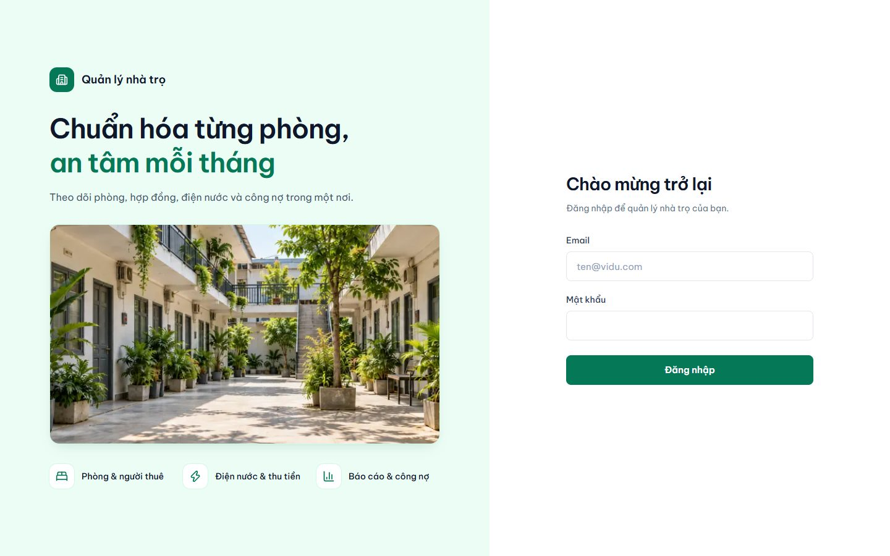
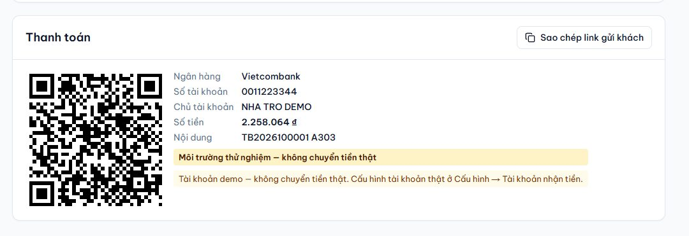
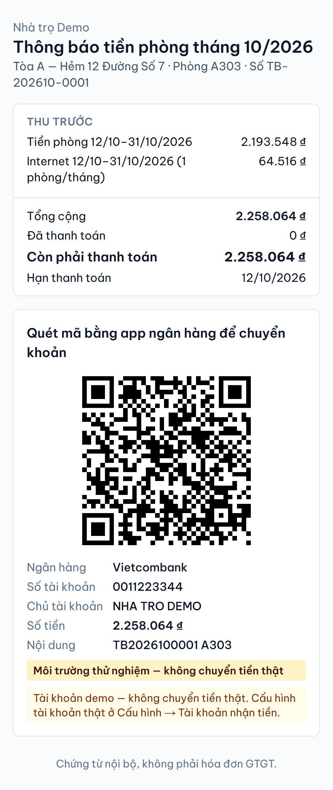
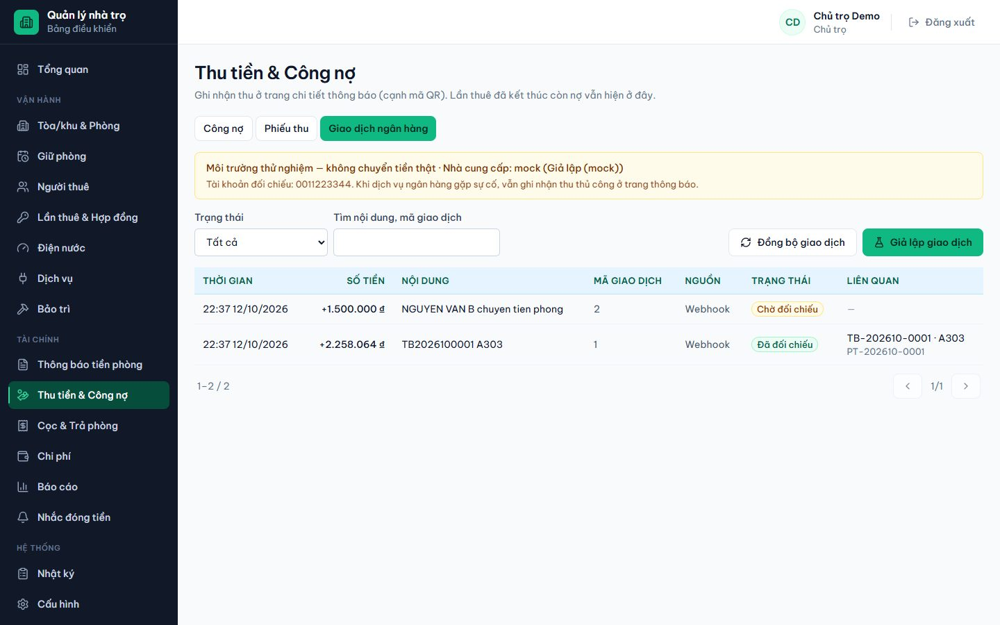
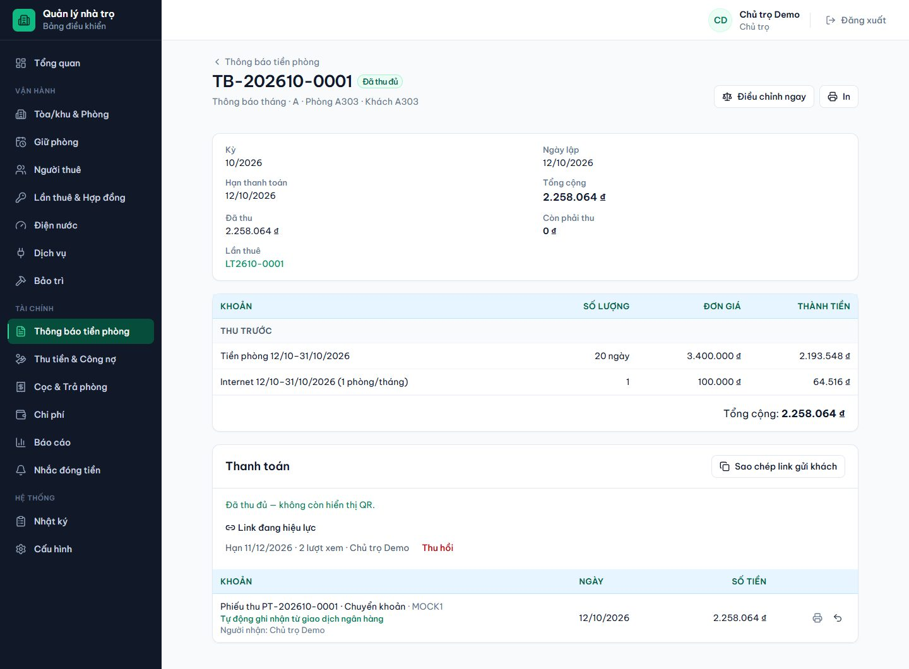
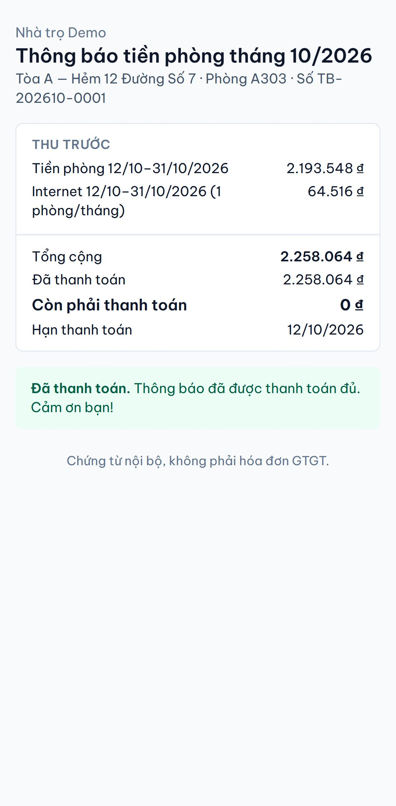
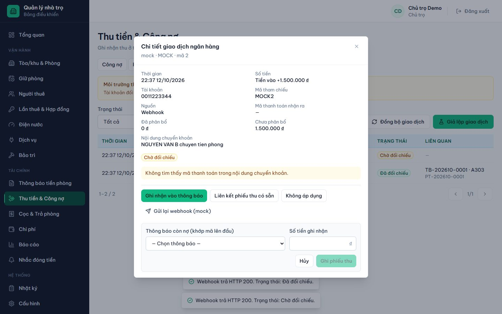

# Giới thiệu dự án — Phần mềm Quản lý nhà trọ

> **Chuẩn hóa từng phòng, an tâm mỗi tháng.**
> Theo dõi phòng, hợp đồng, điện nước và công nợ trong một nơi.

## 1. Tổng quan

Phần mềm quản lý nhà trọ chạy trên trình duyệt, dành cho **một chủ trọ có nhiều tòa/khu**, mỗi tòa nhiều phòng, mỗi phòng có một
hoặc nhiều người ở. Chủ trọ có thể tạo thêm tài khoản **quản lý**; mỗi quản lý chỉ làm việc trong các tòa được giao.

Phần mềm thay cho sổ sách, bảng tính và tin nhắn rời rạc. Mọi việc của một lần thuê nằm trên cùng một hệ thống: giữ phòng,
nhận phòng, hợp đồng, chốt điện nước, thông báo tiền phòng, thu tiền, công nợ, cọc, trả phòng và báo cáo.

| Mục | Nội dung |
|---|---|
| Người dùng | Chủ trọ (toàn quyền, mọi tòa) và Quản lý (trong tòa được giao) |
| Thiết bị | Một đường link dùng cho máy tính, máy tính bảng và điện thoại; giao diện tự sắp xếp theo màn hình (trên điện thoại menu thành nút ☰, bảng thành thẻ). Chốt chỉ số điện nước ưu tiên điện thoại |
| Ngôn ngữ, tiền tệ | Tiếng Việt; tiền VND không có số lẻ; ngày theo giờ Việt Nam |
| Chứng từ | Thông báo tiền phòng, phiếu thu, biên bản quyết toán trả phòng. Đây là **chứng từ nội bộ**, không phải hóa đơn GTGT hay hóa đơn điện tử |

## 2. Chức năng chính

### Tòa/khu và phòng

- Danh sách tòa với giá điện, giá nước, quản lý phụ trách. Giá điện nước đặt **riêng cho từng tòa**, có lịch sử thay đổi.
- Danh sách phòng dạng lưới hoặc bảng; lọc theo tòa, trạng thái, tầng; tìm theo mã phòng hoặc tên khách.
- Trạng thái phòng: **Trống, Đã giữ, Đang thuê, Bảo trì**. Mỗi phòng có đồng hồ điện, nước riêng và lịch sử chỉ số.

### Giữ phòng và tiền giữ chỗ

Giữ phòng cho khách sắp đến, ghi tiền giữ chỗ. Khi khách nhận phòng, tiền giữ chỗ tự chuyển thành tiền cọc. Khách không đến thì
không tự mất tiền: hoàn hay giữ lại do chủ trọ quyết định và ghi lý do.

### Nhận phòng, người thuê, hợp đồng

- Nhận phòng theo 6 bước có bước xem lại: ngày & giá → người thuê → hợp đồng → dịch vụ & chỉ số → cọc → xem lại.
- Hồ sơ người thuê, người ở cùng, tình trạng **đăng ký tạm trú** từng người.
- Hợp đồng có thời hạn, gia hạn, phụ lục, đổi giá thuê từ một ngày. Hợp đồng hết hạn mà khách vẫn ở thì tự hiểu là **thuê theo
  tháng**; không phải bấm “tiếp tục thuê”, không tự đổi phòng thành trống.
- Cảnh báo hợp đồng sắp hết hạn.

### Điện nước và dịch vụ

- Màn hình **chốt chỉ số** hằng tháng: chỉ số cũ tự điền, chỉ cần nhập số mới, thấy ngay tiêu thụ và thành tiền tạm tính.
  Có cảnh báo số bất thường; sửa chỉ số cũ phải ghi lý do.
- Dịch vụ: Internet, rác, gửi xe… tính cố định theo phòng, theo đầu người hoặc theo số lượng; giá có ngày hiệu lực.

### Thông báo tiền phòng

- Lập thông báo cho cả tòa trong một lần: **Xem trước → Tạo nháp → Phát hành**.
- Quy tắc thu: **tiền phòng thu trước, điện nước thu sau.** Thông báo tháng 10 gồm tiền phòng tháng 10 và điện nước tháng 9,
  cộng dịch vụ và các dòng điều chỉnh nếu có.
- Thông báo đã phát hành không bị sửa số tiền. Chênh lệch về sau được ghi thành dòng điều chỉnh có liên kết.
- Mỗi thông báo có **mã VietQR** (đúng số tiền còn nợ và nội dung chuyển khoản), **link gửi khách** có thời hạn, và **trang in / lưu PDF**.

### Thanh toán bằng mã QR — tự động cập nhật trạng thái

Khách không cần cài app: mở link thông báo trên điện thoại, quét mã QR bằng app ngân hàng là chuyển đúng số tiền, đúng nội dung.
Khi tiền vào tài khoản, ngân hàng (qua dịch vụ trung gian) báo về hệ thống và **thông báo tự chuyển sang “Đã thu đủ”** — chủ trọ
không phải ngồi đối chiếu sao kê.

1. **Mã QR trên thông báo**: chứa tài khoản nhận, **số tiền còn nợ tại thời điểm mở** và nội dung chuyển khoản là mã thông báo
   (ví dụ `TB2026100001 A303`). Khách trả một phần thì lần mở sau QR chỉ còn số tiền còn lại.

   

2. **Khách mở link trên điện thoại** (không cần đăng nhập) → quét QR → chuyển khoản.

   

3. **Hệ thống nhận giao dịch và đối chiếu**: tìm mã thông báo trong nội dung chuyển khoản → tự ghi phiếu thu
   “Tự động (ngân hàng)” → công nợ giảm ngay. Mọi giao dịch hiện ở **Thu tiền & Công nợ → Giao dịch ngân hàng**.

   

4. **Trạng thái cập nhật ở mọi nơi**: thông báo thành “Đã thu đủ”, mã QR tự ẩn; khách mở lại link thấy **“Đã thanh toán.”**

   

   

5. **Trường hợp không chắc chắn thì không tự đoán**: chuyển thiếu mã/sai mã, chuyển thừa, thông báo đã trả đủ… được đưa vào
   **“Chờ đối chiếu”** kèm lý do để chủ trọ xử lý bằng một cú bấm. Cùng một giao dịch gửi lại nhiều lần cũng chỉ ghi một lần.

   

> **Hiện trạng:** tính năng đã chạy hoàn chỉnh ở **môi trường thử nghiệm** (ngân hàng giả lập, QR ghi “Môi trường thử nghiệm —
> không chuyển tiền thật”). Muốn dùng với tiền thật, chủ trọ cần đăng ký dịch vụ SePay và liên kết tài khoản ngân hàng nhận tiền
> (các bước trong [RUNBOOK.md](RUNBOOK.md)). Trong lúc chưa bật hoặc khi dịch vụ gặp sự cố, vẫn ghi nhận thu thủ công như bình thường.

### Thu tiền và công nợ

- Chuyển khoản qua QR được **tự động ghi nhận** (xem mục trên). Tiền mặt và các khoản khác: chủ trọ/quản lý bấm **Ghi nhận thu**,
  thu nhiều lần được (thu một phần). Mỗi phiếu thu ghi rõ **người nhận tiền** và nguồn (ghi tay hay tự động từ ngân hàng).
- Không có nút “đánh dấu đã thu”: trạng thái chỉ đổi khi có tiền thật — ngân hàng báo tiền vào, hoặc người thu ghi phiếu thu.
  Việc khách quét QR hay gửi ảnh chụp chuyển khoản **không** làm đổi trạng thái.
- Ghi sai thì đảo phiếu thu kèm lý do, không xóa.
- Công nợ theo từng lần thuê, gồm cả khách đã trả phòng mà còn nợ; tách riêng phần quá hạn.

### Trả phòng và quyết toán cọc

- Báo trả phòng, rồi trả phòng theo các bước: bàn giao → chỉ số cuối → hư hỏng/khoản phí khác → xem trước đối soát → duyệt → hoàn tất.
- Tháng cuối thu đủ tiền phòng; điện nước tính đến ngày bàn giao.
- Sổ cọc theo dõi tiền đã nhận, đang giữ, đã áp vào nợ, đã hoàn, còn phải hoàn. Có biên bản quyết toán để in.
- Hỗ trợ **chuyển phòng**: cọc chuyển theo, hai lần thuê liên kết với nhau.

### Báo cáo và vận hành

- Báo cáo: doanh thu theo tháng; doanh thu theo khoản/tòa/phòng; chi phí & thu nhập vận hành; dòng tiền; lấp đầy; công nợ; cọc;
  thu tiền. Báo cáo nào cũng **xuất được CSV**.
- Chi phí vận hành (sửa chữa, điện nước tổng…), có đảo khi ghi sai.
- Yêu cầu **bảo trì**: tạo, nhận xử lý, hoàn tất, đính kèm ảnh.
- **Nhắc đóng tiền qua Zalo/SMS** theo mốc trước hạn, đúng hạn và quá hạn, chỉ gửi cho người thuê đã đồng ý. Muốn gửi tin thật,
  chủ trọ cần đăng ký nhà cung cấp tin nhắn.
- **Nhật ký thao tác**: ai làm gì, lúc nào, giá trị trước và sau.

## 3. Lợi ích

| Với chủ trọ | Với quản lý | Với người thuê |
|---|---|---|
| Thấy ngay phòng trống, tiền phải thu, nợ quá hạn của mọi tòa trên một màn hình | Danh sách “Việc cần xử lý” nhắc chốt chỉ số, thông báo nháp, nợ quá hạn, tạm trú… | Nhận thông báo rõ từng khoản, có khoảng ngày tính tiền |
| Tiền tính tự động theo một quy tắc, không cộng tay, không sót phòng | Chốt điện nước ngay trên điện thoại khi đi từng phòng | Quét QR đúng số tiền, đúng nội dung chuyển khoản |
| Khách chuyển khoản là tự gạch nợ, không phải dò sao kê ngân hàng | Biết ngay phòng nào đã trả mà không cần hỏi chủ trọ | Chuyển xong mở lại link thấy ngay “Đã thanh toán” |
| Mỗi phiếu thu ghi người nhận tiền; mọi sửa đổi có nhật ký | Chỉ thấy tòa được giao, không lo thao tác nhầm tòa khác | Xem thông báo qua link mà không cần tài khoản |
| Cọc và tiền giữ chỗ tách khỏi doanh thu, biết rõ khoản nào phải hoàn | Thao tác theo từng bước có kiểm tra, khó nhập sai | Khi trả phòng có biên bản quyết toán minh bạch |
| Báo cáo doanh thu, dòng tiền, lấp đầy; xuất CSV | | |

**Độ an toàn của số liệu:**

- Tiền lưu bằng số nguyên VND, không sai số làm tròn.
- Chứng từ đã phát hành không bị sửa hay xóa. Mọi thay đổi tiền đi qua giao dịch có lý do.
- Bấm hai lần cũng không ghi trùng phiếu thu.
- Phân quyền kiểm tra ở máy chủ, không chỉ ẩn nút trên giao diện. Quản lý không xem được số CCCD và ảnh giấy tờ.
- Có quy trình sao lưu và phục hồi cơ sở dữ liệu (xem [RUNBOOK.md](RUNBOOK.md)).

## 4. Phân quyền

| Việc | Chủ trọ | Quản lý (mặc định, trong tòa được giao) |
|---|---|---|
| Tòa, giá điện nước, dịch vụ | Thêm, sửa, đổi giá | Xem |
| Phòng, giữ phòng, nhận phòng, người thuê, hợp đồng | Có | Có (không hủy hợp đồng đã ký; không xem CCCD) |
| Chốt chỉ số điện nước | Có | Có (không thay đồng hồ) |
| Thông báo tiền phòng | Tạo, phát hành, điều chỉnh, hủy | Tạo nháp, xem, gửi link cho khách |
| Thu tiền | Ghi nhận, đảo | Ghi nhận |
| Giao dịch ngân hàng (tự động ghi nhận) | Xem, đối chiếu, đồng bộ | Không (chủ trọ cấp riêng được; chỉ thấy giao dịch của tòa được giao) |
| Trả phòng | Duyệt, hoàn tất, hoàn cọc | Báo trả, lập nháp quyết toán |
| Báo cáo, chi phí, cấu hình, người dùng | Có | Không (chi phí chỉ xem) |

Chủ trọ có thể **cấp thêm hoặc thu hồi từng quyền** cho từng quản lý, ví dụ cho một quản lý được phát hành thông báo.

## 5. Phạm vi và giới hạn

- Không xuất hóa đơn GTGT hay hóa đơn điện tử. Chưa có mẫu báo cáo kê khai thuế; mẫu này chờ chủ trọ xác nhận.
- Tự động ghi nhận chuyển khoản mới chạy ở **môi trường thử nghiệm**; dùng với tiền thật cần chủ trọ đăng ký SePay và liên kết
  tài khoản ngân hàng. Khách chuyển thừa: phần dư chờ chủ trọ quyết định (chưa tự chuyển thành tiền trả trước).
- Chưa có app cài từ App Store/CH Play; dùng qua trình duyệt trên mọi thiết bị. Người thuê xem thông báo qua link, không cần tài khoản.
- Nhắc đóng tiền qua Zalo/SMS cần chủ trọ đăng ký nhà cung cấp và mẫu tin. Trước khi đăng ký, hệ thống chỉ ghi nhật ký, không gửi tin thật.

## 6. Công nghệ

| Thành phần | Công nghệ |
|---|---|
| Giao diện web | Next.js, Tailwind CSS, phông Be Vietnam Pro |
| Máy chủ | NestJS (nơi duy nhất tính tiền chính thức) |
| Nhận giao dịch ngân hàng | Webhook theo chuẩn SePay; hiện chạy bằng ngân hàng giả lập |
| Cơ sở dữ liệu | PostgreSQL, Prisma |
| Kiểm thử | Test đơn vị, test tích hợp trên PostgreSQL thật, test E2E bằng Playwright |
| Triển khai | Docker; sao lưu/khôi phục theo [RUNBOOK.md](RUNBOOK.md) |

Tài liệu liên quan:

- Hướng dẫn thao tác: [HUONG_DAN_SU_DUNG.md](HUONG_DAN_SU_DUNG.md)
- Yêu cầu chi tiết: [MASTER_PLAN.md](../MASTER_PLAN.md)
- Tiến độ: [IMPLEMENTATION_STATUS.md](IMPLEMENTATION_STATUS.md)
