# Hướng dẫn sử dụng — dành cho Chủ trọ và Quản lý

Tài liệu đi theo đúng tên nút và tên mục trên màn hình. Ký hiệu ở đầu mỗi thao tác:

- **[Cả hai]**: chủ trọ và quản lý đều làm được.
- **[Chủ trọ]**: mặc định chỉ chủ trọ làm được. Quản lý cần được chủ trọ cấp quyền riêng mới thấy nút này.

Quản lý chỉ thấy dữ liệu của các tòa được giao.

---

## Mục lục

1. [Bắt đầu](#1-bắt-đầu)
2. [Việc hằng tháng](#2-việc-hằng-tháng)
3. [Thiết lập ban đầu](#3-thiết-lập-ban-đầu-chủ-trọ)
4. [Tòa/khu và phòng](#4-tòakhu-và-phòng)
5. [Giữ phòng](#5-giữ-phòng)
6. [Nhận phòng](#6-nhận-phòng)
7. [Người thuê, người ở cùng, tạm trú](#7-người-thuê-người-ở-cùng-tạm-trú)
8. [Lần thuê và hợp đồng](#8-lần-thuê-và-hợp-đồng)
9. [Chốt chỉ số điện nước](#9-chốt-chỉ-số-điện-nước)
10. [Thông báo tiền phòng](#10-thông-báo-tiền-phòng)
11. [Thu tiền và công nợ](#11-thu-tiền-và-công-nợ)
12. [Báo trả, trả phòng, quyết toán cọc](#12-báo-trả-trả-phòng-quyết-toán-cọc)
13. [Chuyển phòng](#13-chuyển-phòng)
14. [Dịch vụ](#14-dịch-vụ)
15. [Bảo trì](#15-bảo-trì)
16. [Chi phí](#16-chi-phí)
17. [Báo cáo](#17-báo-cáo)
18. [Nhắc đóng tiền](#18-nhắc-đóng-tiền)
19. [Nhật ký và người dùng](#19-nhật-ký-và-người-dùng)
20. [Câu hỏi thường gặp](#20-câu-hỏi-thường-gặp)

---

## 1. Bắt đầu

### Đăng nhập

1. Mở địa chỉ web của nhà trọ, nhập **Email** và **Mật khẩu**, bấm **Đăng nhập**.
2. Nhập sai sẽ có thông báo đỏ ngay trên form. Không có chức năng tự đăng ký hay quên mật khẩu: muốn có tài khoản mới hoặc đặt
   lại mật khẩu, hãy liên hệ chủ trọ (xem [mục 19](#19-nhật-ký-và-người-dùng)).
3. Bấm **Đăng xuất** ở góc phải trên cùng khi dùng máy chung.

### Màn hình chính

- **Thanh menu bên trái** gồm các nhóm:
  - **Tổng quan**
  - **Vận hành**: Tòa/khu & Phòng, Giữ phòng, Người thuê, Lần thuê & Hợp đồng, Điện nước, Dịch vụ, Bảo trì.
  - **Tài chính**: Thông báo tiền phòng, Thu tiền & Công nợ, Cọc & Trả phòng, Chi phí, Báo cáo, Nhắc đóng tiền.
  - **Hệ thống**: Nhật ký, Cấu hình.
- Trên máy tính bảng, menu thu gọn thành cột biểu tượng; rê chuột vào biểu tượng để xem tên mục.
- Trên điện thoại, bấm nút ☰ (**Mở menu**) để mở menu.
- Mục nào bạn không có quyền sẽ không hiện trong menu.

### Tổng quan

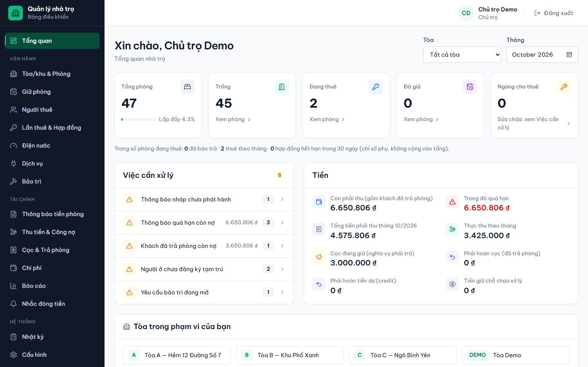

- Chọn **Tòa** và **Tháng** ở góc phải để lọc.
- **Ô số phòng**: Tổng phòng (kèm tỷ lệ lấp đầy), Trống, Đang thuê, Đã giữ, Ngừng cho thuê. Bấm vào ô để mở danh sách phòng tương ứng.
- **Việc cần xử lý**: chưa chốt chỉ số, thông báo nháp chưa phát hành, thông báo quá hạn còn nợ, khách đã trả phòng còn nợ,
  hợp đồng sắp hết hạn, người ở chưa đăng ký tạm trú, yêu cầu bảo trì đang mở… Bấm từng dòng để đi tới việc đó.
- **Tiền** (chủ trọ): còn phải thu, phần quá hạn, tổng phải thu và thực thu trong tháng, cọc đang giữ, các khoản phải hoàn.

---

## 2. Việc hằng tháng

Quy tắc chung: **tiền phòng thu trước, điện nước thu sau.** Thông báo tháng 11 gồm tiền phòng tháng 11, điện nước dùng trong
tháng 10, các dịch vụ và các dòng điều chỉnh (nếu có).

| Thời điểm | Việc | Ai làm |
|---|---|---|
| Ngày cuối tháng M đến ngày 3 tháng M+1 | Đi từng phòng, **chốt chỉ số** điện nước tháng M ([mục 9](#9-chốt-chỉ-số-điện-nước)) | Cả hai |
| Sau khi chốt đủ | **Lập thông báo tháng M+1**: Xem trước → Tạo nháp ([mục 10](#10-thông-báo-tiền-phòng)) | Cả hai |
| Ngay sau đó | Kiểm tra nháp → **Phát hành** | Chủ trọ |
| Sau khi phát hành | Gửi khách **link** hoặc bản in có mã QR | Cả hai |
| Đến hạn là ngày 5 | Khách chuyển khoản hoặc trả tiền mặt → **Ghi nhận thu** ([mục 11](#11-thu-tiền-và-công-nợ)) | Cả hai |
| Sau hạn | Xem **Thu tiền & Công nợ → Chỉ quá hạn**; hệ thống nhắc qua Zalo/SMS nếu đã bật | Cả hai |
| Cuối tháng | Xem **Báo cáo**, xuất CSV nếu cần | Chủ trọ |

> Thông báo nào lập hoặc phát hành **sau ngày 5** sẽ có hạn thanh toán là ngày phát hành cộng 7 ngày. Khách có đủ một tuần để
> đóng tiền rồi thông báo mới bị tính quá hạn.

---

## 3. Thiết lập ban đầu (chủ trọ)

Vào **Cấu hình**:

1. **Tài khoản nhận tiền (VietQR)**: nhập Ngân hàng, Số tài khoản, Tên chủ tài khoản → **Lưu tài khoản**. Mã QR trên
   thông báo sẽ dùng tài khoản này.
2. **Chính sách tính phí**: ngày đến hạn mặc định, cách chia phí theo ngày, cách làm tròn → **Lưu phiên bản mới**. Phiên bản mới
   có ngày hiệu lực và không làm thay đổi các thông báo đã phát hành.
3. **Người dùng & phân quyền**: tạo tài khoản cho quản lý và giao tòa ([mục 19](#19-nhật-ký-và-người-dùng)).
4. **Nhắc đóng tiền (Zalo/SMS)**: bật khi đã có nhà cung cấp tin nhắn ([mục 18](#18-nhắc-đóng-tiền)).

Sau đó tạo tòa và phòng ([mục 4](#4-tòakhu-và-phòng)) và các dịch vụ thu thêm ([mục 14](#14-dịch-vụ)).

---

## 4. Tòa/khu và phòng

Menu **Tòa/khu & Phòng** có hai tab là **Phòng** và **Tòa/khu**.

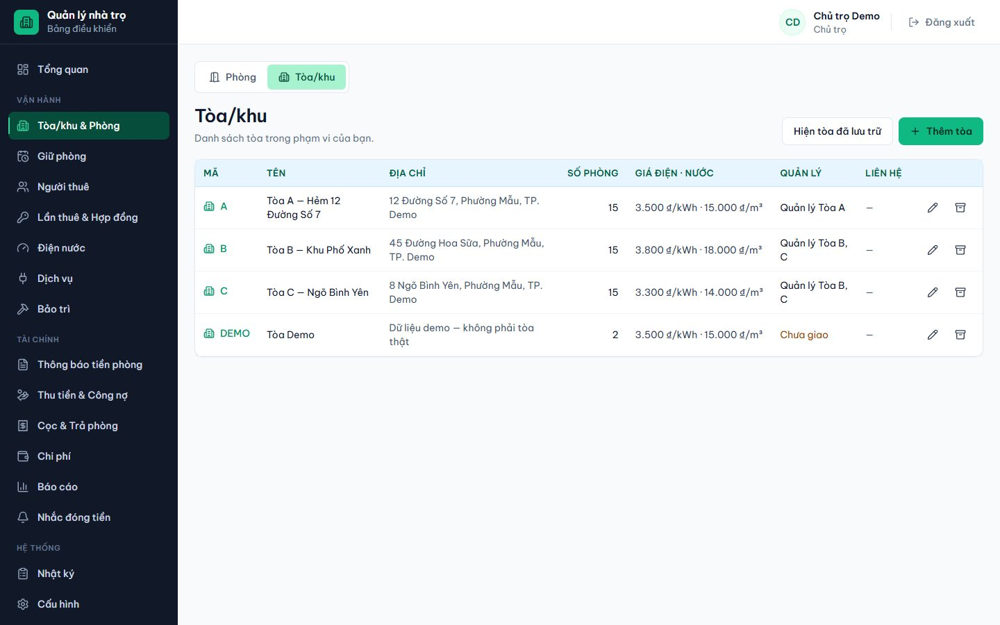

### Thêm tòa — [Chủ trọ]

1. Tab **Tòa/khu** → **Thêm tòa**.
2. Nhập **Mã tòa**, **Tên tòa** (bắt buộc); Địa chỉ, Số tầng, Người liên hệ, SĐT liên hệ, Ghi chú (nếu có).
3. Mục **Giá điện nước (không bắt buộc)**: Giá điện (đ/kWh), Giá nước (đ/m³), **Áp dụng từ**.
4. Bấm **Lưu**.

### Đổi giá điện nước — [Chủ trọ]

Có hai cách:

- **Cách 1**: bấm bút chì ở dòng tòa (**Sửa tòa**), nhập giá mới, chọn **Áp dụng từ** và nhập **Lý do đổi giá** → **Lưu**.
- **Cách 2**: bấm mã tòa để mở trang tòa → thẻ **Giá điện nước** → **Thay đổi giá** → nhập Đơn giá mới, Áp dụng từ, Lý do →
  **Lưu giá**. Bảng bên dưới là lịch sử giá.

Lưu ý:

- Giá dùng chung cho mọi phòng trong tòa và áp dụng từ kỳ đọc chỉ số đã chọn.
- Nếu kỳ đó đã có chỉ số chốt, phần mềm yêu cầu tích ô xác nhận rằng tiền tạm tính của kỳ đó sẽ tính theo giá mới.
- Thông báo đã phát hành không bị đổi.

### Thêm phòng — [Cả hai]

1. Tab **Phòng** → **Thêm phòng**, hoặc vào trang tòa → **Thêm phòng**.
2. Nhập **Tòa**, **Mã phòng**, **Giá thuê mặc định / tháng**, **Số người tối đa**; Tầng, Diện tích, Tiện nghi (nếu có).
3. **Đồng hồ điện nước (nhập một lần)**: Chỉ số điện ban đầu, Chỉ số nước ban đầu. Đây là số đang hiện trên đồng hồ của phòng.
4. Bấm **Lưu**.

### Tìm phòng

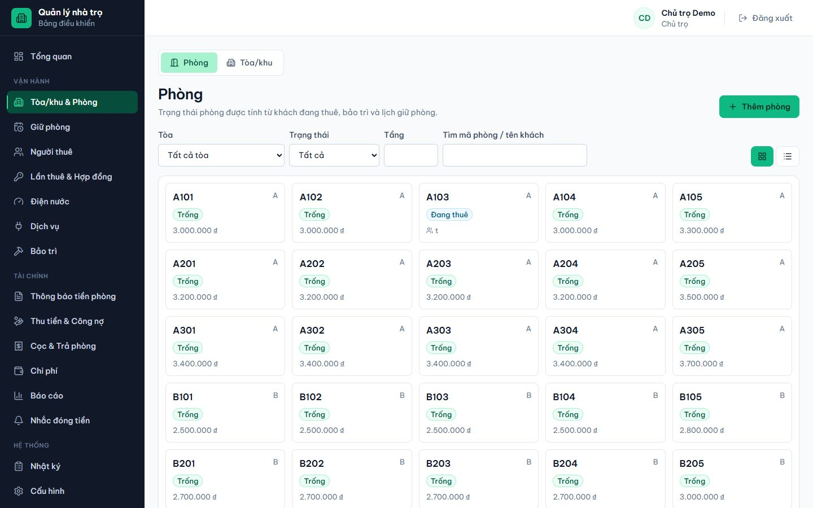

- Lọc theo **Tòa**, **Trạng thái** (Trống / Đã giữ / Đang thuê / Bảo trì), **Tầng**; ô tìm theo mã phòng hoặc tên khách.
- Chuyển giữa **Dạng lưới** và **Dạng bảng**.

### Trang phòng

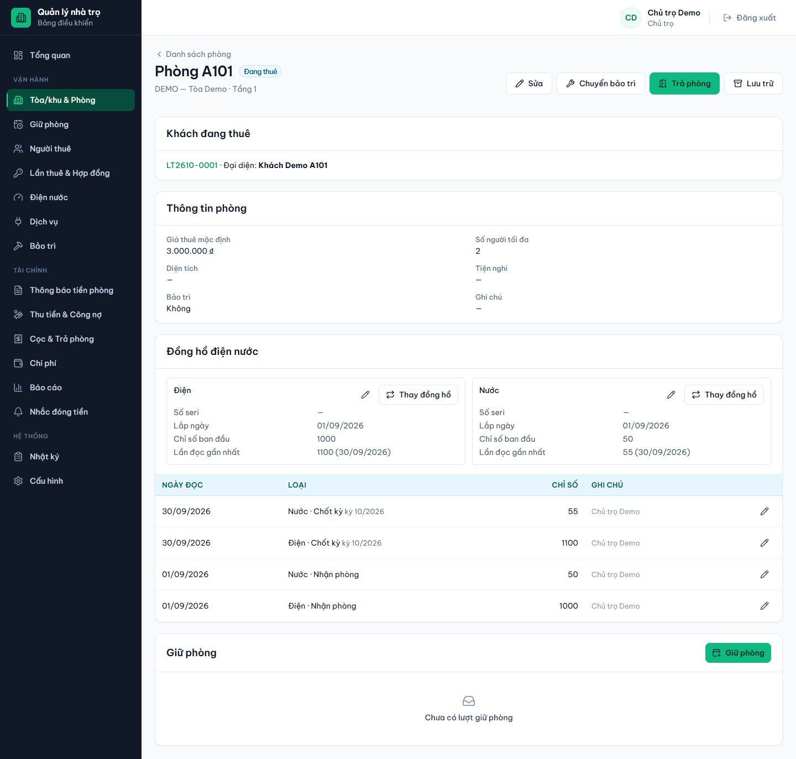

Các nút ở đầu trang tùy tình trạng phòng:

| Nút | Khi nào hiện | Ai |
|---|---|---|
| **Sửa** | Luôn có | Cả hai |
| **Nhận phòng** (trong thẻ “Khách đang thuê”) | Phòng trống, sẵn sàng cho thuê | Cả hai |
| **Giữ phòng** (thẻ “Giữ phòng”) | Phòng trống | Cả hai |
| **Chuyển bảo trì** / **Sẵn sàng cho thuê** | Tạm ngừng cho thuê để sửa (bắt buộc lý do) / mở lại | Cả hai |
| **Trả phòng** | Phòng đang có khách | Cả hai (duyệt và hoàn tất: chủ trọ) |
| **Lưu trữ** | Phòng không dùng nữa (ẩn khỏi danh sách, giữ lịch sử) | Cả hai |

Thẻ **Đồng hồ điện nước**:

- Xem chỉ số ban đầu và lần đọc gần nhất.
- Biểu tượng bút chì trên từng dòng chỉ số để **Sửa chỉ số**, bắt buộc nhập lý do.
- **Thay đồng hồ** khi đồng hồ hỏng hoặc được thay mới [Chủ trọ].

---

## 5. Giữ phòng

Dùng khi khách đặt trước một phòng trống.

1. Trang phòng trống → thẻ **Giữ phòng** → nút **Giữ phòng**.
2. Nhập **Bắt đầu giữ**, **Dự kiến nhận**, **Giữ đến hết ngày**, **Người giữ chỗ**, Số điện thoại → **Giữ phòng**.
   Phòng chuyển sang “Đã giữ”.
3. Khách đưa tiền giữ chỗ: menu **Giữ phòng** → biểu tượng **Tiền giữ chỗ** → **Ghi giao dịch** → **Nhận tiền giữ chỗ**
   (số tiền, ngày nhận, phương thức).
4. Khách đến ở: biểu tượng **Nhận phòng từ lượt giữ này**. Tiền giữ chỗ tự chuyển thành tiền cọc.
5. Đổi ngày: **Đổi lịch**. Khách không đến: **Hủy giữ phòng**, bắt buộc nhập lý do.

Tiền giữ chỗ **không tự mất** khi hủy giữ phòng. Chủ trọ chọn **Hoàn tiền giữ chỗ (đã chi thật)** hoặc **Giữ lại theo thỏa
thuận** và ghi lý do [Chủ trọ].

---

## 6. Nhận phòng

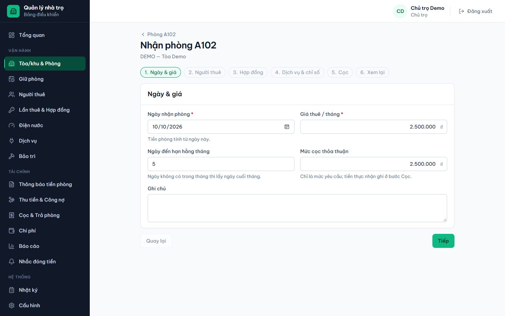

Từ trang phòng trống, bấm **Nhận phòng**. Đi lần lượt các bước bằng **Tiếp** / **Quay lại**:

1. **Ngày & giá**: Ngày nhận phòng, Giá thuê / tháng, Ngày đến hạn hằng tháng (mặc định 5), Mức cọc thỏa thuận.
2. **Người thuê**:
   - Tìm người đã từng thuê theo tên hoặc số điện thoại, hoặc nhập người mới (Họ tên, Số điện thoại, CCCD, ngày sinh, địa chỉ…).
   - **Thêm người ở cùng** nếu phòng có nhiều người.
3. **Hợp đồng**: tích **Tạo hợp đồng có thời hạn** nếu có giấy tờ (Từ ngày, Đến hết ngày, Số ngày báo trước). Tích **Hai bên đã
   ký giấy tờ** nếu đã ký. Có thể bỏ qua bước này và tạo hợp đồng sau.
4. **Dịch vụ & chỉ số**:
   - Chọn dịch vụ khách dùng (Internet, gửi xe…) và số lượng.
   - Kiểm tra **Chỉ số điện**, **Chỉ số nước**. Phần mềm điền sẵn từ đồng hồ; sửa lại nếu số thực tế khác.
5. **Cọc**: **Tiền cọc thực nhận hôm nay**, phương thức, ngày nhận. Chưa nhận thì để trống và ghi sau ở trang lần thuê.
6. **Xem lại**: kiểm tra toàn bộ → **Xác nhận nhận phòng**.

Kết quả: phòng chuyển “Đang thuê”, có một **lần thuê** mới và thông báo tiền phòng đầu tiên.

> **Tiền phòng tháng đầu được chia theo ngày.** Ví dụ nhận phòng ngày 10/10, giá 3.000.000 đ/tháng: tiền tháng 10 tính từ
> 10/10 đến 31/10, tức 22/31 × 3.000.000 = 2.129.032 đ. Thông báo đầu tiên đến hạn ngày nhận phòng. Từ tháng sau thu đủ tháng.

---

## 7. Người thuê, người ở cùng, tạm trú

- Menu **Người thuê** → **Thêm người thuê**, hoặc tìm theo tên, số điện thoại. Trang người thuê có thông tin, **Lịch sử thuê**,
  **Giấy tờ, tệp đính kèm**.
- Số CCCD và ảnh giấy tờ tùy thân chỉ chủ trọ xem được. Quản lý thấy dòng “Không có quyền xem”.
- Người ở cùng nằm ở trang **lần thuê**, thẻ **Người ở**:
  - **Thêm người**: chọn người và **Ngày vào ở**.
  - Biểu tượng **Tạm trú**: chọn Chưa đăng ký / Đã đăng ký / Không áp dụng, kèm ngày đăng ký.
  - **Đặt … làm đại diện**: đổi người đứng tên lần thuê.
  - **… rời đi**: một người dọn đi trước, nhập ngày cuối cùng ở.
- Người chưa đăng ký tạm trú sẽ hiện trong **Việc cần xử lý** ở Tổng quan.

---

## 8. Lần thuê và hợp đồng

“Lần thuê” là toàn bộ quá trình một khách ở một phòng, từ lúc nhận phòng đến khi trả phòng. Hợp đồng, cọc, thông báo và công nợ
đều gắn với lần thuê.

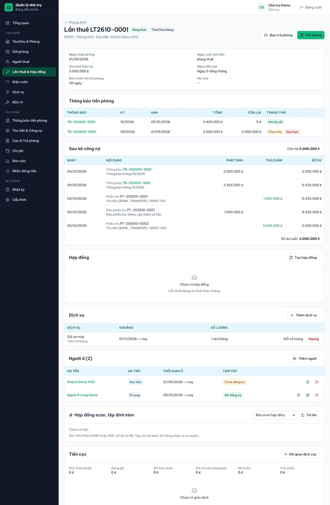

Menu **Lần thuê & Hợp đồng**: lọc theo trạng thái (Đang thuê / Đã báo trả / Đang trả phòng / Đã kết thúc), theo tòa, hoặc tìm
theo mã, phòng, tên khách. Trang lần thuê có các thẻ: Báo trả & trả phòng, Thông báo tiền phòng, **Sao kê công nợ**, Hợp đồng,
Dịch vụ, Người ở, tệp đính kèm, **Tiền cọc**, **Giá thuê**.

### Hợp đồng — [Cả hai]

- **Tạo hợp đồng** / **Gia hạn** (thẻ Hợp đồng): nhập Từ ngày, Đến hết ngày, Giá thuê theo kỳ này, Mức cọc, Số ngày báo trước.
  Lưu nháp hoặc lưu bản đã ký.
- **Xác nhận đã ký**: khi bản nháp đã được hai bên ký.
- **Phụ lục**: đổi ngày kết thúc, giá, mức cọc… từ một ngày, bắt buộc ghi nội dung thỏa thuận.
- **Hủy**: bản nháp thì cả hai đều hủy được. Hợp đồng đã ký nhưng chưa bắt đầu chỉ chủ trọ hủy được, và phải nhập lý do.
- Hợp đồng **hết hạn mà khách vẫn ở** thì phần mềm tự hiểu là **thuê theo tháng**. Phòng vẫn “Đang thuê”, tiền vẫn tính bình
  thường. Muốn có kỳ mới thì bấm **Gia hạn**.
- Xem các hợp đồng sắp hết hạn: nút **Hợp đồng sắp hết hạn** (lọc 7/30/60 ngày).

### Đổi giá thuê — [Cả hai]

Thẻ **Giá thuê** → **Đổi giá thuê**: nhập Có hiệu lực từ, Giá thuê mỗi tháng, Lý do → **Lưu giá mới**.

### Tiền cọc

Thẻ **Tiền cọc** → **Ghi giao dịch cọc**:

- **Nhận cọc** hoặc **Nhận thêm cọc** [Cả hai].
- **Hoàn cọc (đã chi thật)** hoặc **Khấu trừ theo thỏa thuận** [Chủ trọ].
- Ghi sai thì **Đảo giao dịch** [Chủ trọ].

---

## 9. Chốt chỉ số điện nước

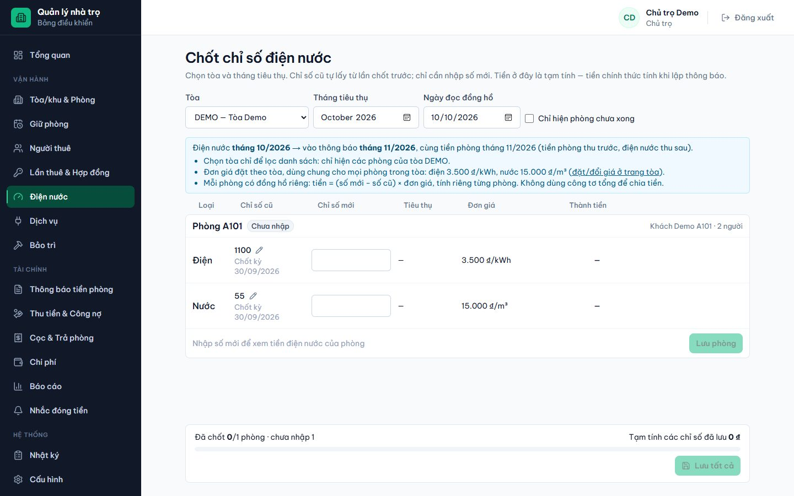

Menu **Điện nước**:

1. Chọn **Tòa** và **Tháng tiêu thụ**, tức tháng khách đã dùng điện nước. Dòng thông tin màu xanh ghi rõ chỉ số này sẽ vào
   thông báo tháng nào.
2. **Ngày đọc đồng hồ** mặc định là hôm nay.
3. Mỗi phòng là một thẻ:
   - **Chỉ số cũ** tự điền từ lần chốt trước và không gõ đè được.
   - Bạn chỉ cần nhập **Chỉ số mới** cho điện và nước.
   - Phần mềm hiện ngay **Tiêu thụ** và **Thành tiền** tạm tính theo đơn giá của tòa.
4. Bấm **Lưu phòng** cho từng phòng, hoặc **Lưu tất cả** ở cuối trang. Thanh tiến độ cho biết đã chốt bao nhiêu phòng.
5. Tích **Chỉ hiện phòng chưa xong** để chỉ còn các phòng chưa nhập.
6. Khi đã chốt đủ mọi phòng, bấm liên kết **Lập thông báo tháng …** để sang bước tính tiền.

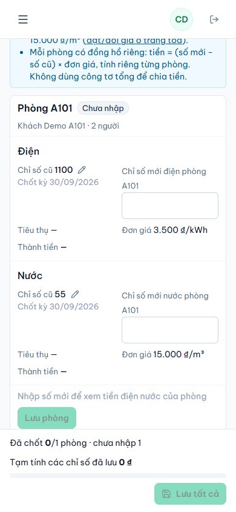

Lưu ý:

- **Chỉ số mới nhỏ hơn chỉ số cũ** sẽ bị báo lỗi và không lưu được. Nếu chỉ số cũ bị nhập sai, bấm bút chì cạnh chỉ số cũ
  (**Sửa chỉ số trước**), nhập chỉ số đúng và lý do.
- Phòng ghi **Cần thiết lập** là phòng chưa có chỉ số nền: nhập chỉ số nền và ngày tính → **Thiết lập**.
- Đồng hồ hỏng hoặc được thay: vào trang phòng → **Thay đồng hồ** [Chủ trọ].
- Tiền ở màn hình này chỉ là **tạm tính**. Số chính thức là số trên thông báo tiền phòng.

---

## 10. Thông báo tiền phòng

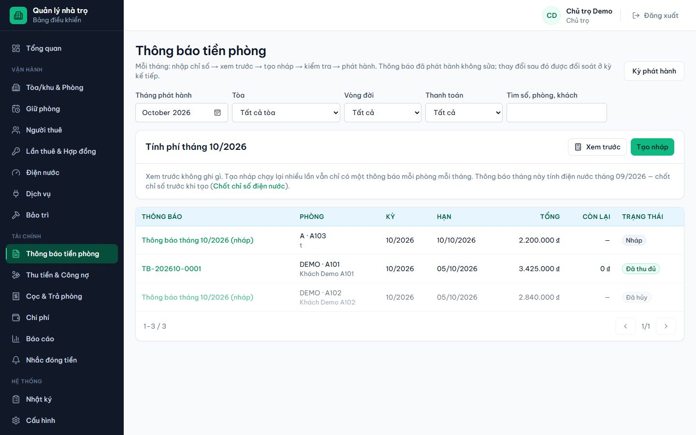

### Lập thông báo tháng

1. Menu **Thông báo tiền phòng** → bảng **Tính phí tháng MM/YYYY** (chọn tháng phát hành, chọn tòa).
2. **Xem trước**: phần mềm tính thử từng phòng nhưng chưa lưu gì. Kết quả mỗi phòng là *Sẵn sàng* hoặc *Có lỗi chặn phát hành*
   (ví dụ thiếu chỉ số điện nước).
3. **Tạo nháp** [Cả hai]: lưu các thông báo nháp.
4. Mở từng nháp để kiểm tra. Nếu có thay đổi (bổ sung chỉ số, đổi giá…), bấm **Tính lại**. Nháp sai thì bấm **Hủy nháp**.
5. **Phát hành n nháp hợp lệ** [Chủ trọ]. Mỗi thông báo được cấp số chứng từ (ví dụ `TB-202610-0001`) và có mã QR.

### Chi tiết thông báo

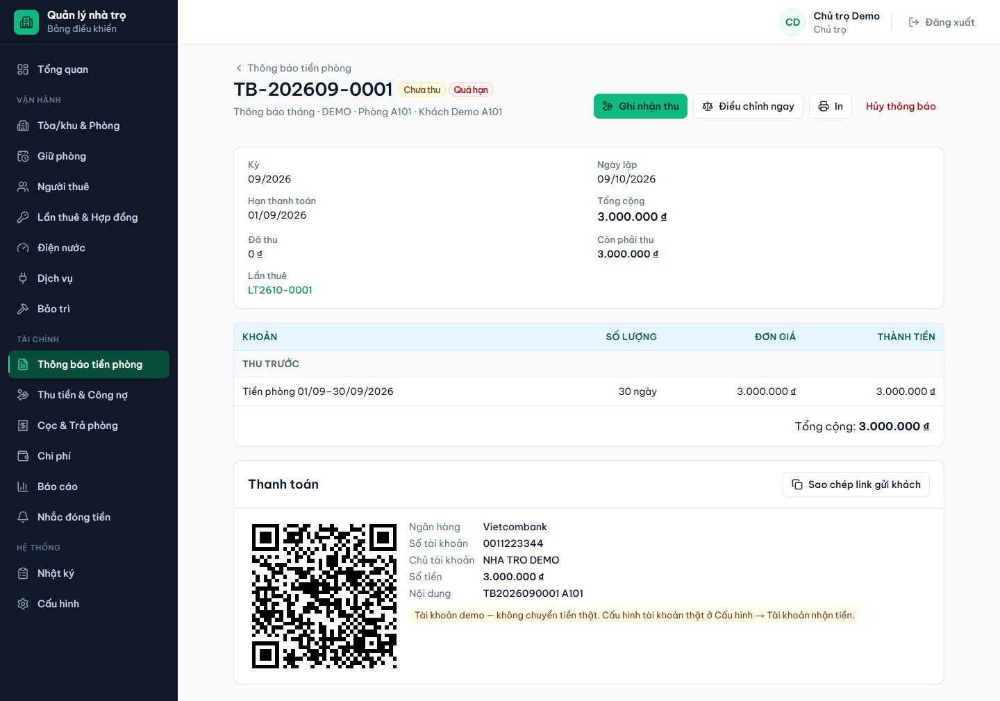

- Bảng khoản chia thành nhóm **Thu trước** (tiền phòng, dịch vụ thu trước), **Thu sau** (điện nước kèm chỉ số cũ → mới) và
  **Điều chỉnh**. Mỗi dòng ghi rõ khoảng ngày tính tiền.
- Các nút ở đầu trang:
  - **Ghi nhận thu**: xem [mục 11](#11-thu-tiền-và-công-nợ).
  - **In**: mở trang in. Dùng **In / Lưu PDF** để in giấy hoặc lưu PDF gửi khách.
  - **Điều chỉnh ngay** [Chủ trọ]: lập thông báo điều chỉnh khi cần sửa một thông báo đã phát hành.
  - **Hủy thông báo** [Chủ trọ]: chỉ hủy được khi chưa thu đồng nào.
- Thẻ **Thanh toán**:
  - **Mã VietQR** có sẵn số tiền còn phải trả và nội dung chuyển khoản dạng `<số thông báo> <mã phòng>`.
  - Nút **Sao chép link gửi khách**: dán link vào Zalo/tin nhắn. Khách mở link xem thông báo và mã QR mà không cần đăng nhập.
    Link có thời hạn; bấm **Thu hồi** để vô hiệu link ngay.
  - Danh sách phiếu thu đã ghi cho thông báo này.

> Thông báo đã phát hành **không sửa được số tiền**. Phát hiện sai thì dùng **Điều chỉnh ngay**: phần mềm lập dòng điều chỉnh
> (cộng hoặc trừ) có liên kết với thông báo gốc.

### Kỳ phát hành — [Chủ trọ]

Nút **Kỳ phát hành** → **Đóng kỳ** để khóa các chứng từ của tháng sau khi đã đối chiếu xong. **Mở lại** bắt buộc nhập lý do.

---

## 11. Thu tiền và công nợ

### Ghi nhận thu — [Cả hai]

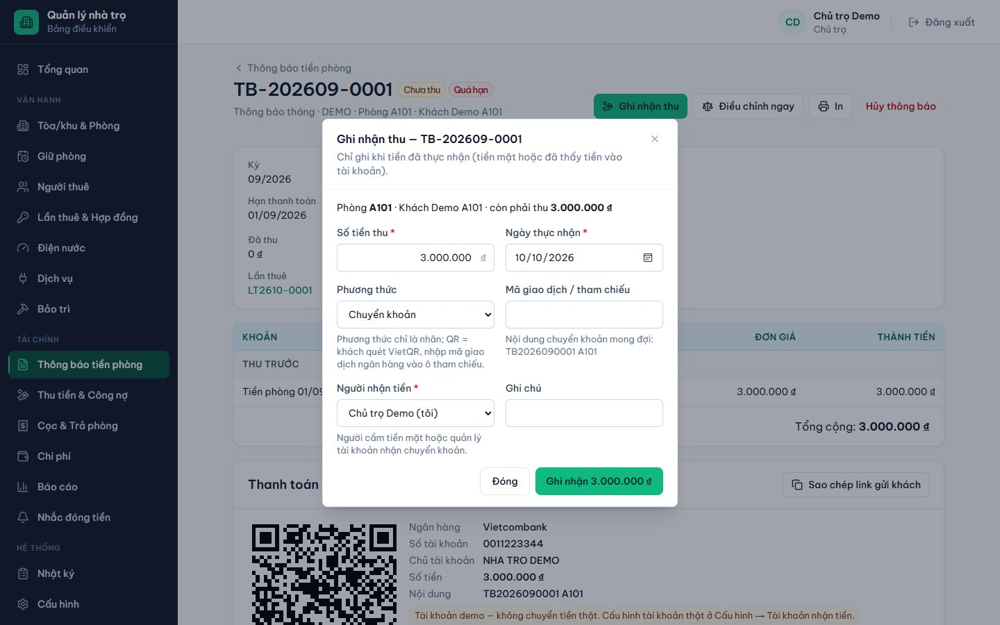

Chỉ ghi khi **tiền đã thực nhận**: đã cầm tiền mặt, hoặc đã thấy tiền vào tài khoản.

1. Mở thông báo → **Ghi nhận thu**.
2. Nhập:
   - **Số tiền thu**: thu một phần cũng được.
   - **Ngày thực nhận**.
   - **Phương thức**: Tiền mặt / Chuyển khoản / Quét QR / Khác.
   - **Mã giao dịch / tham chiếu**: mã giao dịch ngân hàng nếu có. Ô này có gợi ý nội dung chuyển khoản mong đợi để dễ đối chiếu.
   - **Người nhận tiền**: người cầm tiền mặt, hoặc quản lý tài khoản nhận chuyển khoản.
   - Ghi chú.
3. Bấm **Ghi nhận … đ**. Thông báo chuyển sang *Thu một phần* hoặc *Đã thu đủ*, và có **phiếu thu** để in.

Lưu ý:

- Không có nút “đánh dấu đã thu”: phải có phiếu thu thì trạng thái mới đổi.
- Khách quét QR **không** tự ghi nhận vào phần mềm. Thấy tiền vào tài khoản rồi mới bấm **Ghi nhận thu**.
- Ghi sai thì **Đảo phiếu thu** kèm lý do [Chủ trọ]. Phiếu thu không bị xóa mà được đánh dấu “Đã đảo”.

### Thu tiền & Công nợ

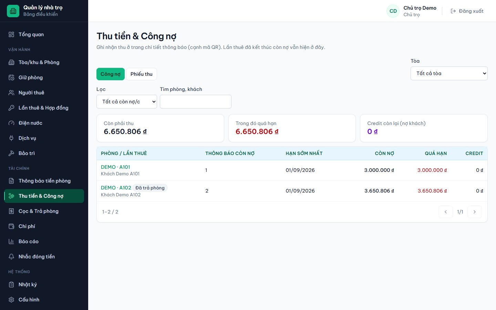

- **Tab Công nợ**:
  - Danh sách phòng/khách còn nợ, gồm cả khách đã trả phòng.
  - Chọn **Chỉ quá hạn** để xem các khoản trễ hạn.
  - Ô tổng ở đầu trang: Còn phải thu, Trong đó quá hạn, Credit còn lại (tiền khách trả dư).
- **Tab Phiếu thu**: tra phiếu thu theo khoảng ngày, theo trạng thái (Đã ghi / Đã đảo). Trên mỗi phiếu có người nhận tiền.
- **Sao kê công nợ** của từng khách nằm ở trang lần thuê: liệt kê theo ngày các khoản phát sinh, đã trả và còn lại.

### Giao dịch ngân hàng (tự động ghi nhận chuyển khoản)

Khi chủ trọ bật tính năng này, khách chuyển khoản theo mã QR thì phần mềm **tự ghi phiếu thu** — không cần bấm “Ghi nhận thu”.
Hiện mới chạy ở **môi trường thử nghiệm**: QR ghi “Môi trường thử nghiệm — không chuyển tiền thật”.

- **Thu tiền & Công nợ → tab Giao dịch ngân hàng** [Chủ trọ]: mọi giao dịch nhận được, kèm trạng thái:
  - *Đã đối chiếu*: đã ghi phiếu thu (phiếu thu ghi “Tự động (ngân hàng)”).
  - *Chờ đối chiếu*: phần mềm không chắc nên không tự ghi — ví dụ nội dung thiếu/sai mã, khách chuyển thừa, thông báo đã trả đủ,
    hoặc thông báo đã có phiếu thu chuyển khoản ghi tay. Bấm vào dòng để xem lý do.
  - *Không áp dụng*: tiền ra, hoặc đã đánh dấu không liên quan. *Lỗi*: bấm **Xử lý lại**.
- Đối chiếu một giao dịch “Chờ đối chiếu”:
  - **Ghi nhận vào thông báo**: chọn thông báo còn nợ (thông báo khớp mã có dấu ★) và số tiền.
  - **Liên kết phiếu thu có sẵn**: khi đã ghi tay phiếu thu cho chính khoản chuyển này — chỉ liên kết, không cộng tiền lần hai.
  - **Không áp dụng**: phần tiền không liên quan hoặc đã trả lại khách (bắt buộc lý do).
- Khách chuyển **thừa**: phần mềm ghi đủ số còn nợ, phần dư nằm ở “Chờ đối chiếu” để chủ trọ quyết định.
- Giao dịch đã đối chiếu xong thì không xử lý lại được. Đảo phiếu thu tự động thì giao dịch quay về “Chờ đối chiếu”.
- **Đồng bộ giao dịch**: lấy bù các giao dịch nhà cung cấp chưa kịp gửi; giao dịch đã có không bị ghi trùng.
- Dịch vụ ngân hàng gặp sự cố vẫn **Ghi nhận thu** thủ công như bình thường.

### Tiền khách trả dư (credit)

Phần trả dư được giữ làm credit của lần thuê. Ở chi tiết thông báo, chủ trọ có hai lựa chọn:

- **Cấn trừ vào nợ**: dùng credit để trừ vào khoản đang nợ.
- **Hoàn tiền cho khách (đã chi)**: ghi nhận đã trả lại tiền cho khách.

---

## 12. Báo trả, trả phòng, quyết toán cọc

### Báo trả phòng — [Cả hai]

Trang lần thuê → **Báo trả phòng** → nhập **Ngày báo**, **Dự kiến ở hết ngày**, ghi chú → **Ghi báo trả**. Lần thuê chuyển
sang “Đã báo trả”; tiền vẫn tính bình thường cho tới ngày cuối. Khách đổi ý thì bấm **Hủy báo trả**.

### Trả phòng

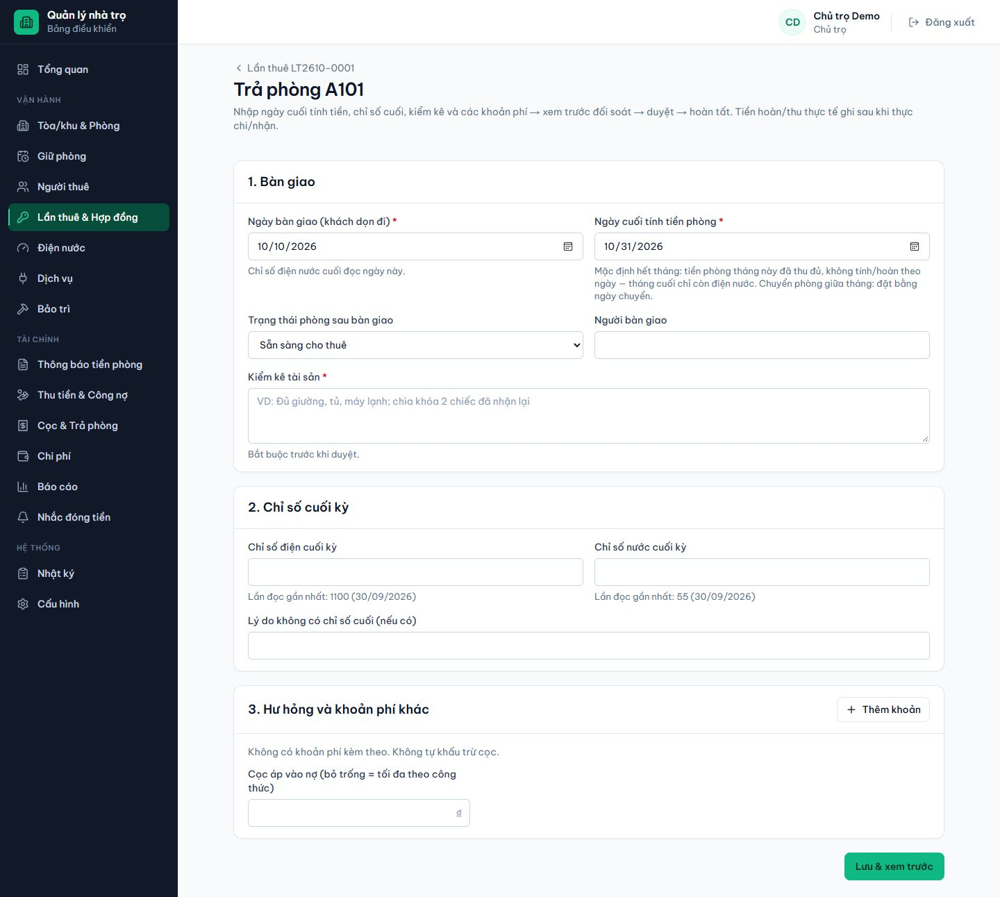

Vào trang phòng hoặc trang lần thuê → **Trả phòng**:

1. **Bàn giao**:
   - **Ngày bàn giao (khách dọn đi)**: chỉ số cuối được đọc vào ngày này.
   - **Ngày cuối tính tiền phòng**: mặc định là cuối tháng. Tiền phòng tháng này đã thu đủ nên không tính hay hoàn theo ngày;
     tháng cuối chỉ còn tiền điện nước.
   - Trạng thái phòng sau bàn giao: *Sẵn sàng cho thuê* hoặc *Cần sửa (bảo trì)*.
   - Người bàn giao.
   - **Kiểm kê tài sản**: bắt buộc trước khi duyệt.
2. **Chỉ số cuối kỳ**: chỉ số điện, nước ngày bàn giao. Nếu không đọc được, ghi lý do.
3. **Hư hỏng và khoản phí khác**:
   - **Thêm khoản**: chọn Hư hỏng / Phạt / Khoản khác, nhập số tiền và lý do.
   - **Cọc áp vào nợ**: để trống thì phần mềm áp tối đa theo công thức. Phần mềm không tự khấu trừ cọc.
4. **Lưu & xem trước**: xem bảng đối soát gồm tiền điện nước cuối, các khoản phí, cọc áp vào nợ, khách còn nợ hay chủ phải hoàn.
5. **Duyệt quyết toán** → **Hoàn tất trả phòng** [Chủ trọ]. Phòng chuyển về Trống (hoặc Bảo trì), lần thuê kết thúc.

### Cọc & Trả phòng

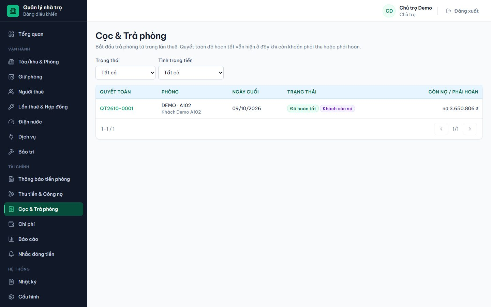

- Lọc các quyết toán theo trạng thái (Nháp / Đã duyệt / Đã hoàn tất) và tình trạng tiền (Đã cân bằng / Khách còn nợ / Chủ còn phải hoàn).
- Mở một quyết toán để thực hiện:
  - **Thu nợ** [Cả hai]: có chọn người nhận tiền.
  - **Hoàn cọc** và **Hoàn tiền dư** [Chủ trọ]: ghi khi đã chi tiền thật.
  - **In biên bản** quyết toán trả phòng.
- Khách đã trả phòng mà còn nợ vẫn hiện trong công nợ. Phòng vẫn cho khách mới thuê bình thường.

---

## 13. Chuyển phòng

Dùng khi khách đang ở chuyển sang một phòng khác.

1. Làm **Trả phòng** cho phòng cũ ([mục 12](#12-báo-trả-trả-phòng-quyết-toán-cọc)). Chuyển giữa tháng thì đặt **Ngày cuối tính
   tiền phòng** bằng ngày chuyển.
2. Trên lần thuê vừa kết thúc → **Chuyển sang phòng khác**.
3. Chọn **Phòng mới (đang trống)**, giá thuê, số cọc chuyển sang, người đại diện, chỉ số điện nước ban đầu ở phòng mới, những
   người ở cùng chuyển theo → **Chuyển phòng**.

Hai lần thuê được liên kết với nhau. Cọc chuyển theo bằng giao dịch có ghi nhận.

---

## 14. Dịch vụ

Menu **Dịch vụ**:

- **Thêm dịch vụ** [Chủ trọ]:
  - Mã, Tên.
  - Cách tính: cố định theo phòng / theo đầu người / theo số lượng / theo đồng hồ.
  - Đơn vị.
  - **Thu trước** (đầu tháng) hay **Thu sau** (cuối tháng).
- **Giá & chi tiết** → **Đổi giá**: chọn áp dụng cho mọi tòa hoặc riêng một tòa, từ ngày, đơn giá, lý do → **Lưu giá**.
- **Ngừng cung cấp** / **Dùng lại dịch vụ**.
- Bật hoặc tắt dịch vụ cho một khách đang ở [Chủ trọ]: trang lần thuê → thẻ **Dịch vụ** (**Thêm dịch vụ**, **Đổi số lượng**, **Ngưng**).

---

## 15. Bảo trì

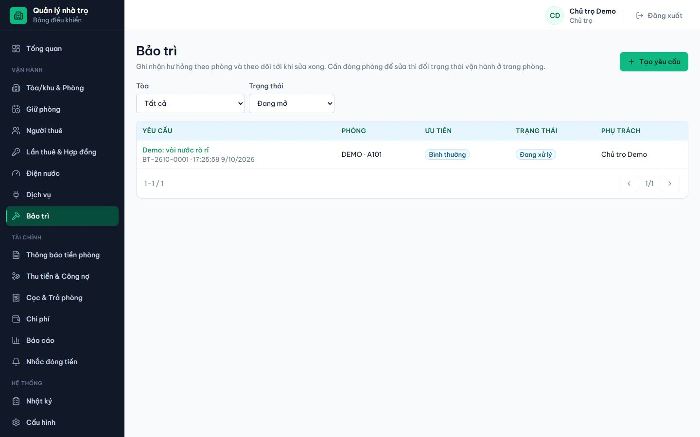

- **Tạo yêu cầu** [Cả hai]: chọn Tòa, Phòng, Nội dung, Mức ưu tiên (Thấp / Bình thường / Cao / Khẩn cấp), Người báo, Mô tả.
  Người tạo là chủ trọ hoặc quản lý, khi nhận được tin báo hỏng từ khách.
- Xử lý theo các bước:
  1. **Nhận xử lý**: yêu cầu chuyển sang “Đang xử lý”.
  2. **Đã sửa xong**: ghi kết quả xử lý.
  3. Nếu cần: **Hủy yêu cầu** hoặc **Mở lại**.
- Đính kèm **ảnh hư hỏng / sau sửa**.
- Yêu cầu sửa vặt khi khách vẫn ở **không** làm đổi trạng thái phòng. Muốn ngừng cho thuê để sửa lớn thì dùng **Chuyển bảo trì**
  ở trang phòng.

---

## 16. Chi phí

Menu **Chi phí** (quản lý chỉ xem):

- **Ghi chi phí** [Chủ trọ]: Tòa, Phòng (nếu có), Loại chi, Số tiền, Ngày chi, Hình thức, Chi cho, Ghi chú.
- Lọc theo khoảng ngày, tòa, loại, trạng thái.
- Ghi sai thì **Đảo** kèm lý do.

---

## 17. Báo cáo

Chỉ chủ trọ thấy mục này, trừ khi chủ trọ cấp quyền riêng cho quản lý.

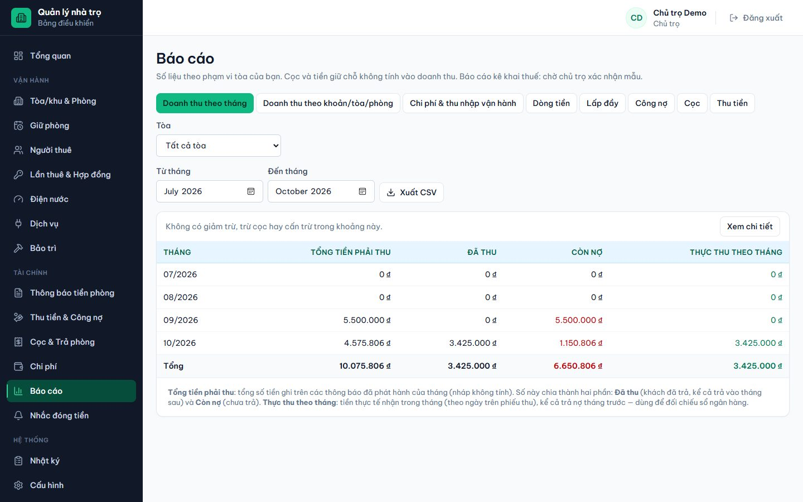

Chọn tab, chọn **Tòa**, **Từ tháng** / **Đến tháng**, rồi bấm **Xuất CSV** để mở bằng Excel.

| Tab | Xem gì |
|---|---|
| **Doanh thu theo tháng** | Tổng tiền phải thu, Đã thu, Còn nợ của các thông báo trong tháng; **Thực thu theo tháng** là tiền nhận thật trong tháng đó. Bấm **Xem chi tiết** để thấy Giảm trừ, Doanh thu thuần |
| Doanh thu theo khoản/tòa/phòng | Tiền phòng, điện, nước, dịch vụ chia theo tòa và phòng |
| Chi phí & thu nhập vận hành | Doanh thu trừ chi phí |
| Dòng tiền | Tiền thực nhận và tiền chi ra theo tháng |
| Lấp đầy | Tỷ lệ phòng có khách |
| Công nợ, Cọc, Thu tiền | Chi tiết khoản nợ, sổ cọc, các phiếu thu |

Cách hiểu:

- **Tổng tiền phải thu = Đã thu + Còn nợ.** “Đã thu” là số tiền đã thu được cho các thông báo của tháng đó.
- **Thực thu theo tháng** là tiền thực nhận trong tháng, không phân biệt thu cho thông báo tháng nào.
- **Tiền cọc và tiền giữ chỗ không tính vào doanh thu**, vì đó là tiền phải trả lại cho khách.

---

## 18. Nhắc đóng tiền

- **Cấu hình → Nhắc đóng tiền (Zalo/SMS)** [Chủ trọ]:
  - Tích **Bật nhắc đóng tiền tự động**.
  - Chọn kênh chính, kênh dự phòng.
  - Mốc nhắc: trước hạn (mặc định 3 ngày), đúng ngày đến hạn, quá hạn (mặc định 3 ngày).
  - Giờ gửi và khoảng giờ không gửi (mặc định không gửi từ 21:00 đến 7:00).
- Chỉ gửi cho người thuê **đã đồng ý**. Trên trang người thuê, bấm **Ghi nhận đồng ý**, nhập cách người thuê đồng ý →
  **Bật nhận tin**. Khách muốn dừng thì bấm **Tắt nhận tin**.
- Menu **Nhắc đóng tiền**: nhật ký từng tin theo trạng thái. **Chạy nhắc ngay** và **Gửi lại** tin lỗi [Chủ trọ].
- Mỗi mốc gửi tối đa một lần cho mỗi thông báo. Gửi tin **không** làm thay đổi số tiền hay trạng thái thanh toán.

> Muốn gửi tin thật, chủ trọ cần đăng ký nhà cung cấp Zalo ZNS hoặc SMS và có mẫu tin được duyệt. Chưa đăng ký thì phần mềm chỉ
> ghi nhật ký, không gửi tin.

---

## 19. Nhật ký và người dùng

### Người dùng & phân quyền — [Chủ trọ]

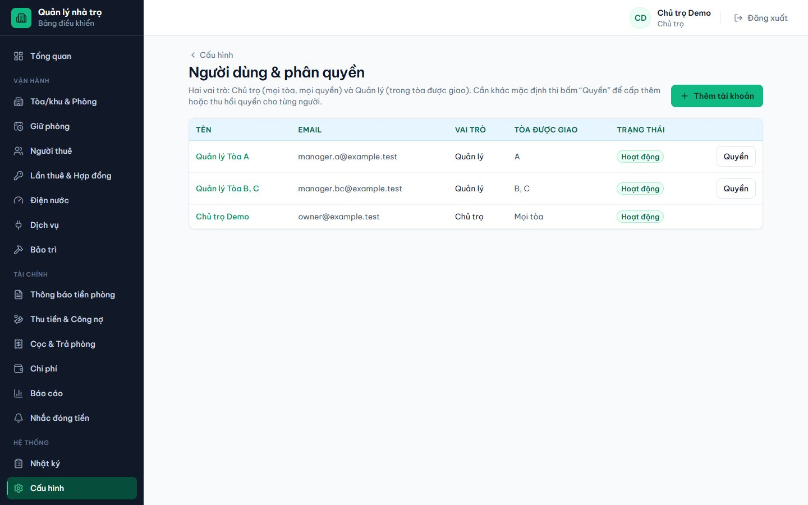

**Cấu hình → Người dùng & phân quyền**:

- **Thêm tài khoản**: Email đăng nhập, Tên hiển thị, Mật khẩu ban đầu, Vai trò (Chủ trọ / Quản lý), **Tòa được giao**.
- Sửa tài khoản: đổi tòa được giao, **Đặt lại mật khẩu**, **Vô hiệu hóa** (người nghỉ việc) / **Kích hoạt lại**.
- **Quyền**: với từng quyền chọn *Theo vai trò* / *Cấp thêm* / *Thu hồi* → **Lưu quyền**. Ví dụ cấp “Phát hành thông báo” hoặc
  “Xem báo cáo” cho một quản lý tin cậy. Thay đổi có hiệu lực ngay và được ghi nhật ký.

### Nhật ký

Menu **Nhật ký**: lọc theo nhóm (Vận hành / Tài chính / Hệ thống), tòa, khoảng ngày. Bấm **Chi tiết** để xem giá trị trước và
sau khi sửa.

- Chủ trọ xem được toàn bộ nhật ký.
- Quản lý chỉ xem nhật ký vận hành trong tòa được giao.

---

## 20. Câu hỏi thường gặp

**Khách nhận phòng giữa tháng thì tính tiền thế nào?**
Tháng đầu chia theo số ngày ở thực tế. Từ tháng sau thu đủ tháng vào đầu tháng. Xem ví dụ ở [mục 6](#6-nhận-phòng).

**Vì sao thông báo tháng 10 có điện nước tháng 9?**
Tiền phòng thu trước cho tháng đang ở. Điện nước phải đợi cuối tháng mới đọc được đồng hồ, nên thu sau vào thông báo tháng kế tiếp.

**Khách báo trả phòng cuối tháng 9 thì tháng 10 thu gì?**
Tiền phòng tháng 9 đã thu đủ từ thông báo tháng 9. Khi trả phòng, phần còn lại thường chỉ là tiền điện nước tháng 9 tính đến ngày
bàn giao, cùng các khoản hư hỏng nếu có. Tất cả nằm trong quyết toán trả phòng.

**Đã thấy khách chuyển khoản nhưng thông báo vẫn “Chưa thu”?**
Phần mềm không tự đọc tài khoản ngân hàng. Bấm **Ghi nhận thu** trên thông báo, chọn phương thức Chuyển khoản hoặc Quét QR và
nhập mã giao dịch.

**Ghi nhận thu nhầm số tiền?**
Chủ trọ bấm **Đảo phiếu thu** (ghi lý do), rồi ghi nhận lại số đúng.

**Thông báo đã phát hành bị sai?**
Chưa thu đồng nào thì chủ trọ có thể **Hủy thông báo** rồi lập lại. Đã thu rồi thì dùng **Điều chỉnh ngay** để lập dòng điều chỉnh.

**Hợp đồng hết hạn, khách vẫn ở, có cần làm gì không?**
Không bắt buộc. Phần mềm tự xem là thuê theo tháng và tiếp tục tính tiền. Có ký kỳ mới thì bấm **Gia hạn**.

**Quản lý không thấy nút Phát hành / Báo cáo?**
Đó là quyền mặc định của chủ trọ. Chủ trọ có thể cấp riêng ở **Cấu hình → Người dùng & phân quyền → Quyền**.

**Dùng trên điện thoại được không?**
Được. Chốt chỉ số điện nước được thiết kế cho điện thoại; các trang khác cũng tự co theo màn hình.

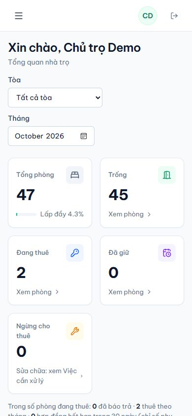
